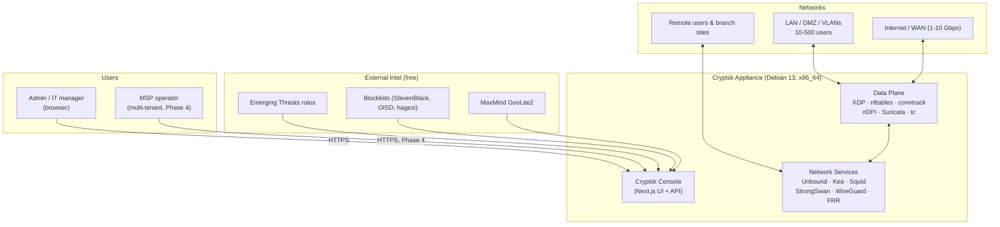
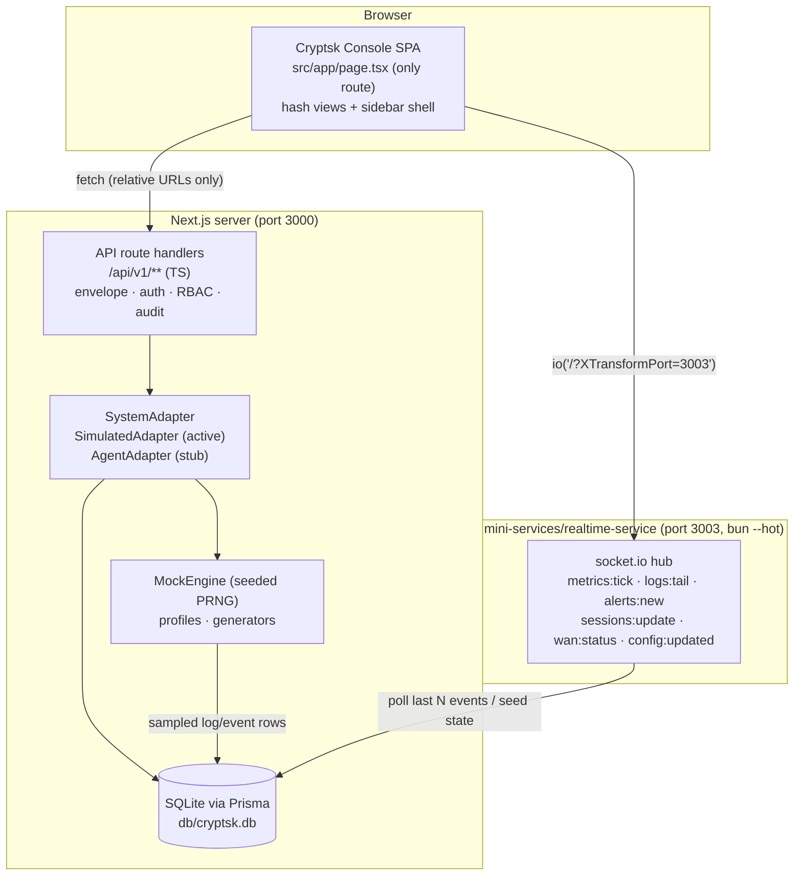
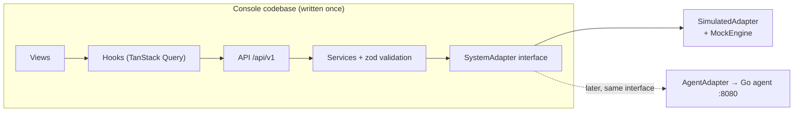
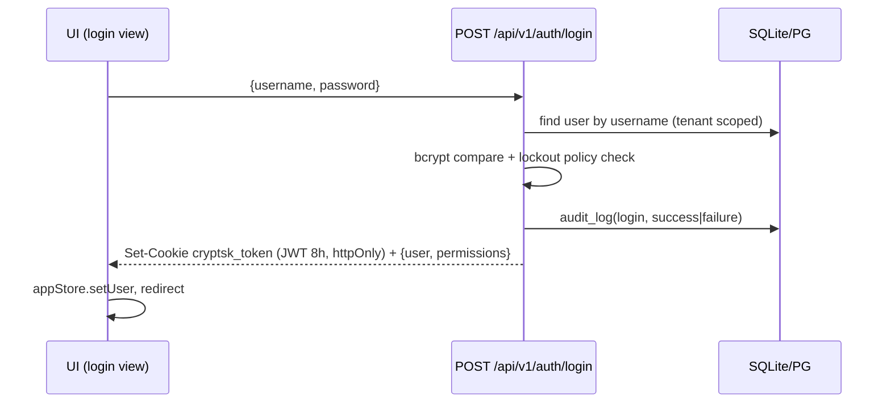
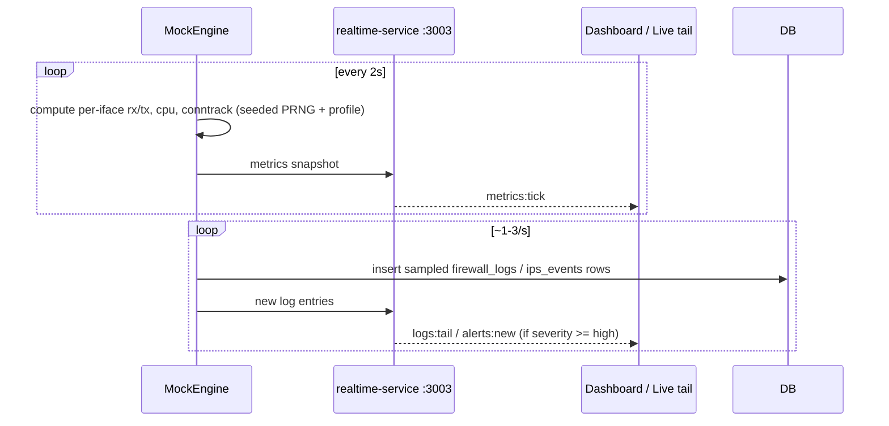

# System Architecture — Cryptsk UTM/NGFW

> TL;DR: One console codebase, two runtime modes. The **Cryptsk Console** (Next.js 16
> single-route SPA + REST API) talks to a `SystemAdapter`. In **Sandbox Mode** a
> deterministic `MockEngine` simulates the appliance; in **Appliance Mode** the same
> console drives a Go agent that programs nftables/Suricata/WireGuard/Unbound/Kea/FRR.
> Contracts (events, endpoints, schema) are identical in both modes.

Related: DATA_PLANE.md (packet pipeline) · CONTROL_PLANE.md (config flow) ·
SIMULATION_LAYER.md (mock engine) · ../03-DATABASE/SCHEMA.md (data) ·
../00-PROJECT-MEMORY/DECISIONS.md (why)

---

## 1. Context Diagram (product level)



---

## 2. Container Diagram — Appliance Mode (production target)

```mermaid
flowchart TB
    subgraph Browser
        UI["Cryptsk Console SPA<br/>(React 19, single route + hash views)"]
    end

    subgraph ApplianceHost["Debian 13 host"]
        subgraph ControlPlane
            GO["Go API (Gin/Fiber, :8080)<br/>JWT + RBAC + audit<br/>config generators"]
            PG[("PostgreSQL 17<br/>config + logs")]
            RD[("Redis<br/>cache · pub/sub · streams")]
            WS["Go WebSocket hub<br/>(same event names as sandbox)"]
            AI["ONNX Runtime inference<br/>(Phase 3)"]
        end
        subgraph DataPlane
            XDP["XDP early-drop"]
            NFT["nftables + conntrack"]
            SQ["Squid + Coraza (TPROXY)"]
            NDPI["nDPI classifier<br/>(library in Go flow worker)"]
            SUR["Suricata IPS (inline)"]
            TC["tc QoS"]
        end
        subgraph SystemServices
            UB["Unbound"] KEA["Kea"] WG["WireGuard"] SS["StrongSwan"] FRR["FRR"] FR["FreeRADIUS"]
        end
        MON["Prometheus + node_exporter + Grafana"]
        AGENT["cryptsk-agent<br/>(applies generated configs, reports status)"]
    end

    UI -->|REST /api/v1| GO
    UI -->|WebSocket events| WS
    GO --> PG
    GO --> RD
    GO -->|renders configs| AGENT
    AGENT -->|applies| NFT & UB & KEA & WG & SS & FRR & SUR & TC
    AGENT -->|status/events| RD
    RD --> WS
    SUR & NDPI & NFT -->|logs/flows| RD
    RD --> AI
    MON --> GO
```

**Key rules (product):** all config is DB-driven; Go generators render service configs
(nftables.conf, unbound.conf, kea.conf, suricata.yaml, wg0.conf, …) and the agent
applies + verifies them; every UI action is a REST call; realtime flows Redis
pub/sub → Go → WebSocket with the exact event names locked in PROJECT_MEMORY §7.3.

---

## 3. Container Diagram — Sandbox Mode (what we build now)



Gateway note: the browser reaches port 3003 only through the Caddy gateway using the
`?XTransformPort=3003` query — never a hostname with a port.

---

## 4. The SystemAdapter Boundary (the most important interface)



Interface sketch (authoritative in `src/lib/adapters/types.ts` when built):

```ts
export interface SystemAdapter {
  // config sections: "firewall" | "nat" | "interfaces" | "routing" | "dns" | "dhcp"
  //                | "vpn" | "ips" | "qos" | "ha" | "identity" | "system"
  applyConfig(section: ConfigSection, payload: unknown): Promise<ApplyResult>;
  getStatus(section: ConfigSection): Promise<SectionStatus>;
  metrics(): Promise<MetricsSnapshot>;                 // cpu/ram/ifaces/conntrack
  probeWan(iface: string): Promise<WanProbeResult>;
  vpnStatus(id: number): Promise<VpnTunnelStatus>;
  recentLogs(kind: "firewall" | "ips", n: number): Promise<LogEntry[]>;
}
```

`SimulatedAdapter` reads/writes SQLite and delegates dynamics to `MockEngine`;
`AgentAdapter` will POST the same payloads to the Go agent. See SIMULATION_LAYER.md.

---

## 5. Core Sequences

### 5.1 Login (both modes)



### 5.2 Config change (firewall rule edit) — the core UTM loop

```mermaid
sequenceDiagram
    participant U as UI (RuleEditor)
    participant API as PUT /api/v1/firewall-rules/{id}
    participant SVC as service (zod + shadow check)
    participant DB as DB (tx)
    participant AD as SystemAdapter
    participant WS as socket.io hub
    U->>API: rule JSON (camelCase)
    API->>SVC: validate + RBAC + tenant scope
    SVC->>DB: tx: update rule + audit_log(before/after) + config_versions snapshot
    SVC->>AD: applyConfig("firewall", section)
    AD-->>SVC: ApplyResult (sandbox: version++ ; appliance: nftables applied)
    SVC-->>U: {data: updatedRule}
    SVC->>WS: config:updated {section:"firewall"}
    Note over U: invalidates ["firewall-rules"] query cache, refetch
```

### 5.3 Live telemetry (dashboard, live tail)



---

## 6. Deployment Topologies (product)

| Topology | Description | Components |
|---|---|---|
| Standalone | Single appliance, console served from the box | Go API + PG + generators |
| HA pair (Phase 1) | Active/passive via VRRP VIP, conntrackd session sync, config sync | 2 appliances + Keepalived |
| MSP central (Phase 4) | Cloud central manager pushing policy to N sites | ClickHouse + central console |
| Cloud node (Phase 4) | Same codebase in AWS/Azure/GCP VM as SASE edge | WireGuard mesh to hub |

Sandbox Mode maps to "standalone, simulated": single SQLite, single mini-service.

---

## 7. Performance Targets & Budgets

| Metric | Target (product) | Sandbox analog |
|---|---|---|
| Firewall throughput | 1–10 Gbps (nic-dependent) | n/a (simulated Kbps series) |
| Conntrack capacity | 500k–2M rows | simulated counter 5k–50k |
| Suricata inline | 5+ Gbps with ET rules (hardware-tier dependent: Performance tier, tuned multi-core workers + RSS; Starter tiers far lower) | n/a |
| API p95 (config read) | < 100 ms | < 100 ms (SQLite local) |
| API p95 (config write incl. apply) | < 500 ms | < 300 ms |
| Metrics tick interval | 2 s | 2 s (locked) |
| Log ingestion | 5k–20k rows/min burst | sampled ~1–3 rows/s + seed batches |
| Dashboard first paint | < 2 s | < 2 s |

---

## 8. Cross-Cutting Concerns

| Concern | Rule | Where |
|---|---|---|
| AuthN | JWT httpOnly cookie; API keys for machines | 07-SECURITY/AUTH_AND_RBAC.md |
| AuthZ | 8 roles; handler-level RBAC matrix | 07-SECURITY/AUTH_AND_RBAC.md |
| Tenancy | tenantId claim scoping every query | ADR-009 |
| Audit | every mutation → audit_log; before/after JSON | ADR-011 |
| Config rollback | config_versions snapshots + diff view | M10-SYSTEM.md |
| Validation | zod at API edge AND for JSON-string DB fields | PROJECT_MEMORY §10 |
| Realtime | locked event set, identical across modes | PROJECT_MEMORY §7.3 |
| Errors | envelope `{error:{code,message,details}}` | 04-API/API_STANDARDS.md |
| Observability | system status endpoint (Phase 1) → Prometheus/Grafana on appliance | M01/M10 |
| Time | UTC storage, IANA tz in schedule objects, date-fns display | PROJECT_MEMORY §13 |
