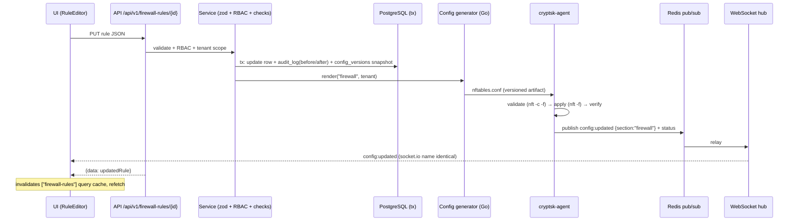

# Control Plane — Config Flow Deep Dive

> TL;DR: The database is the single source of truth. A config change flows: UI → REST API
> (zod + RBAC + tenant scope) → DB transaction (row + audit + config snapshot) → config
> generator renders service files (nftables.conf, unbound.conf, kea.conf, suricata.yaml,
> wg.conf, …) → cryptsk-agent validates, applies, and reports status → Redis pub/sub →
> Go WebSocket hub → UI. The sandbox replicates the same loop with SimulatedAdapter +
> mini-service polling (identical event names). The UI never talks to system daemons.

Deep-dive companion to [ARCHITECTURE.md](ARCHITECTURE.md) (overview, §5 sequences) and
[DATA_PLANE.md](DATA_PLANE.md) (what the generated configs program). Schema references:
[../03-DATABASE/SCHEMA.md](../03-DATABASE/SCHEMA.md) (`config_versions`, `audit_log`,
`system_settings`). Sandbox counterpart: [SIMULATION_LAYER.md](SIMULATION_LAYER.md) §3.

---

## 1. Components and End-to-End Config-Change Flow

| Component | Role |
|---|---|
| Console UI (Next.js SPA) | Renders hash views; issues REST calls only; no service access |
| Console API (`/api/v1`) | zod validation, JWT/RBAC, tenant scope, envelope, audit; delegates to services |
| Services layer | Business rules (shadow checks, referential integrity of id-list refs), transaction wrapping |
| Config store (PostgreSQL on appliance / SQLite in sandbox) | All config rows + `config_versions` snapshots + `audit_log` |
| Config generators (Go, on appliance) | Render DB rows → service config files per §2 contract |
| cryptsk-agent (Go, on appliance) | Validates rendered files, applies atomically, reports status/events to Redis |
| Redis | Cache, session store, pub/sub for realtime events, Streams for log shipping (ADR-010) |
| WebSocket hub (Go, appliance) / realtime-service (bun, sandbox) | Pushes locked event set to the UI (PROJECT_MEMORY §7.3) |

Responsibility split (who may do what — mirrors ARCHITECTURE §2/§3):

| Concern | Console (this repo) | Appliance (product) |
|---|---|---|
| Input validation, RBAC, audit, tenancy | API route handlers via `lib/api/handler.ts` | Go API middleware (same envelope/errors) |
| Business rules (shadow check, reorder integrity) | Services layer in TS | Same rules re-implemented in Go generators (contract parity) |
| Config persistence | SQLite via Prisma | PostgreSQL |
| Rendering service files | SimulatedAdapter (no rendering) | Go generators (Go templates) |
| Applying to daemons | never (nothing to apply) | cryptsk-agent only |
| Realtime hub | realtime-service :3003 | Go WS hub fed by Redis pub/sub |



Contract invariants (both modes):

- **Order:** the DB transaction commits *before* any apply is attempted; a failed apply
  never leaves the DB and running state inconsistent silently — the agent reports
  failure, the API returns the error envelope, and the previous config generation stays
  active on the appliance.
- **One writer:** only the generator+agent path touches system daemons. Console code
  never shells out to `nft`, `unbound-control`, etc. (SECURITY §7 of this doc).
- **Every successful apply** produces: an `audit_log` row (actor, before/after), a
  `config_versions` snapshot (per tenant + section, incrementing version), and a
  `config:updated {section}` broadcast (ADR-011).

## 2. Config Generator Contract (per service)

The generator renders **complete files** (never sed-like edits) into a versioned
directory (`/etc/cryptsk/gen/<section>/<version>/…`), then the agent applies. Validation
always runs before activation; rollback is the previous still-on-disk generation.

| Service | Generated file(s) | Trigger (config section) | Validate | Apply | Rollback |
|---|---|---|---|---|---|
| nftables (firewall + NAT) | `/etc/cryptsk/gen/firewall/<v>/nftables.conf` | `firewall`, `nat` | `nft -c -f <file>` | `nft -f <file>` (atomic transactional load; old ruleset stays on parse error) | Previous version file re-applied with `nft -f` |
| Unbound (DNS) | `unbound.conf` + `conf.d/*.conf` + RPZ zone files | `dns` | `unbound-checkconf <file>` | `unbound-control reload` | Restore previous files + reload |
| Kea (DHCP) | `/etc/kea/kea-dhcp4.conf` (+ `kea-dhcp6.conf` for basic DHCPv6, spec §1.9) | `dhcp` | `config-test` command on the Kea control socket (LAN socket or ctrl-agent HTTP) | `config-reload` command on the control socket (service restart as fallback) | Previous file + `config-reload` |
| Suricata (IPS) | `suricata.yaml` + rules via `suricata-update` (category config from policy) | `ips` | `suricata -T` config/rule test (suricata-update runs it automatically before install) + rule lint | `suricata-update` then `suricatasc -c reload-rules`; `suricata.yaml` changes (e.g. mode switch) need a service restart | Re-run update pinned to previous category config + reload |
| WireGuard | `/etc/wireguard/wgN.conf` per interface | `vpn` (type wireguard_*) | `wg-quick strip wgN` parse check | `wg syncconf wgN <(wg-quick strip wgN)` (keeps handshake state) | Previous file + `wg syncconf` |
| OpenVPN (SSL VPN) | `/etc/openvpn/server/<name>.conf` (+ `ccd/`) | `vpn` (type openvpn) | staged parse: `openvpn --config <file> --dev null --ifconfig-noexec --route-noexec` (no native dry-run) | `systemctl restart openvpn-server@<name>` — restart drops active tunnels; UI confirmation like FreeRADIUS | Previous file + restart |
| StrongSwan (IPSec) | `/etc/swanctl/swanctl.conf` (+secrets) | `vpn` (type ipsec_*) | parse the staged file (swanctl has no dry-run; ensure UDP 500 + 4500 are permitted for IKEv2/NAT-T) | `swanctl --load-all` | Previous file + `--load-all` (existing SAs rekeyed, not dropped) |
| FRR (routing — BFD sessions; Phase 2 BGP/OSPF) | `/etc/frr/frr.conf` (+ `bfdd` peers) | `routing` | `vtysh -C -f <file>` (config check) | `vtysh -f <file>` / `frr-reload.py` | Previous file + reload (frr-reload preserves sessions) |
| FreeRADIUS | Raddb snippets (clients.conf, users, sites) | `identity` (radius profiles) | `radiusd -C` (config test) | **Service restart** — caution: restarts drop in-flight RADIUS conversations; generator marks this section "restart required" and the UI asks for confirmation / maintenance window | Previous files + restart |
| Keepalived (HA) | `/etc/keepalived/keepalived.conf` | `ha` | `keepalived --config-test` | `systemctl reload keepalived` (reload, not restart — VIP stays) | Previous file + reload |
| Squid + Coraza (proxy/WAF) | `squid.conf`, Caddy/Coraza bundle | `proxy` (Phase 2) | `squid -k parse`; Coraza config lint | `squid -k reconfigure`; Caddy reload | Previous files + reconfigure |
| Cron/systemd timers (jobs, reports) | Unit + timer files | `system` | `systemd-analyze verify` | `systemctl daemon-reload` + enable | Disable timer of previous version |

Generator rules:

1. **Deterministic rendering:** same DB state → byte-identical file (stable ordering by
   rule position; no timestamps inside generated files except a version header comment).
2. **Header with provenance:** every file starts with `# cryptsk generated — section=X
   version=N — do not edit` so drift detection (§3) can identify hand-edits.
3. **Schema-shaped input:** generators consume the tenant-scoped rows with the exact
   column semantics documented in SCHEMA.md §4 per-model notes (id-list JSON refs are
   resolved by the generator, which must fail loudly on dangling references — the
   service layer prevents them, see ER_DIAGRAM §3).

REVIEW-4A additions to the same sections (no new services, no new drop authorities): the
`routing` generation also renders static/default/blackhole routes and PBR marks via iproute2
(`ip route` / `ip rule fwmark` + per-WAN tables — the nftables mangle chain carries the
fwmark) and BFD peers for `bfd` routes via FRR `bfdd`; the `dhcp` generation renders
`dhcrelay`/Kea relay config from the `dhcp/relay` setting and `kea-dhcp6.conf` for
`family = ipv6` subnets; the `system` generation covers NTP (chrony), SNMP (`snmpd.conf`),
hardening (sshd_config + mgmt allowlist), and systemd timers for report schedules.

Sandbox analog: `SimulatedAdapter.applyConfig(section)` performs no rendering; it bumps
`config_versions`, marks the section "applied", and flips MockEngine behavior per
SIMULATION_LAYER §3. The mapping table there is the sandbox mirror of this §2.

### 2.1 ApplyResult Contract (both modes)

`applyConfig(section, payload)` resolves to an `ApplyResult` — identical shape in
`SimulatedAdapter` and the future `AgentAdapter` (ARCHITECTURE §4):

| Field | Type | Meaning |
|---|---|---|
| `status` | `applied` \| `validation_error` \| `apply_failed` \| `not_implemented` | `applied` = new generation active; `not_implemented` = sandbox gap (e.g. proxy sections) → API maps to 501 |
| `version` | number | `config_versions.version` written for the section |
| `section` | ConfigSection string | Echoed back for cache invalidation |
| `details` | string[] | Validation findings or apply diagnostics (per-file, per-service) |

Semantics: `validation_error` means the DB was NOT mutated further (service layer
rejects before tx commit); `apply_failed` means the DB has the new row but the
appliance kept the previous generation — the error envelope surfaces this with
`INTERNAL` + details, and the console shows a "config applied to database, apply to
system failed" state with a retry action. The sandbox never produces `apply_failed`
(single-writer, always-valid simulation).

## 3. State and Versioning

- **DB is the single source of truth.** Running config on the appliance is derived data.
  The agent never originates config; it applies and reports.
- **Snapshots:** every significant mutation writes a `config_versions` row
  (`tenantId + section + version` unique; `config_snapshot` = full section JSON,
  `change_summary`, `created_by`). ADR-011. Rollback = restore snapshot through the
  normal API pipeline (re-validation, re-audit) — never a raw DB write.
- **Diff:** the console diff viewer (M10) compares two `config_versions` snapshots of the
  same section; snapshots store the same JSON shape the API returns, so diffs are stable.
- **Drift detection (Phase 2 note):** the agent computes a hash of the running service
  config (e.g. `nft list ruleset | hash`) and compares against the hash of the last
  generated generation. Mismatch → `config` notification + drift flag in
  `system_settings`-backed status. Phase 1 sandbox has no drift concept (single writer
  always consistent).
- **Audit is append-only** (ADR-011): `audit_log` rows are never updated or deleted by
  the app; retention job only prunes by age/cap (DATA_LIFECYCLE §4).

## 4. Realtime Path

Event names and payloads are **locked** in PROJECT_MEMORY §7.3:
`metrics:tick`, `logs:tail`, `alerts:new`, `sessions:update`, `wan:status`,
`vpn:status`, `config:updated`.

| Mode | Producer | Transport to hub | Hub | To UI |
|---|---|---|---|---|
| Appliance | Go services publish to **Redis pub/sub channels named exactly like the socket events** (e.g. channel `metrics:tick`) | Redis subscription | Go WebSocket hub relays same-name events | WebSocket (gorilla) |
| Sandbox | MockEngine pushes into in-process ring buffer (last 500 metrics / 2000 log entries, ADR-010/012) | Mini-service polls `GET /api/internal/events?cursor=N` every 1 s (SIMULATION_LAYER §7) | realtime-service (bun, port 3003) emits identical names | socket.io, connect string exactly `io("/?XTransformPort=3003")` |

Rules: the hub never mutates payloads (rename/re-shape requires editing
PROJECT_MEMORY §7.3 first); `config:updated` carries only `{section}` — clients refetch
via their query caches (TanStack invalidation by key prefix); subscribe control
(`subscribe`/`unsubscribe` with channel lists) exists in both modes.

Example payloads (verbatim from PROJECT_MEMORY §7.3):

```json
// metrics:tick (every 2 s)
{ "ts": "2026-11-05T09:30:02Z",
  "ifaces": [{ "name": "wan0", "rxKbps": 41230, "txKbps": 8810 },
             { "name": "lan0", "rxKbps": 21040, "txKbps": 39980 }],
  "cpuPct": 34, "memPct": 61, "conntrackCount": 18744 }

// config:updated (after any config mutation)
{ "section": "firewall" }

// alerts:new (on generated threat/system alerts)
{ "notification": { "id": 47, "type": "threat", "severity": "critical",
                    "title": "IPS drop: ET TROJAN activity from 198.51.100.7",
                    "sourceModule": "ips" } }
```

## 5. Job Scheduling

- **Schedule objects** (`schedule_objects`: type `always | recurring | onetime`,
  recurrence JSON `{days, start, end}`, IANA timezone, optional date range) attach to
  firewall/QoS rules.
- **Appliance:** a cron-like evaluator in the Go service loop ticks every minute, decides
  per tenant which schedule windows are active, and drives generator renders where the
  state transition requires it (e.g. enabling a rule outside `meta time` capabilities);
  simple daily windows may alternatively compile to nftables `meta time` rules — the
  generator picks per case and documents the choice in the file header.
- **Sandbox:** the same decision runs **in-tick** — MockEngine (2 s tick) checks active
  schedule windows and lets the log/flow generators honor them (e.g. `BUSINESS_HOURS`
  social-block rule produces drops only during the window, seed example in
  DATA_LIFECYCLE §2.3).
- **Report scheduling is Phase 1** (restored REVIEW-4A): `report_schedules` rows fire on their
  window (engine/timer bumps `lastRunAt`); formats pdf/html/csv/json; sandbox delivery is
  on-screen + downloads (csv/json) and browser-print PDF — email delivery to `recipients` is
  appliance-side (no mailer in the console). See the spec-divergence note in ROADMAP §2 for
  what moved when the row was restored.

## 6. Backup / Restore and Firmware Upgrade (High Level)

### 6.1 What a backup contains

| Artifact | Appliance | Sandbox |
|---|---|---|
| Config database | `pg_dump` of config schema + `config_versions` | JSON export of all config tables (SCHEMA.md models except volatile logs/events/sessions/leases) |
| Service provenance | Generated-file generations (§2 directory) + versions | n/a (nothing rendered) |
| Certificates / keys | `/etc/cryptsk` PKI dir (CA material, WireGuard keys) | n/a (no real crypto in sandbox) |
| Users + settings + audit | Included (restore must not lose operator accounts or the audit trail) | Included — audit is preserved, not replaced |
| Manifest | Version, hash, created_by, appliance id | Same fields (JSON) |

### 6.2 Flows

| Operation | Appliance (product) | Sandbox analog |
|---|---|---|
| Backup | `pg_dump` (config + logs metadata) + `/etc/cryptsk` + certs + generated-files provenance bundled as one tar artifact; manifest with version hash; stored locally and optionally copied off-box via API download | JSON snapshot: all config tables (+ users, api_keys, settings) exported to a restore file; `system/backups` POST creates it, restore endpoint re-imports through the normal validation path |
| Restore | Stop config appliers → restore DB + files → run all generators for every section → verify each service status → report | Same semantic: restore re-imports rows then broadcasts `config:updated` per section; **audit_log is not replaced** (append-only, ADR-011) |
| Firmware upgrade | `apt`-based upgrade under systemd; mandatory pre-upgrade versioned backup; staged apply; service-by-service health checks; failure → automatic rollback to previous backup + previous package set | Simulated staged upgrade (M10 §5.6): safety backup → version bump → history entry in the `advanced/firmware` setting, one audited POST, `config:updated {section: "system"}` |
| Rollback | Restore previous versioned backup + previous generation files; VRRP peer can hold the VIP during the window | Roll back to the previous `history` entry in the firmware setting (simulated; appliance: previous versioned backup + package set) |

HA pair upgrade ordering (product): upgrade standby first → force failover → upgrade
former active. Detail belongs to M10 operational runbook when HA ships.

## 7. Security of the Control Plane

| Control | Rule |
|---|---|
| API authentication | JWT (httpOnly cookie) for users, `ck_` bearer API keys for machines; design + matrix in [../07-SECURITY/AUTH_AND_RBAC.md](../07-SECURITY/AUTH_AND_RBAC.md) |
| Authorization | 8-role RBAC matrix enforced in ONE place — `lib/api/handler.ts` (console) / API middleware (appliance); UI gating is cosmetic only |
| Agent exposure | cryptsk-agent binds localhost-only, or mTLS when reached off-box (central manager, Phase 4); it accepts rendered artifacts + apply commands, never arbitrary SQL or shell |
| No shell-out from UI-facing code | Console (Next.js) code never executes system commands; all system effects flow through the adapter boundary — in Appliance Mode through the generator+agent path only |
| Audit trail | Every mutation → `audit_log` (actor, source_ip, before/after, result success/failure/denied); denied attempts are audited too (matrix enforcement result) |
| Tenant scope | Handler injects `tenantId` from the JWT claim into every query; no cross-tenant endpoints in Phase 1 (ADR-009) |
| Secrets | PSKs/shared secrets/totpSecret/api-key hashes are never returned clear by the API (masked; reveal only for VPN PSK with audit) — AUTH_AND_RBAC §8 |
| Config integrity | Generated files are versioned + hash-tracked; agent refuses artifacts without a valid version header (drift detection, Phase 2) |
