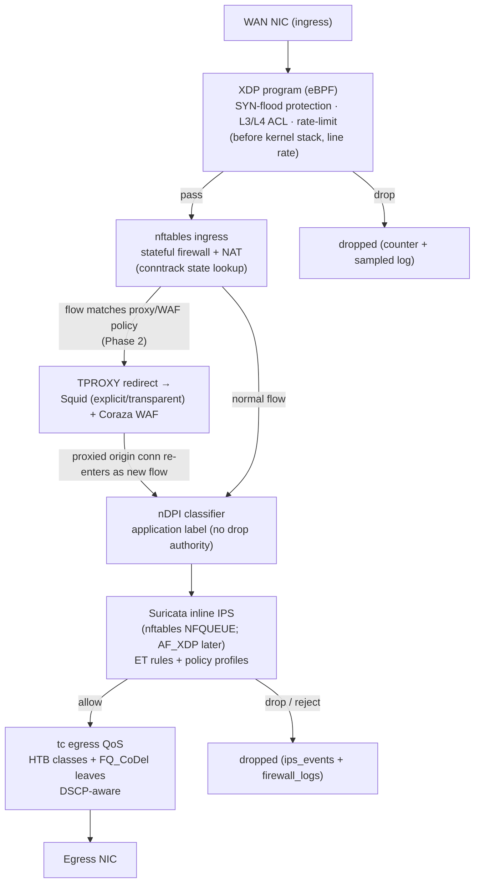
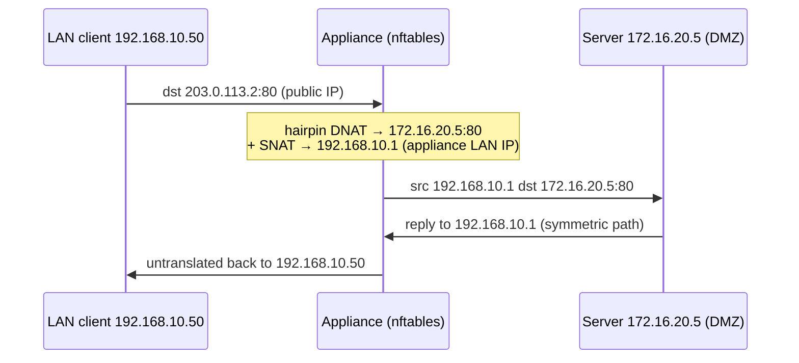
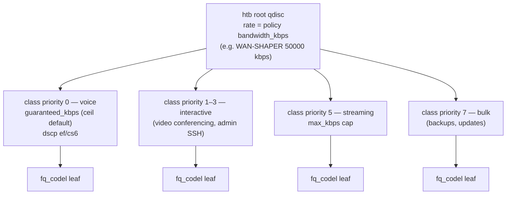

# Data Plane — Appliance Packet Pipeline Deep Dive

> TL;DR: On the appliance, every packet flows: NIC → XDP (line-rate early drop) →
> nftables (stateful firewall + NAT, conntrack) → optional TPROXY branch (Squid/Coraza,
> Phase 2) → nDPI classification → Suricata inline IPS → tc QoS → egress NIC. Each stage
> has a single decision authority and a documented failure mode. In **Sandbox Mode** none
> of this runs — the MockEngine simulates each stage's *observable behavior* (§7).

This is the deep-dive companion to [ARCHITECTURE.md](ARCHITECTURE.md) (which keeps the
context/container views). Sandbox analogs: [SIMULATION_LAYER.md](SIMULATION_LAYER.md).
Why these components: ADR-003. Appliance OS/kernel baseline: ADR-001 (Debian 13, 6.8+).

---

## 1. Pipeline



Pipeline rules (product-level, from the spec's architecture section):

- XDP handles SYN-flood protection, basic L3/L4 ACLs, and rate-limiting **before the
  kernel** — it runs before sk_buff allocation, sees raw frames only, and has no NAT or
  conntrack capability (stateful handling is nftables' job once the packet enters the
  stack). XDP needs native (driver) mode for line rate — see §8.
- nftables owns **all** stateful firewalling and NAT; nothing else drops on policy.
- TPROXY redirects **selected** traffic (per proxy/WAF policy) to Squid/Coraza; the
  branch is optional per flow. Mechanical note (Phase 2): the redirect is a
  mangle/prerouting hook (`tproxy to :3128 meta mark set 1`) paired with `socket`
  matching, policy routing (`ip rule fwmark 1 lookup 100` + a local-route table), and
  Squid built with `--enable-linux-netfilter`; it fires before the filter/NAT hooks, and
  Squid's own outbound connection re-enters the pipeline as a new flow.
- nDPI is a **classifier**, not a blocker — its labels feed nftables application sets
  and Suricata metadata.
- Suricata runs **inline via NFQUEUE** for flows whose policy attaches an IPS profile:
  the generator emits `queue num 1-4 fanout bypass` on the forward chain, Suricata runs
  in nfq mode with one worker per queue, and the verdict is drop (`inline_drop`) or
  accept + alert (`inline_tap`). The `bypass` flag is the fail-open path if the engine
  dies. (Architect note: NFQUEUE is the only inline mechanism that can sit between
  nftables/NAT and tc inside the routed path; AF_PACKET inline is a bump-in-the-wire L2
  bridge and is used here only for the passive/tap capture role. This refines the spec's
  AF_PACKET bullet to match the spec's own pipeline — see REVIEW-2A.)
- tc does **all** shaping at egress; ingress has no shaper in Phase 1 (spec cut list).

## 2. Per-Stage Contract

| Stage | Component | License | Decision authority | Failure mode (documented behavior) | Tuning knobs |
|---|---|---|---|---|---|
| Early drop | XDP (eBPF) program | GPL (kernel) / own programs | XDP program per attached policy (SYN threshold, ACL, rate limit) | Program unload/detach → nftables alone guards (degraded, not open); load failure → packet path continues untouched | SYN cookie trigger, per-source pps limit, ACL prefix maps, ring buffers |
| Stateful firewall | nftables + conntrack | GPL (kernel) | The rendered ruleset, top-down first match; implicit deny at chain end | Ruleset load is atomic (`nft -f` transaction); on invalid ruleset the previous generation stays active (CONTROL_PLANE §2) | Rule order (position), conn limits (`ct count`), rate limits (`limit rate`), logging level per rule |
| Connection state | conntrack (kernel) | GPL (kernel) | Kernel — establishes/expires flow state | Table full → new connections dropped (that is the fail-close symptom; sized per §8) | `nf_conntrack_max`, hashsize, per-protocol timeouts |
| Proxy/WAF branch | TPROXY → Squid + Coraza (Phase 2) | GPL 2.0 / Apache 2.0 | Proxy policy engine (per-destination/user) | Squid down → policy choice: bypass direct (fail-open, default) or block (fail-close); Coraza crash → same policy switch | Intercept mode, bypass lists, SSL bump exclusions, CRS paranoia level |
| Classification | nDPI (library inside the Go flow-classifier worker — not a standalone daemon) | LGPL 3.0 | None (label only) | Worker down → flows labeled `unknown`; unknown handling follows per-policy default (allow / block / alert) | Protocol enable/disable, custom port-based hints, budget per flow |
| IPS | Suricata inline | GPL 2.0 | IPS policy (mode + rule categories + exceptions) | Engine down → **policy choice**: fail-open (`bypass` flag on the nftables queue → packets pass the dead engine) or fail-close (no bypass → queue drains by drop); default in product policy: fail-open for `inline_tap`, fail-close optional for `inline_drop` on WAN only | Workers per core (one NFQUEUE per worker, `queue num 1-4 fanout`), bypass lists, threshold.config, per-SID suppression |
| Shaping | tc (HTB + FQ_CoDel) | GPL (kernel) | QoS policy tree (rates/priorities) | Qdisc removal → line-rate best effort (never drops by policy) | Root rate, class guarantees/caps, quantum, fq_codel target/interval, DSCP→class mapping |

Two failure-mode principles: (1) the data plane **never invents** decisions — it executes
the last successfully applied generation of config; (2) every drop that is policy-driven
must produce a log row (`firewall_logs` or `ips_events`), so the console can explain
itself (SIMULATION_LAYER §6 defines the sandbox correlation contract for this).

### 2.1 Conntrack States (what nftables keys on)

| State | Meaning | Generated-rule behavior |
|---|---|---|
| NEW | First packet of a connection (no conntrack entry) | Evaluated top-down against the ruleset; implicit deny if nothing matches |
| ESTABLISHED | Part of a tracked connection that has seen traffic both ways | Early accept in every forward chain (generated as the first rule) |
| RELATED | New connection related to an existing one (FTP data, ICMP errors, conntrack helpers) | Accept via `ct state related`; helpers enabled only where a service object requires them |
| INVALID | Packet cannot be tracked (malformed, out of window, late replies) | Drop + counter (generated early, before zone policy); logged as summary |
| UNTRACKED | Explicitly exempted from conntrack (not exception NAT — that still tracks) | Used by high-rate management probes; not exposed in the Phase 1 UI |

The generator always emits the `ct state established,related accept` fast path before
zone-policy rules; dropping it costs 30–50% throughput at 5 Gbps (measured on comparable
open-source rulebases — treat as sizing guidance, not a benchmark).

### 2.2 Generated Ruleset Sketch (what `nftables.conf` looks like)

```nft
# cryptsk generated — section=firewall version=42 — do not edit
flush ruleset

table inet cryptsk {
  set geo_blocked { type ipv4_addr; flags interval; }   # from MaxMind GeoLite2 sync
  set ndpi_blocked  { type inet_proto . inet_service; } # port-tuple hints; app rules use
                                                        # classifier-populated daddr sets

  chain input {
    type filter hook input priority 0; policy drop;
    ct state established,related accept
    ct state invalid drop counter
    iifname "wan0" udp dport 51820 accept           # WireGuard transport (wg0 carries
                                                    # already-decapsulated traffic)
    iifname "wan0" tcp dport { 22, 443 } ct state new limit rate 5/second accept  # mgmt
  }

  chain forward {
    type filter hook forward priority 0; policy drop;
    ct state established,related accept
    ct state invalid drop counter
    iifname "lan0" oifname "wan0" ct state new accept            # LAN -> WAN allow
    iifname "dmz0" oifname "lan0" limit rate 10/second log prefix "DMZ2LAN " drop
    iifname "wan0" ip saddr @geo_blocked drop counter               # GeoIP WAN ingress
  }
}

table ip cryptsk_nat {
  chain prerouting {
    type nat hook prerouting priority -100;
    ip saddr 10.99.0.0/24 return                 # NAT exemption (VPN_NO_NAT) FIRST
    iifname "wan0" tcp dport 8080 dnat to 172.16.20.5:80   # WEB_PORT_FWD
  }
  chain postrouting {
    type nat hook postrouting priority 100;
    oifname "wan0" ip saddr 192.168.10.0/24 masquerade     # MASQ_LAN_WAN
  }
}
```

Seeded examples from DATA_LIFECYCLE §2.3 are used as names above so console rows and
appliance artifacts are traceable to each other. The sketch shows ordering (exemption
before DNAT, established fast path first) — the generator owns this order, never the
row insertion order of unrelated tables.

## 3. Flow Classification and App-Aware Rules

- nDPI labels every flow with a protocol/app id (first packets decide; label can be
  revised mid-flow for TLS/SNI-detected apps).
- nDPI is a **library**, not a daemon: it runs inside the appliance's Go flow-classifier
  worker (libndpi via cgo bindings). That worker publishes the app-label catalog
  (~300 protocols today), populates the nftables app sets, and enriches Suricata
  metadata; port-based hints remain the fallback for unmatched traffic.
- The console's `firewall_rules.application_ids` (JSON id list in SQLite; `INTEGER[]` on
  the appliance, SCHEMA.md) reference the same app-label catalog the appliance publishes.
- The Go generator maps application labels onto nftables **named sets** populated by the
  nDPI helper (e.g. set `ndpi_video` → rule `ip daddr @ndpi_video drop` semantics at the
  flow level via the classification hook), so app rules stay O(1) lookups.
- Unknown-app handling is explicit per policy: `allow` (default for LAN→WAN), `block`
(available per rule), or `alert` (log only). The label `unknown` is itself filterable in
  the console (M03) so admins can find and pin down uncategorized traffic.
- User-based rules work off the identity map (FreeRADIUS/captive-portal sessions →
  ip-to-user), surfaced as `identity_sessions` in the console (M07); the appliance joins
  that map at classification time.

### 3.1 Suricata Policy Profiles

From spec §1.6 — the three named profiles the console exposes (M04), implemented as
rule-category bundles + mode:

| Profile | Rule categories | Typical deployment |
|---|---|---|
| Conservative | High-confidence categories only (malware, trojan, exploit kit); scans/policy categories off; alert-heavy, drop rarely | First week after deployment, hospitals/labs |
| Balanced (default seed) | Most ET categories on, noisy policy categories off, inline_drop on WAN-facing zones | Standard small enterprise |
| Aggressive | All categories on including policy/scan, drop-enabled, tight thresholds | DMZ servers, guest networks, incident response |

Mode (`inline_drop` / `inline_tap` / `passive`) is orthogonal: tap modes never drop, so
they are safe on any link; `inline_drop` on a saturated WAN is a capacity decision (§8).

## 4. NAT Walk-Through

Order of evaluation is fixed and MUST be generated in this sequence:

1. **Exemption (no-NAT) rules first** — e.g. VPN subnet traffic must not be masqueraded
   into the tunnel (`nat_rules.type = exempt`). Generated as early `snat`-skipping /
   non-NAT accept statements in the prerouting/postrouting NAT chains.
2. **DNAT (port-forward) in prerouting** — rewrites destination before routing decision
   (`nat_rules.type = dnat`, e.g. `WEB_PORT_FWD` 8080 → 172.16.20.5:80).
3. **Hairpin** — LAN client → public WAN IP → internal server: DNAT as above **plus**
   SNAT of the client to the appliance's LAN address so the return path re-enters the
   appliance (`nat_rules.type = hairpin`, e.g. `HAIRPIN_WEB`).
4. **SNAT/masquerade in postrouting** — egress translation (`nat_rules.type = snat`,
   e.g. `MASQ_LAN_WAN` masquerade out `wan0`).

Reasoning: exemption must precede DNAT/SNAT or VPN/site-to-site traffic gets translated
and never reaches the tunnel; DNAT must happen before routing (the new destination
decides the egress interface); SNAT must happen after routing (it depends on the chosen
egress interface).

Hairpin packet path (numbered):



Without the SNAT leg the server would answer directly to `192.168.10.50` across the
local segment and the client would drop the "unsolicited" reply (asymmetric path). The
generator emits the DNAT+SNAT pair as one atomic ruleset generation so hairpin cannot
exist half-configured. Console side: all four types are first-class in the NAT editor
(M03); `nat_rules.hit_count` increments per matched flow (simulated identically).

> **Spec divergence note:** the spec also carries `nat_type`/`nat_target`/`nat_port`
> columns on `firewall_rules`. The build contract (SCHEMA.md) keeps NAT exclusively in
> `nat_rules`; firewall rules reference zones/objects only. The Go generator must not
> expect those columns.

## 5. QoS Egress Tree

Phase 1 shape: one HTB tree per shaped interface, FQ_CoDel leaves, DSCP-aware class
selection (from `qos_policies` + `qos_rules`, M08):



- **DSCP marking points:** (a) firewall rules and QoS rules can set DSCP via nftables
  mangle statements (generator emits these in a dedicated mangle chain *before* egress
  classification); (b) existing DSCP from upstream is preserved and mapped via
  `dscp → class` rules; (c) QoS templates (voip/video/gaming/bulk) are predefined
  marking + class bundles.
- Priority 0 = highest (voice), 7 = lowest (bulk) — matches the `qos_rules.priority`
  enum semantics in PROJECT_MEMORY §6.
- **DSCP reference values used by templates** (marking point (a) above):

| Template / class | DSCP | Decimal | Queue mapping |
|---|---|---|---|
| VoIP (voice) | EF (CS6 fallback) | 46 (48) | priority 0 class |
| Interactive video (Teams/Zoom) | AF41 | 34 | priority 1 class |
| Signaling (SIP) | CS3 | 24 | priority 2 class |
| Streaming (Netflix/YouTube) | AF31 (best effort by default) | 26 (0) | priority 5 class |
| Bulk (backups, updates) | CS1 | 8 | priority 7 class |

- Per-user and per-app limits: identity-map / nDPI matchers place flows into dedicated
  classes with their own guarantees/caps — custom engineering per spec §1.11. Phase 1
  ships classification + per-class caps (templates first, M08); dedicated hard-limit
  classes per user/app are a fast-follow (spec-divergence note: spec lists them as
  Phase 1 — tracked in REVIEW-2A).
- CAKE, ingress shaping (IFB), and multi-level hierarchy are Phase 2 (ROADMAP §5).

## 6. Kernel Requirements Checklist (from Spec)

Mandatory kernel config on the appliance build (backport if the distro kernel lacks any):

- [ ] eBPF program types: `BPF_PROG_TYPE_XDP`, `BPF_PROG_TYPE_CGROUP_SKB`
- [ ] XDP native mode with actions: redirect, pass, drop (+ abort) — native (driver)
      mode required for line rate: igb/ixgbe/i40e/igc/mlx5 support it; Realtek r8169
      does not (generic fallback only)
- [ ] nftables with all extensions used by generators: conntrack, tproxy, hash sets, limits
- [ ] WireGuard as kernel module / built-in (not wireguard-go)
- [ ] AF_XDP sockets (future 10 Gbps Suricata ingestion)
- [ ] Netfilter conntrack: `nf_conntrack_max` + timeout tuning exposed via sysctl
- [ ] tc qdiscs: FQ_CoDel, CAKE, HTB (CAKE shipped for Phase 2 readiness)
- [ ] Debian 13 (Trixie) baseline; fallback Debian 12 + backports 6.8+ kernel (ADR-001)

## 7. Sandbox Mode Analog

The sandbox runs none of the above. Every stage has a simulated stand-in whose
*observable console behavior* matches (detail: [SIMULATION_LAYER.md](SIMULATION_LAYER.md)):

| Data-plane stage | SimulatedAdapter / MockEngine stand-in |
|---|---|
| XDP SYN-flood / rate-limit drop | Profile-driven generator emits bursts of `firewall_logs` rows with action=drop and rate-limit reasons; no real packets exist |
| nftables stateful firewall + first-match ruleset | Service-layer rule evaluation in order (first match wins); matched rules increment `hit_count`/`last_hit_at`; block/deny rules immediately change generated flows |
| conntrack state | `conntrackCount` series 5k–50k in `metrics:tick` (ring buffer, 2 s tick) |
| TPROXY → Squid/Coraza | Not simulated in Phase 1 (Phase 2 console features); adapter returns NOT_IMPLEMENTED for proxy sections |
| nDPI classification | Generator draws `app_name` from a realistic app-label list per traffic profile (office/hospitality/msp_branch) |
| Suricata inline IPS | `ips_events` generator with ET-style sid ranges, categories, severity distribution; `inline_drop` mode correlates drop events with `firewall_logs` drops (contract in SIMULATION_LAYER §6) |
| tc QoS | Metrics generator honors per-policy caps — series flatten at the configured bandwidth ceiling |
| Egress NIC counters | Per-iface rx/tx Kbps baselines by role (wan 40k–300k, lan 20k–150k, dmz 5k–40k) + profile noise |

Same rule as the appliance: every policy-driven simulated drop produces a log row, so
views behave identically in both modes.

## 8. Performance Notes

| Topic | Guidance |
|---|---|
| Throughput targets | 1–10 Gbps per appliance (hardware tiers in PRODUCT_OVERVIEW §7); XDP early-drop path sustains line rate on the drop decisions; full-stack (Suricata inline) reaches 5+ Gbps only on the Performance tier with tuned workers + RSS — Starter-tier realistic capacity is a fraction of that |
| Conntrack sizing | `nf_conntrack_max` 500k–2M rows (ARCHITECTURE §7 budget); hashsize ≈ max/4; watch table-fill drops in monitoring (they present as new-connection failures, not broken flows) |
| Suricata workers | One worker per core, one NFQUEUE per worker (`queue num 1-4 fanout`); NIC queues aligned to cores via RSS; Performance tier (8C/16T) sized for 5–10 Gbps inline with ET rules |
| NIC selection | Intel i225 (igc, 1 GbE), X710 (i40e) / ConnectX-4/5 (mlx5) for 10 GbE — all with native XDP; avoid Realtek: r8169 has no native XDP (generic fallback only) and misbehaves under load (PRODUCT_OVERVIEW §7) |
| XDP placement | Attach native (driver) mode wherever drivers support it; generic fallback costs ~1–2 Gbps at 10 GbE |
| Offloads | Keep GRO/GSO on; disable only when Suricata inline needs full frames; checksum offload on, scatter-gather per Suricata capture guidance |
| Console-side expectations | The console never assumes a specific Gbps: all rate displays derive from `metrics:tick` Kbps values, identical shape in both modes |

### 8.1 Stage Latency Budget (indicative, 1 Gbps, small packets excluded)

| Stage | Added latency | Notes |
|---|---|---|
| XDP | < 0.1 ms | In-driver; drop path cheaper than pass |
| nftables + conntrack | 0.1–0.3 ms | Grows with ruleset size — keep sets, not rules, for bulk matches |
| TPROXY → Squid/Coraza (Phase 2) | 1–10 ms | Only for intercepted flows; bypass lists keep this off trusted SaaS |
| nDPI classification | 0.1–0.5 ms | First-packets-of-flow only; state cached |
| Suricata inline | 0.5–2 ms | Dominated by ruleset size; tune via categories (§3.1) |
| tc HTB + fq_codel | < 0.2 ms | Adds delay only when shaping (that is its purpose) |

Budget purpose: explains to customers why the proxy branch is policy-selective, and
gives the console a defensible story when users compare with wire-speed commercial
boxes. Numbers are sizing guidance from the spec's throughput expectations, not lab
benchmarks.
