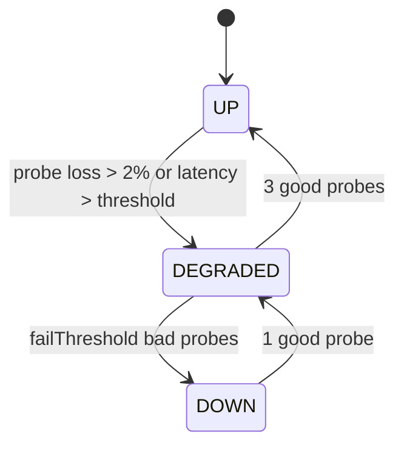
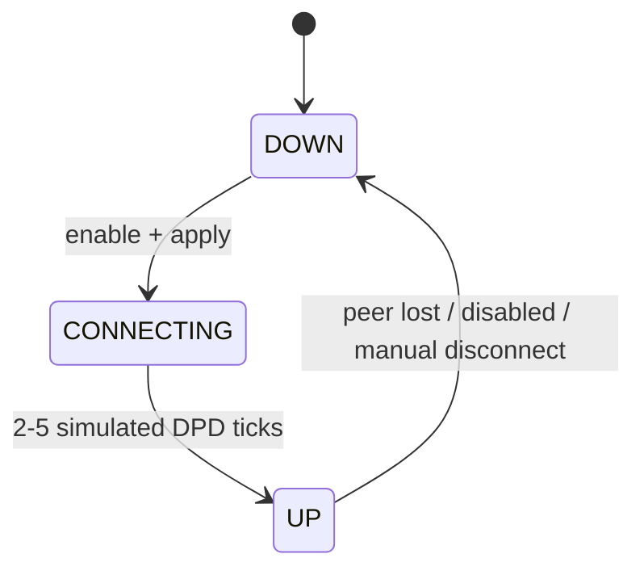
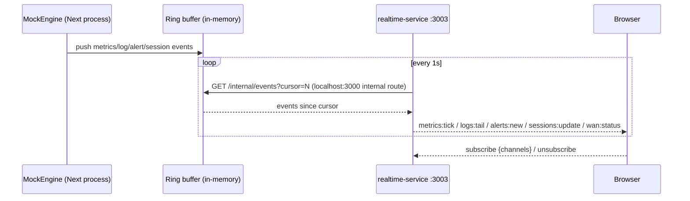

# Simulation Layer — Sandbox Stand-in for the Appliance

> TL;DR: The sandbox cannot run nftables, Suricata, WireGuard, Unbound, or Kea.
> The `SimulatedAdapter` + `MockEngine` provide believable, **deterministic** behavior
> so the entire console can be built, demoed, and tested before the Go agent exists.
> Everything is behind the `SystemAdapter` interface (ADR-004).

Related: ARCHITECTURE.md §4 · ../03-DATABASE/DATA_LIFECYCLE.md (volumes/seeds) ·
../00-PROJECT-MEMORY/PROJECT_MEMORY.md §7.3 (realtime events)

---

## 1. Why Simulation (and why it is safe)

| Risk of building UI on mocks | Mitigation |
|---|---|
| UI drifts from real backend shapes | API envelope + payload contracts are locked in PROJECT_MEMORY §7; AgentAdapter will send identical JSON |
| Mock behavior teaches wrong mental model | MockEngine mirrors documented data-plane semantics (blocks produce logs, rules affect counters, WAN probes fail over) |
| Non-reproducible demos | Seeded PRNG (ADR-12) — same seed → same series, same logs |
| Real appliance integration surprises | Generator output contracts documented (§6) so the Go agent must honor the same shapes |

---

## 2. Components

```
src/lib/adapters/
├── types.ts          SystemAdapter interface + ConfigSection + result types
├── host.ts           HostAdapter (ACTIVE default — real telemetry, ADR-021)
├── simulated.ts      SimulatedAdapter (opt-in demo plane; FORBIDDEN in production)
├── agent.ts          AgentAdapter (shipped — remote sensor transport, checklist contract)
└── index.ts          getAdapter(): ADAPTER_MODE=host (default) | agent | simulated
                      (simulated + NODE_ENV=production throws — no-mock mandate)

src/lib/engine/
├── mock-engine.ts    TickLoop + PRNG (mulberry32), MOSEED env, singleton per process
├── profiles.ts       Traffic profiles (JSON): office | hospitality | msp_branch
├── generators/
│   ├── metrics.ts    per-iface rx/tx series, cpu, mem, conntrack count
│   │                 (honors QoS caps incl. per-user/per-app hard-limit classes)
│   ├── firewall-logs.ts   plausible flows respecting active rules/zones + PBR egress
│   ├── ips-events.ts     ET-style categories, severity distribution, preset bundles
│   ├── dns-queries.ts    domain mix incl. blocked categories
│   ├── sessions.ts       vpn/identity session churn (connect/expire; honors VPN
│   │                     user-group pools/limits + concurrent-session caps)
│   ├── switching.ts     LLDP neighbor churn + bridge FDB entries (derived views,
│   │                     ring buffers — never persisted)
│   └── wan-probes.ts     probe state machine (up → degraded → down); feeds BFD
│                         state for static routes with `bfd: true`
└── seeds.ts          idempotent seed orchestrator (called by prisma/seed.ts)
```

## 3. Behavior Contract (what "apply" means in sandbox mode)

| Section | Real appliance effect | SimulatedAdapter effect |
|---|---|---|
| firewall | renders + applies nftables ruleset | bumps `config_versions`, marks rules "applied", log generator immediately respects new rules (blocked flows produce `firewall_logs` with action=drop/deny) |
| nat | renders + applies nftables NAT | same as firewall; hit counters increment per matched flow |
| interfaces | netplan/iproute2 changes | accepts config; link state simulated (physical ifaces always up; vlan/bridge follow parent) |
| routing | FRR/iproute2 + nftables marks | accepts; reachability simulated for probes; **PBR rules are evaluated before WAN-mode selection** (matching flows are fwmarked to the rule's `outgoingIface`/`gateway` — same `ip rule fwmark` mechanism as multi-WAN); **BFD sessions** on static routes with `bfd: true` flip up/down with next-hop reachability and disable the route when down |
| dns | writes unbound.conf + RPZ, reloads | query-log generator starts blocking per policy categories; `forwardZones` rows mark their domains' queries with the forwarder's latency flavor; DoT/DoH toggles display-only |
| dhcp | renders kea config, reloads | lease generator uses subnet ranges + reservations (per `family`: v4 churn; v6 rows accepted, churn stays IPv4 — labeled in UI); **relay config** (`dhcp/relay`) recorded and honored for relayed interfaces' option sets |
| vpn | wg set / swanctl / ovpn configs | tunnels come "up" after 2–5 simulated DPD ticks; sessions churn; **VpnUserGroup** pools/limits/DNS/timeouts applied at connect time for member usernames |
| ips | renders suricata.yaml + rules, reloads | event generator follows enabled categories + mode (inline → drops appear in firewall logs too); **presets** (`apply-preset`) rewrite the category bundle + mode in one apply; **auto-update scheduler** (`ips/auto_update`) marks `lastUpdateAt`/`nextUpdateAt` and simulates a rule-set refresh on its window; `tiBlocklist` emits `c2`/`malware` drops for feed IPs |
| qos | tc qdisc changes | metrics generator honors per-policy bandwidth caps (series flatten at cap) |
| ha | keepalived | peer state machine per §5; `trackedInterfaces` feed the status chips (a down tracked iface pins the node out of master election); `sessionSync`/`syncConfig` recorded (no peer exists) |
| identity | radius/portal/ldap actions | identity_sessions churn; radius test returns simulated ok + latency; **directory-source test** returns `{ok, latencyMs, userCount?}`; vouchers in-memory; concurrent-session cap enforced during churn |
| system | apt/systemd actions | backup/restore copies snapshots; **firmware** check sets `available`, upgrade = safety backup + version bump + history entry (all simulated, one audited POST); **service restart** flips a service `stopped → running` over ~2 s; resource-threshold comparison emits warning/critical notifications |

Every successful apply: writes `audit_log`, snapshots `config_versions`, broadcasts
`config:updated {section}` (via the realtime service poll loop, §7).

## 4. MockEngine Tick Loop

- Interval: **2 s** = one "tick" (matches `metrics:tick` cadence).
- Per tick the engine:
  1. Advances PRNG-driven state machines (WAN probes, VPN tunnels, leases, sessions).
  2. Computes metrics for all enabled interfaces (profile-driven baselines + noise,
     honoring QoS caps and interface enabled state).
  3. Emits 0–3 firewall log rows + 0–1 IPS event (distribution per profile; blocked
     categories produce DNS query-log rows).
  4. Pushes the snapshot to an in-process ring buffer (last 500 metrics + 2000 log
     entries) that the realtime service polls (ADR-010).
- Determinism: `seed = MOCK_SEED env (default 1337)`; tick N with same seed always
  produces the same values. Time is wall-clock, so only sequences within a run are
  stable — series *shape* is stable across runs.

## 5. State Machines (simulated)


WAN probe (per wan_policies row).


VPN tunnel (per vpn_configs row). Sessions: `connected → idle(expiry) → disconnected`.

HA peer: `standby ⇄ active` on simulated heartbeat loss after `failAfter` seconds,
with hold-down before failback (mirrors Keepalived semantics for the HA view).

BFD session (per static route with `bfd: true`): mirrors the next-hop reachability the
routing/wan-probes generator computes — `up` while the gateway answers, `down` after
fail-threshold misses; a down BFD session removes the route from the egress-candidate set
(floating-route behavior) until it recovers.

## 6. Generator Output Contracts (what the Go agent must also honor)

These are the *semantic* contracts that make simulated logs realistic. The appliance
generators (Go) must map real telemetry into the same DB columns.

| Generator | Output row | Key semantics |
|---|---|---|
| firewall-logs | `firewall_logs` | src/dst drawn from zone subnets; `action` follows rule evaluation order (first match wins); **egress iface follows PBR rules first, then multi-WAN mode selection**; `app_name` from nDPI-ish label list; `rule_name` = matched rule; hits increment `firewall_rules.hit_count`, `last_hit_at` |
| ips-events | `ips_events` | `sid` from ET ranges (2xxxxxx web, 20xxxxx malware, 21xxxxx scan…); severity per category; `action` from policy mode (inline_drop → drop events exist and correlate with firewall_logs drops); preset-derived category bundles; `tiBlocklist` → `c2`/`malware` drops for feed IPs |
| dns-queries | `dns/query-logs` (derived view) | domain mix: normal ~85%, ads ~10%, malware/phishing ~5% (blocked when categories enabled → sinkhole/nxdomain action); `forwardZones` domains carry the forwarder's latency flavor |
| metrics | ring buffer → socket | per-iface `rxKbps/txKbps` (baseline per role: wan 40k–300k, lan 20k–150k, dmz 5k–40k), `cpuPct` 5–85 bursty, `memPct` slow drift, `conntrackCount` 5k–50k; series flatten at QoS caps (policy-level **and per-user/per-app hard-limit classes**) |
| sessions | `vpn_sessions`, identity sessions | pool IPs from vpn config pools **or the matching `VpnUserGroup.pool` for members**; bytes counters grow while connected; idle/max timeouts + per-user/per-group session caps honored; concurrent-identity cap (`maxConcurrentPerUser`) expires the oldest session |
| switching | derived views `lldp-neighbors`, `mac-table` | LLDP: neighbor rows per lldp-enabled iface (chassis id, system name, port, capabilities), churn per tick, ring buffer only; FDB: dynamic entries per bridge member + static rows synthesized from DHCP reservations/bridge membership; never persisted |
| wan-probes | `wan_policies.state` | state machine §5; states surface on dashboard + WAN view; also drives BFD session state for `bfd` routes |

## 7. Realtime Wiring (sandbox)



- The mini-service keeps **no DB connection**; it polls an internal (non-published)
  Next endpoint `GET /api/internal/events` — keeps single-writer to SQLite.
- `config:updated` is broadcast by the mini-service when it sees an audit entry with
  kind `config_apply`.
- Event names/payloads: PROJECT_MEMORY §7.3 (LOCKED).

## 8. Seed & Reset (summary — full detail in DATA_LIFECYCLE.md)

- `prisma/seed.ts` (idempotent, `--reset` to wipe volatile tables): tenant, users
  (admin/`admin123` + role samples), 7 interfaces (wan0, wan1, lan0, dmz0, vlan10,
  br-mgmt, wg0 — DATA_LIFECYCLE §2), zones, objects, 12 firewall rules, NAT rules, IPS
  policies + categories, VPN configs + pools + 1 user group, DNS policy + records, DHCP
  subnets/reservations + relay sample, 1 PBR rule, QoS, HA config, syslog/netflow
  targets, report schedule, webhook sample, SSH key, settings (NTP, SNMP, hardening,
  firmware, thresholds, auto-update, resolver forwardZones), notifications.
- Backfills ~5,000 firewall_logs + ~300 ips_events (30 days span) so charts/logs are
  populated on first login.
- `MOCK_SEED` env → deterministic volumes/series.

## 9. What Simulation Does NOT Cover (honest limits)

- Kernel-level timing, packet-level correctness, nftables syntax validation.
- Suricata rule *content* semantics (we simulate category behavior, not signature logic).
- Real crypto (WireGuard keys are random strings; IPSec PSKs stored as-is, masked in UI).
- Performance testing (throughput numbers are fiction until AgentAdapter exists).
- RADIUS/802.1X protocol conversations (identity sessions are generated).
