# Database Relations — ER Diagram

> TL;DR: Solid relations (real Prisma FKs) are few and clean; everything else is
> **logical references** (JSON id-array String columns) enforced in the service layer —
> a deliberate ADR-005 consequence. Read §3 before writing any delete/move logic.

Related: SCHEMA.md (full schema) · DATA_LIFECYCLE.md · ../00-PROJECT-MEMORY/PROJECT_MEMORY.md §10

---

## 1. Core ER Diagram (hard FK relations)

```mermaid
erDiagram
    TENANT ||--o{ USER : "has"
    TENANT ||--o{ ZONE : "has"
    TENANT ||--o{ NETWORKINTERFACE : "has"
    TENANT ||--o{ STATICROUTE : "has"
    TENANT ||--o{ WANPOLICY : "has"
    TENANT ||--o{ ADDRESSOBJECT : ""
    TENANT ||--o{ ADDRESSGROUP : ""
    TENANT ||--o{ SERVICEOBJECT : ""
    TENANT ||--o{ SERVICEGROUP : ""
    TENANT ||--o{ SCHEDULEOBJECT : ""
    TENANT ||--o{ FIREWALLRULE : ""
    TENANT ||--o{ NATRULE : ""
    TENANT ||--o{ IPSPOLICY : ""
    TENANT ||--o{ VPNCONFIG : ""
    TENANT ||--o{ DNSPOLICY : ""
    TENANT ||--o{ DNSRECORD : ""
    TENANT ||--o{ DHCPSUBNET : ""
    TENANT ||--o{ QOSPOLICY : ""
    TENANT ||--o{ RADIUSPROFILE : ""
    TENANT ||--o{ CAPTIVEPORTALPROFILE : ""
    TENANT ||--o{ USERGROUP : ""
    TENANT ||--o{ APIKEY : ""
    TENANT ||--o{ NOTIFICATION : ""
    TENANT ||--o{ CONFIGVERSION : ""
    TENANT ||--o{ SYSTEMSETTING : ""
    TENANT ||--o{ HACONFIG : ""

    USER |o--o{ AUDITLOG : "acts in"
    USER |o--o{ CONFIGVERSION : "authors"
    USER ||--o{ USERGROUPMEMBER : ""
    USERGROUP ||--o{ USERGROUPMEMBER : ""

    ZONE |o--o{ NETWORKINTERFACE : "zoneId"
    NETWORKINTERFACE ||--o| WANPOLICY : "interfaceName"

    SCHEDULEOBJECT |o--o{ FIREWALLRULE : "scheduleId"
    IPSPOLICY |o--o{ FIREWALLRULE : "ipsPolicyId"
    QOSPOLICY ||--o{ QOSRULE : "policyId"
    QOSPOLICY |o--o{ FIREWALLRULE : "qosPolicyId"

    VPNCONFIG ||--o{ VPNSESSION : "vpnId"
    DHCPSUBNET ||--o{ DHCPRESERVATION : "subnetId"
    DHCPSUBNET ||--o{ DHCPLEASE : "subnetId"

    TENANT ||--o{ IPSEVENT : "scoped rows"
    TENANT ||--o{ FIREWALLLOG : "scoped rows"
    TENANT ||--o{ AUDITLOG : "scoped rows"
    TENANT ||--o{ IDENTITYSESSION : "identity sessions"
    TENANT ||--o{ PBRRULE : "policy routes"
    TENANT ||--o{ PORTMIRROR : "SPAN sessions"
    TENANT ||--o{ VPNUSERGROUP : "vpn groups"
    TENANT ||--o{ SYSLOGTARGET : "forwarding"
    TENANT ||--o{ NETFLOWTARGET : "forwarding"
    TENANT ||--o{ REPORTSCHEDULE : "scheduled reports"
    TENANT ||--o{ WEBHOOK : "callbacks"
    TENANT ||--o{ SSHKEY : "mgmt access"
    TENANT ||--o{ DIRECTORYSOURCE : "ldap/ad"
```

Note: all child tables carry `tenantId @default(1)`. Every tenant-scoped model has a
real Prisma relation to `Tenant` **except the three append-heavy log models**
(`FirewallLog`, `IpsEvent`, `AuditLog`) — those keep `tenantId` as a plain indexed
column with no FK (spec's log-table design; retention deletes must not fight FKs).
The tenant edge is drawn once per family above to keep the diagram readable.
Log models are shown as "scoped rows" (logical tenant scoping, not a hard FK).

## 2. Cardinality & Delete Behavior

| Parent | Child | Cardinality | On delete |
|---|---|---|---|
| Tenant | * | 1 : N | n/a (never delete tenant in sandbox) |
| Zone | NetworkInterface | 0..1 : N (iface.zoneId nullable) | SET NULL (service layer nulls zoneId) |
| NetworkInterface | WanPolicy | 1 : 0..1 (compound FK `interfaceName + tenantId` → `name + tenantId`) | RESTRICT — service layer deletes the wan policy before the interface |
| ScheduleObject | FirewallRule | 0..1 : N | RESTRICT (`onDelete: Restrict` — deleting a referenced schedule/policy returns 409; UI detaches first) |
| IpsPolicy | FirewallRule | 0..1 : N | RESTRICT (`onDelete: Restrict`) |
| QosPolicy | FirewallRule | 0..1 : N | RESTRICT (`onDelete: Restrict`) |
| QosPolicy | QosRule | 1 : N | CASCADE |
| VpnConfig | VpnSession | 1 : N | CASCADE |
| DhcpSubnet | DhcpReservation | 1 : N | CASCADE |
| DhcpSubnet | DhcpLease | 1 : N | CASCADE |
| Tenant | IdentitySession | 1 : N | RESTRICT (Prisma default for required relation; sandbox never deletes tenants) |
| UserGroup | UserGroupMember | 1 : N | CASCADE (join table) |
| User | UserGroupMember | 1 : N | CASCADE (join table) |
| User | AuditLog | 0..1 : N | SET NULL (userId nullable; username string kept) |
| User | ConfigVersion | 0..1 : N | SET NULL (createdBy nullable) |

**Rule of thumb:** config objects RESTRICT when referenced (service returns `409 CONFLICT`
with the list of referencing rule names); operational children (sessions, leases, members)
CASCADE; logs have no config FKs at all (denormalized strings survive deletes on purpose).

## 3. Logical References (JSON id-array columns — NO Prisma FK)

These are `String` columns holding JSON arrays of ids. They exist because the spec's
PostgreSQL schema uses `INTEGER[]` and SQLite has no array type (ADR-005). The service
layer is the integrity boundary:

- On create/update: every referenced id must exist in the same tenant → else `400 VALIDATION_ERROR`.
- On delete of a referenced object: check references → else `409 CONFLICT` listing referrers.
- Helpers live in `src/lib/adapters/` + `src/lib/validators/` (e.g. `resolveAddressSpecs(ids)`).

| Column | References | Used by |
|---|---|---|
| `zones.interfaceNames` | NetworkInterface.name (strings, not ids) | zone grouping |
| `address_groups.memberIds` | AddressObject.id | grouping |
| `service_groups.memberIds` | ServiceObject.id | grouping |
| `firewall_rules.srcZoneIds / dstZoneIds` | Zone.id | rule matching |
| `firewall_rules.srcAddrIds / dstAddrIds` | AddressObject.id **and** AddressGroup.id | rule matching (mixed list; groups expanded at apply time) |
| `firewall_rules.serviceIds` | ServiceObject.id **and** ServiceGroup.id | rule matching (mixed) |
| `firewall_rules.applicationIds` | nDPI app label ids (strings from app catalog) | app-aware rules |
| `firewall_rules.userIds` | User.id | user-based rules |
| `firewall_rules.tags` | string tags | rule groups/categories filtering (first-class toolbar chips) |
| `firewall_rules.srcMacs` | MAC strings | MAC filtering rules (nftables `ether saddr`) |
| `nat_rules.srcAddrIds / dstAddrIds / serviceIds` | same semantics as firewall | NAT matching |
| `pbr_rules.srcAddrIds / dstAddrIds / serviceIds` | same semantics as firewall | policy-based routing matching |
| `pbr_rules.outgoingIface` | NetworkInterface.name | forced egress (logical ref, validated on save) |
| `port_mirrors.srcIface / dstIface` | NetworkInterface.name | SPAN source/target (logical ref) |
| `vpn_user_groups.memberUsernames` | VpnSession.userName (strings) | VPN user groups → per-group pools/limits |
| `ha_configs.trackedInterfaces` | NetworkInterface.name | Keepalived track_interface |
| `qos_rules.matchApps / matchUsers / matchAddresses` | app labels / User.id / AddressObject.id | shaping matchers |
| `ips_policies.customRules` | raw rule strings | suricata passthrough |

**Mixed id semantics warning:** `*AddrIds` and `serviceIds` deliberately mix object ids
and group ids (spec behavior). Convention: expand groups in UI pickers; service layer
validates that every id belongs to *either* table. Never hardcode "all ids are objects".

## 4. Query Patterns (how modules read the data)

| Need | Pattern |
|---|---|
| Ordered rules list | `firewall_rules ORDER BY position` (tenant scoped, `enabled` filter optional) |
| Rule with resolved objects | fetch rule → collect ids from JSON arrays → batch `findMany({ where: { id: { in: [...] } } })` per referenced table → hydrate |
| Top apps 24h | `firewall_logs GROUP BY app_name` (`logs/stats` endpoint, `range=24h`) |
| Top talkers | `firewall_logs GROUP BY src_ip` with bytes sum |
| Live tail | ring buffer via socket `logs:tail` (NOT the DB) |
| Active leases | `dhcp_leases WHERE state='active'` (mock engine keeps fresh) |
| Session map | `identity_sessions WHERE state='active'` (unique per sourceIp) |
| Audit with actor | `audit_log LEFT JOIN users` via Prisma include |

## 5. Counts & Growth (what to expect in sandbox)

| Table | Seed volume | Growth rate |
|---|---|---|
| firewall_logs | 5,000 (30 days) | ~1–3 rows/tick (2 s) while running |
| ips_events | 300 (30 days) | ~0–1/tick |
| identity_sessions | ~15 | churn on tick |
| vpn_sessions | ~10 | churn |
| dhcp_leases | ~25 | steady |
| config tables | 10–30 rows each | per admin action |
| pbr_rules / port_mirrors / vpn_user_groups | 0–5 rows | per admin action |
| syslog/netflow targets, webhooks, report_schedules, ssh_keys, directory_sources | 0–3 rows | per admin action |
| lldp_neighbors (derived) | ~10 live rows | churn per tick (ring buffer, not persisted) |
| mac_table (derived) | ~40 live rows | churn per tick (ring buffer, not persisted) |

At demo scale SQLite handles this trivially; retention job caps firewall_logs at 50k rows
(see DATA_LIFECYCLE §4).
