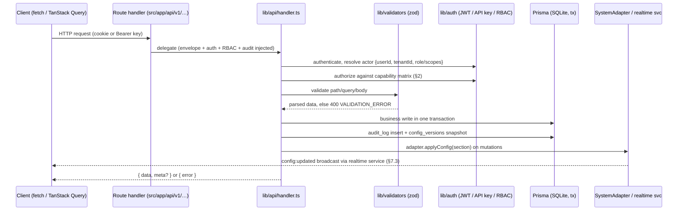

# API Standards — Cryptsk Console

> TL;DR: Every endpoint lives under a relative `/api/v1` base, speaks camelCase JSON through a fixed
> `{ "data" | "error" }` envelope, authenticates with an httpOnly JWT cookie or a `ck_` API key, and gets
> auth, RBAC, validation, audit and envelope behavior injected by the shared handler in `lib/api/handler.ts`.
> Paths are locked in PROJECT_MEMORY §7.2; the full catalog with examples lives in [ENDPOINTS.md](./ENDPOINTS.md).

Related: [../00-PROJECT-MEMORY/PROJECT_MEMORY.md](../00-PROJECT-MEMORY/PROJECT_MEMORY.md) (§7 API contract — wins over this file on any conflict) ·
[./ENDPOINTS.md](./ENDPOINTS.md) (full endpoint catalog) · [../02-ARCHITECTURE/ARCHITECTURE.md](../02-ARCHITECTURE/ARCHITECTURE.md) ·
[../03-DATABASE/SCHEMA.md](../03-DATABASE/SCHEMA.md) (field names + JSON shapes)

---

## 1. Base Path & Versioning

- Base path: `/api/v1/…` — always **relative**. No absolute URLs, no ports in hostnames (sandbox rule:
  cross-service calls go through the gateway with `?XTransformPort=<port>`, e.g. socket.io to 3003).
  REST itself is always same-origin under `/api/v1`.
- Why a version segment: `/v1` freezes the request/response contract while Phase 1 iterates. Additive
  response fields are non-breaking; breaking changes ship as `/api/v2` alongside v1, never in place.
  No version negotiation headers; the segment is the only version signal.
- Implementation: Next.js App Router **route handlers** under `src/app/api/v1/<resource>/…`, exporting
  `GET`/`POST`/`PUT`/`PATCH`/`DELETE` functions. Hard rule (PROJECT_MEMORY §11.10): **API routes, not server
  actions** — server actions bypass the envelope/auth/audit pipeline and are forbidden for API work.
  The only Next.js page route remains `/` (PROJECT_MEMORY §11.1).

### Request lifecycle (every request)



---

## 2. Authentication & Authorization

Two credential types:

1. **Browser session**: httpOnly cookie `cryptsk_token` — JWT signed with `jose` (ADR-007), 8-hour expiry,
   `HttpOnly; Path=/; Max-Age=28800; SameSite=Lax`, set by `POST /api/v1/auth/login`, cleared by
   `POST /api/v1/auth/logout`. The token is never readable from client JS by contract; `GET /api/v1/auth/me`
   is how the UI learns who is logged in.
2. **Machine access**: `Authorization: Bearer ck_<secret>`. Keys are stored as a sha256 hash plus a unique
   lookup prefix of `ck_` + 8 chars (`ApiKey.prefix`); the full key is displayed exactly once at creation.
   Scopes: `["read"]`, `["read","write"]`, or `["read","write","admin"]` (`ApiKey.scopes`, SCHEMA.md §4).
   A key with no `write` scope gets `403 FORBIDDEN` on any mutation.

**Roles** (PROJECT_MEMORY §6, stored on `User.role`):
`super_admin`, `tenant_admin`, `security_admin`, `network_admin`, `soc_analyst`, `helpdesk`, `auditor`, `api_service`.

Capability matrix (mirrors the authoritative matrix in `../07-SECURITY/AUTH_AND_RBAC.md` §4 —
that file wins on any RBAC conflict):

| Role | Level | Read | Write | Admin |
|---|---|---|---|---|
| super_admin | L5 | everything | everything | tenants, super_admin accounts, api-key create/revoke, every admin operation |
| tenant_admin | L4 | everything in own tenant | everything in own tenant **except api-key create/revoke** (read-only on api-keys) | users, auth-settings, backups + restore, system settings |
| security_admin | L3 | everything | firewall/NAT/zones/objects, IPS (policies + event handling), identity (users, groups, RADIUS, captive portal, session-expire), VPN session ops | — |
| network_admin | L3 | everything | interfaces, routes, WAN, DHCP, DNS (settings/policies/records), QoS, HA, VPN configs | — |
| soc_analyst | L2 | dashboard, all logs, IPS, firewall/NAT reads, network/object reads, identity + VPN sessions | IPS event suppress, VPN session disconnect, notification mark-read | — |
| helpdesk | L1 | dashboard, system status, notifications, identity sessions, VPN sessions, WAN status | notification mark-read | — |
| auditor | special | every GET endpoint, including `/logs/audit` and `/config-versions` | notification mark-read only | nothing |
| api_service | special | per key `read` scope | per key `write` scope | per key `admin` scope |

Floor ladder used in ENDPOINTS.md tables: `helpdesk < soc_analyst < network_admin = security_admin < tenant_admin < super_admin`.
REVIEW-4A additions (restored spec-Phase-1 features) map onto extra capability areas — log forwarding
targets (network_admin full), report schedules (security_admin/soc_analyst edit), webhooks
(security_admin full, machine keys none), firmware/service-restart/policy-templates (tenant_admin
full) — see the authoritative matrix in AUTH_AND_RBAC §4.

- A "role floor" is the minimum role required; every higher level passes. L3 is peer level **for the
  ladder only** — the capability matrix above is area-specific, and where a floor would admit a role the
  matrix denies (e.g. `network_admin` writing firewall objects, `security_admin` editing VPN configs),
  **the matrix wins**: the handler enforces the matrix, ENDPOINTS.md floors are a coarse summary.
- `auditor` passes **any** read floor; its only mutation is notification mark-read. Everything else →
  `403 FORBIDDEN`.
- `api_service` passes floors covered by its key scopes; only the `admin` scope unlocks tenant_admin-floor
  admin endpoints (backups, system settings) — api-key create/revoke stays `super_admin` only.

> Resolved: SCHEMA.md `User.role` default is now `"helpdesk"` (8-role enum, PROJECT_MEMORY §6).
> `viewer` is not a role — zod rejects it; use `helpdesk` for low-privilege demo users.

---

## 3. Request Conventions

- Request bodies are JSON, **camelCase**, field names matching the Prisma TS names in SCHEMA.md
  (`sourceAddrIds`, `hitCount`, `lastHitAt`, …). DB columns are snake_case; that never leaks into the API.
- Resource ids are integers (`Int @default(autoincrement())`).
- List operations take query params, never POST bodies (`?page=&limit=&sort=&q=` + field filters).
- `Content-Type: application/json` for all bodies. No multipart in Phase 1 — imports
  (`POST /api/v1/firewall-rules/import`) carry `{format: "json"|"csv", payload}` inside the JSON body.
- **zod validation at the edge**: every route validates path params, query string and body through schemas
  in `src/lib/validators/<resource>.ts` (+ `src/lib/validators/enums.ts` for the §6 enum values) before
  any DB access. Failures return `400 VALIDATION_ERROR` with the zod issue list in `error.details`.
- JSON-string DB columns (`srcAddrIds`, `config`, `ruleCategories`, …) are parsed/serialized by `lib/json.ts`
  helpers — API consumers always send and receive real arrays/objects, never escaped strings.

---

## 4. Response Envelope

Success: `{ "data": <payload>, "meta"?: { "page", "limit", "total", "totalPages" } }`
Error: `{ "error": { "code": "<CODE>", "message": "<human readable>", "details"?: <any>, "requestId"?: <string> } }`
`requestId` is a per-request correlation id (ULID) generated by the shared handler middleware and echoed in every error response; it also lands in the server log line, so a user-reported `requestId` pinpoints the exact log entry (ADR-016).

Single object (GET /api/v1/firewall-rules/12):

```json
{
  "data": {
    "id": 12,
    "tenantId": 1,
    "name": "block-guest-to-corp",
    "enabled": true,
    "position": 4,
    "srcAddrIds": [6, 12],
    "action": "deny",
    "logging": "summary",
    "hitCount": 18422,
    "lastHitAt": "2026-11-05T09:14:02.000Z",
    "updatedAt": "2026-11-05T08:02:11.000Z"
  }
}
```

Paginated list (GET /api/v1/logs/firewall?limit=2&page=1):

```json
{
  "data": [
    {
      "id": 248312,
      "timestamp": "2026-11-05T09:28:41.000Z",
      "srcIp": "203.0.113.44",
      "dstIp": "192.168.10.24",
      "action": "drop",
      "ruleName": "block-inbound-management"
    },
    {
      "id": 248311,
      "timestamp": "2026-11-05T09:28:39.000Z",
      "srcIp": "198.51.100.7",
      "dstIp": "192.168.10.10",
      "action": "deny",
      "ruleName": "implicit-deny"
    }
  ],
  "meta": { "page": 1, "limit": 2, "total": 1184, "totalPages": 592 }
}
```

Error (409 on delete of a referenced object):

```json
{
  "error": {
    "code": "CONFLICT",
    "message": "Address object 'corp-subnet' is referenced by 2 firewall rules",
    "details": { "referencedBy": ["block-guest-to-corp", "allow-mgmt-ssh"] }
  }
}
```

---

## 5. Error Codes

| Code | HTTP | When it happens | Example message |
|---|---|---|---|
| `VALIDATION_ERROR` | 400 | Body/query/params fail the zod schema: bad enum, malformed CIDR/IP, `limit` above 100, missing required field, malformed reorder array | `"position must be a positive integer"` |
| `UNAUTHORIZED` | 401 | No/expired/invalid JWT cookie, unknown or revoked API key, wrong credentials at login | `"Invalid username or password"` |
| `FORBIDDEN` | 403 | Authenticated but the role (or key scope) lacks the capability — e.g. `auditor` attempting a mutation, `read`-only key calling PUT | `"Role 'auditor' may not modify firewall rules"` |
| `NOT_FOUND` | 404 | Id in path does not exist in this tenant, or collection path unknown | `"Firewall rule 99 not found"` |
| `CONFLICT` | 409 | Unique constraint hit (duplicate name/MAC), deleting a still-referenced config object, stale `updatedAt` on optimistic write, state-precondition failed (e.g. deleting a physical interface) | `"Address object 'corp-subnet' is referenced by 2 firewall rules"` |
| `RATE_LIMITED` | 429 | Session or API key exceeded its request budget (§9) | `"Rate limit exceeded, retry after 12 seconds"` |
| `INTERNAL` | 500 | Unhandled server error; nothing about internals leaks into `message` | `"Internal server error"` |

`details` is optional and structured (zod issues, referencing object names, expected/actual `updatedAt`).
Error bodies are also enveloped — there is no bare-string error anywhere in v1.

---

## 6. Pagination & Filtering

- Canonical list query: `?page=1&limit=25&sort=-timestamp` → `meta: { page, limit, total, totalPages }`.
- `limit` default 25, **max 100**; a larger value is rejected with `400 VALIDATION_ERROR` naming the cap.
- `sort` uses field name with optional leading `-` for descending (`-timestamp`, `name`). Sortable fields are
  listed per resource in ENDPOINTS.md; the default sort is stated on each list endpoint (e.g. firewall rules
  always evaluate in `position` order).
- Free-text search: `?q=` — server-defined per resource (typically name/description/ip/domain, case-insensitive).
- Field filters: `?severity=&since=&until=` with ISO-8601 UTC timestamps; resource-specific filters
  (`?action=`, `?src=`, `?state=`, `?policyId=`, `?unread=`) are documented on each endpoint. Invalid filter
  values → `400 VALIDATION_ERROR`; unknown params are ignored (forward compatible).
- Cursor pagination (`?cursor=<id>&limit=`) is **reserved, not implemented in Phase 1**. Offset pagination is
  fine for sandbox volumes; at appliance log rates the high-volume streams (`firewall_logs`, `ips_events`)
  should migrate to cursors. Do not build UI against cursors yet.

---

## 7. Audit & Config Versioning

- **Every mutating request** writes one `audit_log` row in the same transaction as the change:
  actor (`userId`, `username`, `sourceIp`), `action`, `objectType`, `objectId`, `objectName`,
  `beforeState`/`afterState` (full JSON snapshots), `result` (`success` | `failure` | `denied`).
  "Mutating" includes action endpoints (`/toggle`, `/reorder`, `/suppress`, `/read`, `/probe`,
  `/disconnect`, `/restore`, `/client-bundle`) and `login` (result `failure` on bad credentials).
- Action naming convention: `<objectType>.<verb>` — `rule.create`, `rule.update`, `rule.delete`,
  `rule.toggle`, `rule.reorder`, `iface.update`, `wan.probe`, `ips.suppress`, `vpn.session.disconnect`,
  `auth.login`, `config.apply`, `backup.create`, `backup.restore`, `apikey.create`, `apikey.delete`,
  `user.create`, `settings.update`. `objectType` mirrors the resource name
  (`firewall_rule`, `nat_rule`, `interface`, `address_object`, `ips_policy`, `vpn_config`, `user`, …).
- **Config versioning**: after a mutation the affected section (`firewall` | `nat` | `interfaces` | `routing` |
  `dns` | `dhcp` | `vpn` | `ips` | `qos` | `ha` | `identity` | `system`) is snapshotted into `config_versions` with an incremented
  `version`, a `changeSummary` (the audit action + object name) and the author. Browsable via
  `GET /api/v1/config-versions`.
- All of this is enforced inside `lib/api/handler.ts` (envelope + auth + RBAC + audit are injected there —
  PROJECT_MEMORY §12.2). Routes must never hand-roll audit writes, envelope shaping or RBAC checks.

---

## 8. Idempotency & Concurrency

- **PUT = idempotent-by-replace**: the request body is the complete resource; unspecified optional fields
  reset to defaults. Replay the same PUT and the row converges to the same state. `PATCH` exists only for
  the locked toggle endpoint (`PATCH /api/v1/firewall-rules/{id}/toggle`).
- **POST creates mint new ids**: replaying a POST duplicates the resource (no idempotency keys in Phase 1).
  Clients must not blind-retry POSTs on network errors; the UI uses check-then-create flows for named objects.
- **Optimistic concurrency**: resources carrying `updatedAt` (`FirewallRule`, `SystemSetting`, …) expect the
  client to echo the `updatedAt` it read in the PUT body. Mismatch → `409 CONFLICT` with
  `details: { expected, actual }`; the client reloads and re-applies.
- **Reorder endpoints accept the full ordered id array** (`POST /api/v1/firewall-rules/reorder` with
  `{ "orderedIds": [...] }`). Omitted or duplicated ids → `400 VALIDATION_ERROR`; the handler repositions
  every rule `1..n` in one transaction. There is no move-up/move-down-by-one endpoint.

---

## 9. Rate Limits

| Subject | Budget | Burst |
|---|---|---|
| Authenticated session (cookie) | 300 req/min | short bursts above the average allowed (token bucket) |
| API key | 60 req/min | short bursts allowed |

- Exceeding the budget → `429 RATE_LIMITED` with a `Retry-After: <seconds>` response header.
- Limits are per session / per key, measured per appliance node; the sandbox MockEngine is configured well
  above demo usage so normal UI browsing never trips them. `auth/login` additionally throttles failed
  attempts per (username, source IP) via the auth-settings lockout policy (Identity group; 5/min —
  AUTH_AND_RBAC §2).

---

## 10. Realtime Is NOT REST

No REST endpoint streams, long-polls or server-sent-events. Live behavior comes exclusively from the
socket.io mini-service events defined in PROJECT_MEMORY §7.3 — `metrics:tick`, `logs:tail`, `alerts:new`,
`sessions:update`, `wan:status`, `vpn:status`, `config:updated` — connected via `io("/?XTransformPort=3003")`
(never a port in the hostname; sandbox rules 5 and 6). After any config mutation the server broadcasts
`config:updated { section }` and clients refetch the affected REST resources. REST remains pure
request/response.

---

## 11. Cross-Links

- Contract of record: [../00-PROJECT-MEMORY/PROJECT_MEMORY.md](../00-PROJECT-MEMORY/PROJECT_MEMORY.md) §7 (API contract, API_SURFACE, realtime events), §6 (naming + enums)
- Endpoint catalog with per-group examples: [./ENDPOINTS.md](./ENDPOINTS.md)
- System/architecture context (adapters, dual mode): [../02-ARCHITECTURE/ARCHITECTURE.md](../02-ARCHITECTURE/ARCHITECTURE.md)
- Field names and JSON column shapes: [../03-DATABASE/SCHEMA.md](../03-DATABASE/SCHEMA.md)
