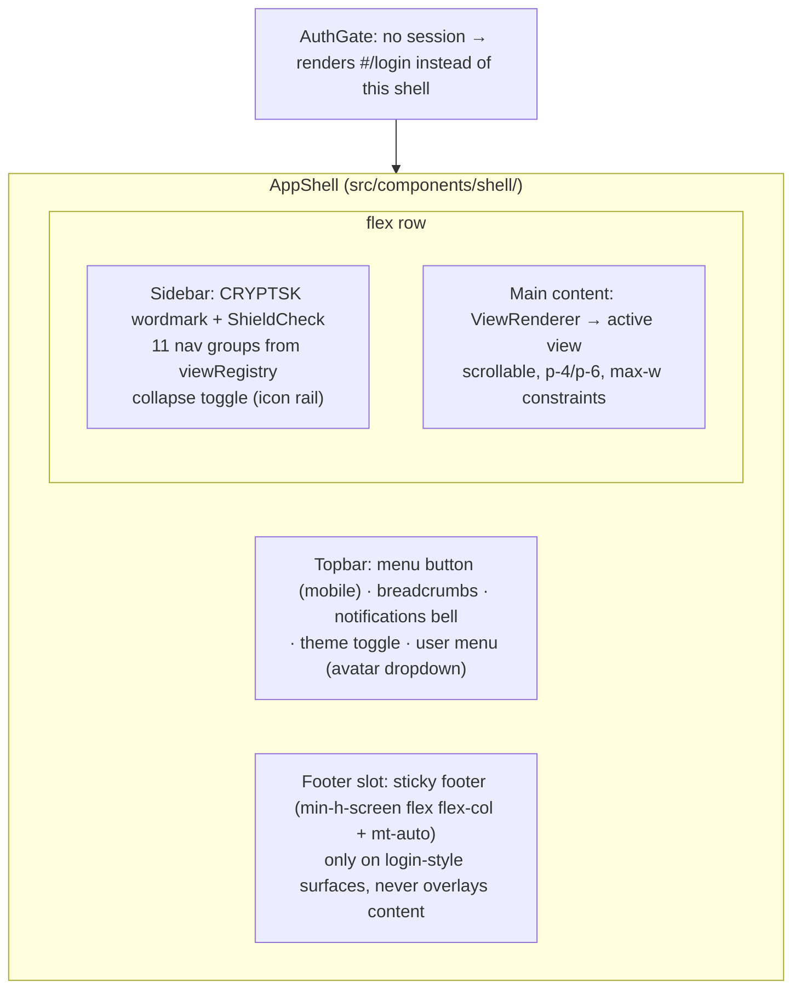

# Page Map — Single-Route SPA Views

> **TL;DR:** The console is a single Next.js route (`/` → `src/app/page.tsx`) that renders
> `AppShell`. All 29 screens are client-side hash views (`#/dashboard`, `#/firewall/rules`,
> …) resolved from a `viewRegistry` — this is a HARD sandbox rule (ADR-006); `#/setup` is
> view 29 and renders instead of the shell while first-time setup is incomplete. This
> document reproduces the LOCKED view map, defines the shell layout and sidebar tree, and
> gives a compact blueprint (layout, components, hooks, realtime, actions) for every view.

Related: [PROJECT_MEMORY §7.2–§9 (endpoints, realtime, views, tokens)](../00-PROJECT-MEMORY/PROJECT_MEMORY.md) ·
[UI_DESIGN_SYSTEM.md](./UI_DESIGN_SYSTEM.md) ·
[STATE_AND_DATA_FLOW.md](./STATE_AND_DATA_FLOW.md) ·
[ARCHITECTURE.md](../02-ARCHITECTURE/ARCHITECTURE.md) ·
Module specs: [M01](../06-MODULES/M01-DASHBOARD.md) … [M11](../06-MODULES/M11-API-PLATFORM.md)

---

## 1. Routing Model

- **Why hashes:** the sandbox exposes exactly one user-visible route (`/`). ADR-006
  (DECISIONS.md) locks the decision: one Next route, `AppShell` parses
  `window.location.hash`, and renders the matching view from
  `src/components/shell/view-registry.ts`. Creating any other Next.js route is a bug
  (PROJECT_MEMORY §11.1).
- **Registry entry:** `{ path: "#/firewall/rules", group: "Firewall", label: "Rules",
  icon: LucideIcon, component: DynamicComponent, order }`. Sidebar and breadcrumbs are
  generated from the registry, never hand-written per view.
- **Hash syntax:** `#/` + group + `/` + view. Tabbed views append the tab id as a third
  segment for deep links (`#/firewall/objects/services`, `#/dns-dhcp/dns/records`);
  the LOCKED two-segment paths from PROJECT_MEMORY §8 always resolve to the first tab.
  Filter deep links use hash query params: `#/ips/events?severity=critical`.
- **Deep-linking / back / forward / refresh:** all work for free via `hashchange` — the
  shell listens on the event, parses the hash, and swaps the view (per-view code splitting
  via `next/dynamic` mitigates the single-bundle trade-off of ADR-006).
- **Auth gate:** when unauthenticated, `AuthGate` renders the `#/login` view **in place of
  the whole shell** (no sidebar/topbar leak). After successful login the user lands on the
  originally requested hash, or `#/dashboard` when the request was bare `/`. The same
  gate pattern hosts the **setup gate**: while `setup.completed` is false, `#/setup`
  renders instead of the shell (PROJECT_MEMORY §8, view 29).
- **Session expiry:** any `401` from the fetch wrapper clears the app store and points the
  hash to `#/login` (see STATE_AND_DATA_FLOW §3).

## 2. Shell Layout



- **Sidebar** (built on `ui/sidebar.tsx`): collapsible — full labels on lg+, icon rail on
  md, hidden into a `Sheet` on mobile. Active item: emerald primary treatment; group
  headers are muted `text-xs` labels. Collapse state persists in `ui-store`.
- **Topbar:** mobile menu button (opens the sidebar `Sheet`), breadcrumbs (tabbed views),
  notifications bell (`Popover` listing notifications; unread count badge;
  `alerts:new` pushes into it), theme toggle (`Sun`/`Moon` via next-themes), user menu
  (`DropdownMenu`: username + role, "Logout" → `POST /api/v1/auth/logout` → `#/login`).
- **Notifications data:** `GET /api/v1/notifications?unread=` +
  `POST /api/v1/notifications/{id}/read` (mark read on open).
- **Footer:** only the login view carries a footer (sticky per §11.12); app views fill
  the viewport and scroll the main region.

## 3. Sidebar Tree (LOCKED paths + icon suggestions)

Group icons are the normative suggestion; per-item glyphs are implementation freedom.

- **Dashboard** — `LayoutDashboard`
  - `#/dashboard` — Overview
- **Network** — `Network`
  - `#/network/interfaces` (suggested: `Cable`)
  - `#/network/routing` (suggested: `Route`)
  - `#/network/wan` (suggested: `RadioTower`)
- **Firewall** — `ShieldHalf`
  - `#/firewall/rules` (suggested: `ListOrdered`)
  - `#/firewall/nat` (suggested: `ArrowRightLeft`)
  - `#/firewall/objects` — tabs: Address | Address Groups | Services | Service Groups | Schedules (suggested: `Boxes`)
  - `#/firewall/zones` (suggested: `BrickWall`)
- **IPS** — `Radar`
  - `#/ips/policies` (suggested: `ShieldAlert`)
  - `#/ips/events` (suggested: `Siren`)
- **VPN** — `LockKeyhole`
  - `#/vpn/configs` — tabs: WireGuard | IPSec | OpenVPN | User Groups (suggested: `KeyRound`)
  - `#/vpn/sessions` (suggested: `Activity`)
- **DNS & DHCP** — `Globe`
  - `#/dns-dhcp/dns` — tabs: Resolver Settings | Policies | Records | Query Log
  - `#/dns-dhcp/dhcp` — tabs: Subnets | Reservations | Leases | Relay
- **Identity** — `Users`
  - `#/identity/users`
  - `#/identity/sessions` (suggested: `UserCheck`)
  - `#/identity/portal` — captive portal settings + guest vouchers
- **QoS** — `Gauge`
  - `#/qos/policies`
- **Logs & Reports** — `ScrollText`
  - `#/logs/firewall`
  - `#/logs/ips`
  - `#/logs/audit`
  - `#/logs/live` — realtime tail (socket.io `logs:tail`)
  - `#/logs/reports` — tabs: Reports | Scheduled | Forwarding
- **HA** — `Server`
  - `#/ha`
- **System** — `Settings`
  - `#/system/settings`
  - `#/system/backups`
  - `#/system/api-keys` — tabs: API Keys | Webhooks

`#/setup` (view 29) is **not** a sidebar entry — it renders instead of the shell while
first-time setup is incomplete (same gate pattern as `#/login`).

## 4. Per-View Blueprints

Conventions: "Components" lists shared patterns from [UI_DESIGN_SYSTEM §5](./UI_DESIGN_SYSTEM.md#5-component-patterns-canonical-shared-registry)
plus `ui/*` primitives; "Data" names the hooks (`src/hooks/`, TanStack Query) and the
LOCKED endpoints they call; "Realtime" lists PROJECT_MEMORY §7.3 events the view
subscribes to (`config:updated` is handled globally — see STATE_AND_DATA_FLOW §4 — and is
listed only where it drives the whole view). Module specs in `../06-MODULES/` own the
detailed behavior; blueprints here stay layout-level.

---

### `#/login`
- **Purpose:** authenticate and obtain the `cryptsk_token` cookie.
- **Layout:** centered card on `--background`; CRYPTSK wordmark + ShieldCheck; username +
  password fields; sign-in button; inline error for wrong credentials; **sticky footer**
  (console/legal links) via `min-h-screen flex flex-col` + `mt-auto`.
- **Components:** Card, Form, Input, Button, Alert; footer slot.
- **Data:** `useLogin()` → `POST /api/v1/auth/login`; session bootstrap `GET /api/v1/auth/me`.
- **Realtime:** none (socket connects after login).
- **Actions:** sign in; redirect to originally requested hash or `#/dashboard`.

### `#/dashboard`
- **Purpose:** 30-second health answer: traffic, sessions, threats, WAN/VPN, system.
- **Layout:**
```
┌ health strip: StatusBadge healthy|degraded|critical · uptime · quick actions ┐
┌ MetricCard throughput ┬ MetricCard sessions ┬ alerts 24h ┬ notifications ───┤
┌ throughput area chart (rx/tx, Live|1h|24h) ────┬ top apps donut ─────────────┤
┌ top talkers table ─────────────────────────────┬ threat feed (max-h-96) ─────┤
┌ WAN strip badges ┬ VPN tunnel list ┬ CPU/RAM/disk Gauges · temp · services ───┘
```
- **Components:** PageScaffold, MetricCard, Sparkline, Gauge, StatusBadge, DataTable (talkers), EmptyState, ChartContainer (Area/Pie).
- **Data:** `useDashboardSummary()` → `GET /api/v1/dashboard/summary`; `useSystemStatus()` → `GET /api/v1/system/status`; range switch → `GET /api/v1/logs/stats?range=1h|24h`.
- **Realtime:** `metrics:tick` (ring buffer → cards + live chart), `wan:status` (strip), `alerts:new` (feed + badge), `sessions:update` (debounced summary refetch).
- **Actions:** range switch; "Create backup" → `POST /api/v1/system/backups`; "Restart service" → `POST /api/v1/system/services/{name}/restart` (menu of running services from `/system/status`; audited, simulated — M01 §4); deep links to WAN/VPN/IPS views. Details: [M01](../06-MODULES/M01-DASHBOARD.md).

### `#/network/interfaces` — 4 tabs: Interfaces | LLDP Neighbors | MAC Table | Mirroring (SPAN)
- **Purpose:** manage physical/VLAN/bridge/bond/loopback/GRE/IPIP interfaces with live stats, plus the switching extras (LLDP discovery, FDB view, SPAN sessions).
- **Layout (tab 1):** full-width table (name, type/role chips, L2/L3 mode chip, addresses, StatusBadge link state, rx/tx Sparkline) + detail `Sheet` (config, counters, errors/drops). Tab 2 LLDP Neighbors: derived neighbor table (auto-refresh 10 s, not persisted). Tab 3 MAC Table: derived FDB view with iface/VLAN filters. Tab 4 Mirroring: `PortMirror` CRUD table (one active mirror per source iface).
- **Components:** PageScaffold, Tabs, DataTable, StatusBadge, Sparkline, Sheet, ConfirmDialog, FormSection dialogs.
- **Data:** `useInterfaces()` → `GET/POST /api/v1/interfaces`; `GET/PUT/DELETE /api/v1/interfaces/{id}`; `useInterfaceStats(id)` → `GET /api/v1/interfaces/{id}/stats`; `useLldpNeighbors()` → `GET /api/v1/network/lldp-neighbors`; `useMacTable()` → `GET /api/v1/network/mac-table?iface=&vlan=&q=`; `usePortMirrors()` → `GET/POST /api/v1/network/port-mirrors` + `PUT/DELETE /{id}`.
- **Realtime:** `metrics:tick` (per-iface `rxKbps`/`txKbps` sparklines); LLDP/MAC tabs are engine-derived (10 s auto-refresh, no socket event — flagged in REVIEW-4A).
- **Actions:** create (vlan/bridge/bond/gre/ipip/loopback), edit (incl. `mode l2|l3`, `wanType`, `config.lldp`, bridge `stpMode`/`igmpSnooping`), delete (non-physical only — disabled with Tooltip otherwise); mirror CRUD. Details: [M02](../06-MODULES/M02-NETWORK.md).

### `#/network/routing` — 2 tabs: Static Routes | Policy-Based Routes
- **Purpose:** static routes incl. default route, blackholes, floating routes + BFD monitoring; policy-based routing (match → forced egress).
- **Layout (tab 1):** DataTable (destination, gateway/blackhole chip, interface, distance, BFD chip, StatusBadge reachability) + create/edit Dialog. Tab 2: ordered `PbrRule` table (pos, match summary, `→ iface|gateway` action, enabled toggle) + editor dialog with `ObjectPicker` and the mutually-exclusive egress choice.
- **Components:** PageScaffold, Tabs, DataTable, ConfirmDialog, FormSection, ObjectPicker.
- **Data:** `useRoutes()` → `GET/POST /api/v1/routes`; `PUT/DELETE /api/v1/routes/{id}`; `usePbrRules()` → `GET/POST /api/v1/pbr-rules`; `PUT/DELETE /api/v1/pbr-rules/{id}`; `PATCH /api/v1/pbr-rules/{id}/toggle`.
- **Realtime:** none beyond global `config:updated` (section `routing` invalidates `routes`, `pbr-rules`, `wan-policies`).
- **Actions:** add/edit/delete route (incl. `bfd` toggle); add/edit/delete/toggle PBR rule. Details: [M02](../06-MODULES/M02-NETWORK.md).

### `#/network/wan`
- **Purpose:** multi-WAN policies (priority / failover / load_balance) and probe health.
- **Layout:** policy cards or table (mode chip, assigned interfaces, probe type/target, interval) + per-WAN StatusBadge; probe history line chart.
- **Components:** PageScaffold, DataTable or Card grid, StatusBadge, FormSection, ChartContainer (Line).
- **Data:** `useWanPolicies()` → `GET/POST /api/v1/wan-policies`; `PUT/DELETE /api/v1/wan-policies/{id}`; `useForceProbe()` → `POST /api/v1/wan-policies/{id}/probe`.
- **Realtime:** `wan:status` (`{iface, state: up|down|degraded}` → badge flips, toast on down).
- **Actions:** create/edit/delete policy; force probe now; edit probe settings.

### `#/firewall/rules`
- **Purpose:** the core policy table — ordered, zone-scoped L3/L4 rules.
- **Layout:**
```
┌ zone Select · search Input · validate button · import/export ── [+ Add rule] ┐
┌ # ┆ enabled Switch ┆ name ┆ src→dst zones ┆ objects ┆ service ┆ action ┆ hits ┆ kebab ┐
└ dnd-kit reorder handles (drag to reprioritize) ──────────────────────────────┘
```
- **Components:** PageScaffold, DataTable, Switch (optimistic toggle), RuleEditor (Sheet), ObjectPicker, ConfirmDialog, StatusBadge, JsonFieldViewer (rule detail), `@dnd-kit` sortable rows.
- **Data:** `useFirewallRules({zone, search})` → `GET/POST /api/v1/firewall-rules`; `GET/PUT/DELETE /api/v1/firewall-rules/{id}`; `PATCH /api/v1/firewall-rules/{id}/toggle`; `POST /api/v1/firewall-rules/reorder`; `GET /api/v1/firewall-rules/{id}/hits`; `POST /api/v1/firewall-rules/validate`; `POST /api/v1/firewall-rules/import`; `GET /api/v1/firewall-rules/export?format=`.
- **Realtime:** `config:updated` (section `firewall`) refetches the table.
- **Actions:** create/edit/duplicate/delete; toggle enable (optimistic); drag reorder (optimistic); validate (shadow/conflict alerts); import JSON/CSV; export. Details: [M03](../06-MODULES/M03-FIREWALL.md).

### `#/firewall/nat`
- **Purpose:** SNAT / DNAT / hairpin / exempt rules.
- **Layout:** like the rules table but with `type` chips and translation columns (original → translated); RuleEditor variant.
- **Components:** PageScaffold, DataTable, RuleEditor (NAT fields), StatusBadge (type chips), ConfirmDialog.
- **Data:** `useNatRules()` → `GET/POST /api/v1/nat-rules`; `PUT/DELETE /api/v1/nat-rules/{id}`.
- **Realtime:** `config:updated` (section `nat`).
- **Actions:** create/edit/delete; reorder; port-forward presets.

### `#/firewall/objects`
- **Purpose:** reusable network objects behind the rules.
- **Layout:** PageScaffold + `Tabs` (Address | Address Groups | Services | Service Groups | Schedules); each tab = DataTable + create/edit Dialog; group rows expandable (Collapsible) to members.
- **Components:** PageScaffold, Tabs, DataTable, FormSection dialogs, ConfirmDialog, Collapsible.
- **Data:** `useAddressObjects()`, `useAddressGroups()`, `useServiceObjects()`, `useServiceGroups()`, `useScheduleObjects()` → `GET/POST /api/v1/address-objects | address-groups | service-objects | service-groups | schedule-objects` (+ `PUT/DELETE /{id}` each).
- **Realtime:** `config:updated` (section `firewall`).
- **Actions:** CRUD per tab; delete blocked with Tooltip when object is referenced by a rule (`CONFLICT` → ErrorState explaining usage).

### `#/firewall/zones`
- **Purpose:** zone definitions and interface membership.
- **Layout:** zone cards (name, emoji-free icon, members as interface chips) or table; edit Dialog assigns interfaces via multi-select.
- **Components:** PageScaffold, Card grid, FormSection, ConfirmDialog.
- **Data:** `useZones()` → `GET/POST /api/v1/zones`; `PUT/DELETE /api/v1/zones/{id}`.
- **Realtime:** `config:updated` (section `firewall`).
- **Actions:** create/edit/delete zone; assign/remove interfaces.

### `#/ips/policies`
- **Purpose:** Suricata policy modes, Emerging Threats category tuning, one-click presets, auto-update scheduler.
- **Layout:** policies table (mode chip: inline_drop/inline_tap/passive, preset badge, "categories on: k/10") + **Rule Updates card** (auto-update: enabled switch, interval daily|weekly, time, last/next run — `SystemSetting` `ips/auto_update`) + **Presets row** (three one-click buttons: conservative/balanced/aggressive → `POST /api/v1/ips/policies/apply-preset`) + rule-categories Accordion: category rows with count + Switch; policy editor includes `preprocessors` toggles (stream/http/tls/ssh) and the `tiBlocklist` toggle.
- **Components:** PageScaffold, DataTable, Accordion, Switch, FormSection, StatusBadge, ConfirmDialog (preset apply).
- **Data:** `useIpsPolicies()` → `GET/POST /api/v1/ips/policies` (+`PUT/DELETE /{id}`); `useIpsRuleCategories()` → `GET /api/v1/ips/rule-categories`; `useApplyIpsPreset()` → `POST /api/v1/ips/policies/apply-preset`; `useIpsUpdateSettings()` → `GET/PUT /api/v1/ips/update-settings`.
- **Realtime:** `config:updated` (section `ips`); the update scheduler's simulated cycle surfaces `lastUpdateAt`/`nextUpdateAt` on refetch.
- **Actions:** create/edit/delete policy; toggle categories; set per-policy mode; apply preset; save update schedule. Details: [M04](../06-MODULES/M04-IPS.md).

### `#/ips/events`
- **Purpose:** IDS/IPS event explorer.
- **Layout:** filter bar (`q`, severity Select, sid, since/until via Calendar+Popover) + server-paginated DataTable (timestamp, severity badge, category, src → dst, action badge); row `Sheet` detail with JsonFieldViewer payload; suppress kebab action.
- **Components:** PageScaffold, DataTable, StatusBadge, Sheet, JsonFieldViewer, DropdownMenu, ConfirmDialog.
- **Data:** `useIpsEvents(filters)` → `GET /api/v1/ips/events?severity=&sid=&q=&since=&until=&page=`; `useSuppressEvent()` → `POST /api/v1/ips/events/{id}/suppress`.
- **Realtime:** optional `logs:tail` (kind `ips`) prepend when "live" toggle is on; `alerts:new` refreshes unread badge.
- **Actions:** open detail; suppress 24h / 7d / forever; jump from dashboard threat feed deep links (`?severity=critical`, `?q=<sid>`).

### `#/vpn/configs` — 4 tabs: WireGuard | IPSec | OpenVPN | User Groups
- **Purpose:** tunnel configuration across the three stacks + per-group VPN user policies.
- **Layout:** `Tabs` (WireGuard | IPSec | OpenVPN | **User Groups**) → tunnel cards/table: name, type chip, StatusBadge (`up`/`connecting`/`down`/`error`), peers, last handshake; detail Sheet with DPD + handshake info, `replayWindow` (IPsec), keepalive/DNS/pool fields (remote-access), and client-bundle download. **User Groups tab:** `VpnUserGroup` table (name, pool, dns, timeouts, limits, member count) + editor dialog (pool override, pushed DNS, `idleTimeoutMin`, `maxSessionMin`, `maxSessionsPerUser`, `memberUsernames` multiselect).
- **Components:** PageScaffold, Tabs, DataTable or Card grid, StatusBadge, Sheet, JsonFieldViewer (bundle preview), FormSection, ConfirmDialog.
- **Data:** `useVpnConfigs({type})` → `GET/POST /api/v1/vpn/configs` (+`PUT/DELETE /{id}`); `useVpnConfigStatus(id)` → `GET /api/v1/vpn/configs/{id}/status`; `useClientBundle()` → `POST /api/v1/vpn/configs/{id}/client-bundle`; `useVpnUserGroups()` → `GET/POST /api/v1/vpn/user-groups` (+`PUT/DELETE /{id}`).
- **Realtime:** `vpn:status` (`{vpnId, status, statusMessage?}` → badge flips without refetch),
  `sessions:update` (kind `vpn`) updates counts/status rows.
- **Actions:** CRUD per type; manage user groups; download `wg .conf` / `.ovpn` bundle; inspect status. Details: [M05](../06-MODULES/M05-VPN.md).

### `#/vpn/sessions`
- **Purpose:** active remote-access sessions and admin disconnect.
- **Layout:** DataTable (user, virtual IP, real IP, tunnel, since, rx/tx) + disconnect row action.
- **Components:** PageScaffold, DataTable, ConfirmDialog, StatusBadge, tabular-nums byte columns.
- **Data:** `useVpnSessions()` → `GET /api/v1/vpn/sessions`; `useDisconnectSession()` → `POST /api/v1/vpn/sessions/{id}/disconnect`.
- **Realtime:** `sessions:update` (kind `vpn`) applies diffs without refetch.
- **Actions:** disconnect (ConfirmDialog states the user + tunnel).

### `#/dns-dhcp/dns`
- **Purpose:** Unbound resolver settings, DNS policies, local records, query log.
- **Layout:** `Tabs` — Resolver Settings (FormSection form: upstreams, caching, blocklists); Policies (DataTable + dialog); Records (DataTable + dialog, type chips A/AAAA/CNAME/MX/TXT/SRV/PTR); Query Log (filter `?q=&blocked=` + paginated table, blocked rows rose-dotted).
- **Components:** PageScaffold, Tabs, DataTable, FormSection, ConfirmDialog, StatusBadge, Switch.
- **Data:** `useDnsSettings()` → `GET/PUT /api/v1/dns/settings`; `useDnsPolicies()`, `useDnsRecords()` → `GET/POST /api/v1/dns/policies | dns/records` (+`PUT/DELETE /{id}`); `useDnsQueryLogs()` → `GET /api/v1/dns/query-logs`.
- **Realtime:** `config:updated` (section `dns`).
- **Actions:** save resolver settings; CRUD policies/records; filter query log. Details: [M06](../06-MODULES/M06-DNS-DHCP.md).

### `#/dns-dhcp/dhcp` — 4 tabs: Subnets | Reservations | Leases | Relay
- **Purpose:** Kea subnets (IPv4 + basic DHCPv6), static reservations, lease table, relay config.
- **Layout:** `Tabs` — Subnets (cards: family chip v4/v6, CIDR, range, lease usage Progress); Reservations (DataTable + dialog); Leases (state filter `?state=active|expired` + paginated table, state badges); **Relay** (singleton settings card: enabled switch, server IP list, interface multiselect, info note "appliance renders dhcrelay/Kea relay per interface; sandbox records the config").
- **Components:** PageScaffold, Tabs, DataTable, Progress, StatusBadge, FormSection, ConfirmDialog.
- **Data:** `useDhcpSubnets()`, `useDhcpReservations()`, `useDhcpLeases()` → `GET/POST /api/v1/dhcp/subnets | dhcp/reservations | dhcp/leases` (+`PUT/DELETE` for subnets/reservations); `useDhcpRelay()` → `GET/PUT /api/v1/dhcp/relay`.
- **Realtime:** `config:updated` (section `dhcp`); leases refetch on focus.
- **Actions:** CRUD subnets/reservations (family `ipv4|ipv6` gates IP validation); filter leases; force-release a lease
  (`POST /api/v1/dhcp/leases/{id}/release`, `network_admin`, audited); save relay config. Details: [M06](../06-MODULES/M06-DNS-DHCP.md).

### `#/identity/users`
- **Purpose:** local users, groups, RADIUS profiles, password policy.
- **Layout:** users DataTable (username, role chip, groups, StatusBadge enabled) + panels: groups table, RADIUS profiles table, password/TOTP policy FormSection — secondary panels in tabs or side Sheet to keep one primary table.
- **Components:** PageScaffold, DataTable, FormSection, ConfirmDialog, StatusBadge, DropdownMenu.
- **Data:** `useUsers()`, `useUserGroups()`, `useRadiusProfiles()`, `useAuthSettings()`, `useDirectorySources()` → `GET/POST /api/v1/users | user-groups | radius-profiles | directory-sources` (+`PUT/DELETE /{id}`) and `GET/PUT /api/v1/auth-settings`.
- **Realtime:** `config:updated` (section `identity`).
- **Actions:** CRUD users/groups/RADIUS profiles/**directory sources** (LDAP/AD card: type chip, server:port, baseDn, masked bindPassword, simulated "Test" → `{ok, latencyMs, userCount?}`); TOTP enroll/disenroll; reset password; edit lockout/TOTP policy. Details: [M07](../06-MODULES/M07-IDENTITY.md).

### `#/identity/sessions`
- **Purpose:** live ip→user identity map from RADIUS/captive portal/VPN/local auth.
- **Layout:** DataTable (ip, user, method chip: local/radius/captive_portal/vpn, since, idle) — read-only live view.
- **Components:** PageScaffold, DataTable, StatusBadge, EmptyState, DropdownMenu.
- **Data:** `useIdentitySessions()` → `GET /api/v1/identity/sessions`.
- **Realtime:** `sessions:update` (kind `identity`) patches rows in place.
- **Actions:** filter/search; row links to `#/identity/users`; force-expire a session
  (`POST /api/v1/identity/sessions/{id}/expire` — kebab action, `security_admin`, audited).

### `#/identity/portal`
- **Purpose:** captive portal profile and guest vouchers.
- **Layout:** settings FormSection (enabled, mode `clickthrough|credentials|voucher`, interface,
  session timeout, bandwidth cap, redirect URL, voucher TTL) + vouchers card (list/table with status
  chips, generate action).
- **Components:** PageScaffold, FormSection, Switch, DataTable, ConfirmDialog.
- **Data:** `useCaptivePortal()` → `GET/PUT /api/v1/captive-portal`; `useVouchers()` →
  `GET/POST /api/v1/captive-portal/vouchers` + `DELETE /api/v1/captive-portal/vouchers/{id}`
  (vouchers are MockEngine in-memory state — SCHEMA.md §6).
- **Realtime:** `config:updated`.
- **Actions:** save portal profile; generate/revoke vouchers.

### `#/qos/policies`
- **Purpose:** traffic-shaping policies and their rules.
- **Layout:** master-detail: policies list (template chips: voip/video/gaming/bulk/custom) → selected policy's rules table (`?policyId=`) with priorities; RuleEditor (QoS variant) for rules.
- **Components:** PageScaffold, DataTable, RuleEditor, StatusBadge, ConfirmDialog.
- **Data:** `useQosPolicies()` → `GET/POST /api/v1/qos/policies` (+`PUT/DELETE /{id}`); `useQosRules(policyId)` → `GET/POST /api/v1/qos/rules?policyId=` (+`PUT/DELETE /{id}`).
- **Realtime:** `config:updated` (section `qos`).
- **Actions:** CRUD policies/rules; reorder rule priority. Details: [M08](../06-MODULES/M08-QOS.md).

### `#/logs/firewall`
- **Purpose:** historical firewall log search.
- **Layout:** filter bar (`q`, action Select, src, dst, since/until) + server-paginated DataTable (timestamp, action badge, src → dst, service, app, rule name); row Sheet with JsonFieldViewer payload.
- **Components:** PageScaffold, DataTable, StatusBadge, Sheet, JsonFieldViewer, Calendar/Popover filters.
- **Data:** `useFirewallLogs(filters)` → `GET /api/v1/logs/firewall?q=&action=&src=&dst=&since=&until=&page=`.
- **Realtime:** none (live needs → link `#/logs/live`).
- **Actions:** filter, paginate, inspect, export CSV (`GET /api/v1/logs/firewall/export` with the same
  filter params). Details: [M09](../06-MODULES/M09-LOGGING.md).

### `#/logs/ips`
- **Purpose:** historical IPS event archive (same UX as ips/events without suppress).
- **Layout:** filter bar (`severity`, `category`, `page`) + paginated DataTable; detail Sheet.
- **Components:** PageScaffold, DataTable, StatusBadge, Sheet, JsonFieldViewer.
- **Data:** `useIpsLogs(filters)` → `GET /api/v1/logs/ips?severity=&category=&page=`.
- **Realtime:** none.
- **Actions:** filter, paginate, inspect.

### `#/logs/audit`
- **Purpose:** who changed what — the compliance trail.
- **Layout:** filter bar (`user`, `objectType`) + paginated DataTable (timestamp, actor, action, objectType, result badge); row expands to before/after diff via two JsonFieldViewer panels.
- **Components:** PageScaffold, DataTable, StatusBadge, JsonFieldViewer.
- **Data:** `useAuditLogs(filters)` → `GET /api/v1/logs/audit?user=&objectType=&page=`.
- **Realtime:** none.
- **Actions:** filter, paginate, inspect before/after.

### `#/logs/live`
- **Purpose:** realtime tail of firewall/IPS log streams.
- **Layout:**
```
┌ kind toggle: firewall | ips ┆ pause / resume ┆ severity filter ┆ autoscroll ──┐
┌ streaming rows (newest on top, severity badge + src → dst + message) ────────┐
└ virtualized list, max-h region, paused rows dim to 50% opacity ──────────────┘
```
- **Components:** PageScaffold, StatusBadge, ToggleGroup, Button, virtualized list (plain map + `max-h-96 overflow-y-auto` in Phase 1).
- **Data:** `useLogTail("firewall" | "ips")` — no REST; buffer lives in the realtime store.
- **Realtime:** `logs:tail` (`{kind, entry}`), `alerts:new` (toast on high/critical while open); subscribes `{channels:["logs","alerts"]}`.
- **Actions:** pause/resume, switch kind, clear buffer, jump to historical views.

### `#/logs/reports` — 3 tabs: Reports | Scheduled | Forwarding
- **Purpose:** reports over pre-aggregated buckets, scheduled report CRUD, syslog/NetFlow forwarding targets.
- **Layout (Reports tab):** range toggle (1h | 24h | 7d) + chart cards from the locked `/logs/stats` payload (ENDPOINTS §11): stacked action-trend area, action-mix donut, threats-by-severity (`ipsBySeverity`) donut, KPI cards (total flows, blocked %, critical+high); export csv/json (`GET /logs/reports/export`), PDF via browser print. **Scheduled tab:** `ReportSchedule` table (range daily|weekly|monthly, format pdf|html|csv|json, sections chips, recipients, enabled, `lastRunAt`) + create/edit dialog + "Run now" (`POST …/run` → on-screen/download result). **Forwarding tab:** Syslog targets card (host, port, protocol udp|tcp|tls, minSeverity, `bufferedRows` reliability counter) + NetFlow targets card (host, port, version v5|v9|ipfix, samplingRate).
- **Components:** PageScaffold, Tabs, ChartContainer (Area/Bar/Pie), MetricCard, DataTable, FormSection, ConfirmDialog.
- **Data:** `useLogsStats(range)` → `GET /api/v1/logs/stats?range=1h|24h|7d`; `useLogsReportsExport()` → `GET /api/v1/logs/reports/export`; `useReportSchedules()` → `GET/POST /api/v1/logs/report-schedules` (+`PUT/DELETE /{id}`, `POST /{id}/run`); `useSyslogTargets()`, `useNetflowTargets()` → `GET/POST /api/v1/logs/syslog-targets | logs/netflow-targets` (+`PUT/DELETE /{id}`).
- **Realtime:** none (reports are aggregates; schedule firing bumps `lastRunAt` server-side).
- **Actions:** switch range; export; CRUD schedules + run-now; CRUD forwarding targets. Details: [M09](../06-MODULES/M09-LOGGING.md).

### `#/ha`
- **Purpose:** high-availability pair status and configuration.
- **Layout:** two status cards (local + peer: role badge disabled/active/standby, VIP, sync state incl. `configSynced`/`sessionSynced`, tracked-interface state chips, last heartbeat) + config FormSection (enabled, role, priority "higher wins", VIP CIDR, iface, peer IP, `syncConfig`, `sessionSync` (conntrackd), `trackedInterfaces` multiselect, failAfter/holdDown).
- **Components:** PageScaffold, Card grid, StatusBadge, FormSection, ConfirmDialog.
- **Data:** `useHaStatus()` → `GET /api/v1/ha/status`; `useHaConfig()` → `GET/PUT /api/v1/ha/config`.
- **Realtime:** none locked for HA in §7.3 — page refetches on focus and on `config:updated`; HA events arrive as notifications (`type: "ha"`) via `alerts:new`.
- **Actions:** edit HA config; force state refresh. Details: [M10](../06-MODULES/M10-SYSTEM.md).

### `#/system/settings`
- **Purpose:** appliance identity/time/services plus all system-level settings cards.
- **Layout:** health strip (CPU/RAM/disk/temp gauges + services list from status) + settings cards: General (hostname, timezone); **System time (NTP)** (enabled, server list, simulated sync state); **SNMP** (v2c/v3 radio, masked community / v3 user+protocols, port, allowlist); **Hardening** (SSH password auth, mgmt allowlist, stop-unused services); **Firmware** (current/channel, check, upgrade/rollback with safety-backup note, history); **SSH keys** (table + add/remove, fingerprint mono); Notifications prefs (email display-only + **resource-alert thresholds** cpu/mem/disk/temp); Logging retention overrides; Advanced toggles; **Policy templates** (per-vertical catalog + apply); Config history + side-by-side diff viewer (12 LOCKED sections).
- **Components:** PageScaffold, FormSection, Gauge, StatusBadge, Switch, DataTable (ssh keys, firmware history, versions), JsonFieldViewer + diff panes, ConfirmDialog.
- **Data:** `useSystemSettings()` → `GET/PUT /api/v1/system/settings`; `useSystemStatus()` → `GET /api/v1/system/status`; `useFirmware()` → `GET /api/v1/system/firmware` + `POST …/check | …/upgrade | …/rollback`; `useSshKeys()` → `GET/POST /api/v1/system/ssh-keys` + `DELETE /{id}`; `usePolicyTemplates()` → `GET /api/v1/system/policy-templates` + `POST /{id}/apply`; `useConfigVersions()` → `GET /api/v1/config-versions` (+`/{id}`).
- **Realtime:** `metrics:tick` (cpuPct/memPct refresh gauges between manual reloads); threshold breaches surface as `system` notifications via `alerts:new`.
- **Actions:** save each card; firmware check/upgrade/rollback; manage SSH keys; apply template; diff two versions. Details: [M10](../06-MODULES/M10-SYSTEM.md).

### `#/system/backups`
- **Purpose:** config backup / restore.
- **Layout:** backups DataTable (created, size, origin chip, note) + "Create backup" action; restore behind ConfirmDialog (restores are destructive).
- **Components:** PageScaffold, DataTable, ConfirmDialog, DropdownMenu.
- **Data:** `useBackups()` → `GET/POST /api/v1/system/backups`; `POST /api/v1/system/backups/{id}/restore`;
  `GET /api/v1/system/backups/{id}/download` (JSON download).
- **Realtime:** `config:updated` (section `system`).
- **Actions:** create backup; restore; audit trail records both.

### `#/system/api-keys` — 2 tabs: API Keys | Webhooks
- **Purpose:** machine access keys (`ck_…` bearer tokens) + webhook registrations.
- **Layout (API Keys tab):** keys DataTable (name, prefix `ck_…`, scopes badges, created, last used, expires, StatusBadge revoked) + create dialog showing the full secret **once** with copy button. **Webhooks tab:** registrations table (name, url, events chips, enabled, last delivery + status chip, failureCount) + create/edit dialog (https URL, five-event multiselect, masked HMAC secret) + "Send test" row action.
- **Components:** PageScaffold, Tabs, DataTable, ConfirmDialog, Input, Button (copy), StatusBadge.
- **Data:** `useApiKeys()` → `GET/POST /api/v1/api-keys`; `DELETE /api/v1/api-keys/{id}`; `useWebhooks()` → `GET/POST /api/v1/webhooks` + `PUT/DELETE /{id}` + `POST /{id}/test`.
- **Realtime:** none.
- **Actions:** create (one-time reveal + Copy), revoke; webhook CRUD + test. Details: [M11](../06-MODULES/M11-API-PLATFORM.md) (semantics), [M10](../06-MODULES/M10-SYSTEM.md) (view).

### `#/setup` (view 29 — first-time setup wizard)
- **Purpose:** guided first-run: admin password change, WAN pick, LAN/DHCP defaults, policy template, finish.
- **Layout:** renders **instead of the shell** while `setup.completed` is false; centered single-column stepper (Progress header, back/next); summary step before finish.
- **Components:** Card, Progress, FormSection, Button; no sidebar/topbar.
- **Data:** reads/writes only through regular module endpoints (interfaces, dhcp subnets, policy templates) + `POST /api/v1/system/setup/complete` on finish; gate reads `SystemSetting` `setup.completed`.
- **Realtime:** none (gate re-evaluates on `config:updated {section: "system"}`).
- **Actions:** complete steps; finish setup (shell renders → `#/dashboard`). Details: [M10 §4](../06-MODULES/M10-SYSTEM.md).

## 5. Navigation Behaviors

- **Unknown hash:** any hash that misses the registry redirects to `#/dashboard` and fires
  one `toast.info("Unknown page — redirected to dashboard")`. Never render a blank main.
- **Per-group default child:** the first item of each group in §3 is its default
  (`#/network` → `#/network/interfaces`, `#/logs` → `#/logs/firewall`, …). Group headers
  in the sidebar navigate to their default child.
- **Last-visited memory:** `ui-store` (zustand `persist`) keeps `lastViews: Record<group,
  path>`; a bare `#/group` or app relaunch with bare `#/` restores the group's last
  visited child, else its default. `activeView`, `sidebarCollapsed` persist the same way.
- **Breadcrumbs:** tabbed views render `Breadcrumb` in the topbar:
  `Firewall / Objects / Address` (group / view / tab). Non-tabbed views show
  `Group / View`. Breadcrumbs are links built from the registry — clicking the group goes
  to its default child.
- **Scroll reset:** on hash change the main region scrolls to top; focus moves to the view
  `h1` (`tabIndex={-1}`) for keyboard/screen-reader orientation.

## 6. Responsive Rules

| Breakpoint | Shell | Content |
|---|---|---|
| Mobile `<768px` | Sidebar hidden; topbar menu button opens it as a `Sheet` (overlay, `Esc` closes). | Single-column stacks; MetricCard grid 1-col (2-col ≥ 480px if it fits); tables get horizontal scroll (`min-w` on table) — log tables may switch to card-list mode; RuleEditor sheet is full-width; all touch targets ≥ 44px. |
| Tablet `768–1023px` | Icon-rail sidebar (collapsed, tooltip labels on hover). | 2-col KPI grids; master-detail views (QoS, objects) use stacked panels; charts keep full card width. |
| Desktop `≥1024px` | Full sidebar with labels; user-toggleable collapse persists. | Multi-column grids (`lg:grid-cols-2/3/4`), 4-up MetricCard row, side-by-side master-detail, detail `Sheet` at `sm:max-w-xl`. |

General: content max width is generous but never full-bleed on ultrawide (`max-w-screen-2xl`
wrapper); charts drop legend to bottom on narrow cards; dialogs become full-screen sheets
on mobile via responsive `Dialog`/`Sheet` choice in the shared patterns.
