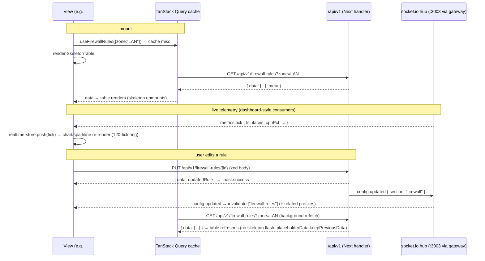

# State & Data Flow — Cryptsk Console

> **TL;DR:** Server state lives **only** in TanStack Query (keys `["resource", params]`,
> `config:updated` invalidates by resource prefix); client state lives **only** in two
> zustand stores (`ui-store`, `app-store`) plus the realtime buffer store; all HTTP goes
> through one `apiFetch<T>()` wrapper with relative URLs and envelope unwrapping; realtime
> is one singleton socket.io connection `io("/?XTransformPort=3003")` feeding
> `useMetricsTick` / `useLogTail` / `useConfigUpdated`. Optimistic updates exist in exactly
> two places: rule toggle and drag-reorder.

Related: [PROJECT_MEMORY §7 (API + realtime, LOCKED)](../00-PROJECT-MEMORY/PROJECT_MEMORY.md) ·
[UI_DESIGN_SYSTEM.md](./UI_DESIGN_SYSTEM.md) ·
[PAGE_MAP.md](./PAGE_MAP.md) ·
[API_STANDARDS.md](../04-API/API_STANDARDS.md) ·
[ARCHITECTURE.md §5 (sequences)](../02-ARCHITECTURE/ARCHITECTURE.md)

---

## 1. State Ownership

| State | Owner | Location | Notes |
|---|---|---|---|
| All server data (lists, details, mutations) | TanStack Query v5 | `src/hooks/use-<resource>.ts` | one hook file per resource; keys per §2 |
| Active view, sidebar collapsed, last-visited views | zustand `ui-store` | `src/stores/ui-store.ts` | `persist` middleware; hash remains the URL truth, store only memoizes |
| Theme (dark/light) | next-themes | `ThemeProvider` in root layout | `useTheme()` for the toggle; `ui-store` must not duplicate it |
| Session/user + permissions | zustand `app-store` | `src/stores/app-store.ts` | set by login / `GET /api/v1/auth/me`; cleared on 401/logout |
| Realtime buffers (metric ticks, log tails) | zustand `realtime-store` | `src/stores/realtime-store.ts` | ring buffers only — not a server-data cache (§4) |
| Form state | react-hook-form | per view/dialog | zodResolver + `src/lib/validators/*` (§6) |
| Ephemeral widget state (dialog open, tab index, selection) | `useState`/component-local | in the view | never lifted into stores |

Nothing else is stateful. If a value comes from the API it belongs to TanStack Query —
never copy it into zustand. If two views need it, they share the query cache.

## 2. TanStack Query Conventions

- **Query keys:** `["resource", params?]` where `resource` is the kebab-case API resource.
  Filtered list: `["firewall-rules", { zone: "LAN", search: "smb" }]`. Detail:
  `["firewall-rules", 7]`. Every filter value **must** appear in the key (PROJECT_MEMORY
  §13) so prefix invalidation stays correct.
- **Key families:** list keys are `[resource, paramsObj]`; detail keys are
  `[resource, id]`; aggregates use their own resource (`dashboard-summary`, `logs-stats`).
  One hook file owns one family (e.g. `use-firewall-rules.ts` exports `useFirewallRules`,
  `useFirewallRule(id)`, and the mutations).
- **staleTime:** `30_000` for config resources (interfaces, rules, objects, users, system
  settings — config changes are rare and arrive via `config:updated`); `0` for logs,
  events, sessions, and dashboard summary (always refetch on mount/focus).
- **Mutations invalidate:** every mutation's `onSettled` invalidates its own family plus
  logically-related families (e.g. deleting an address group invalidates
  `["address-groups"]` and `["firewall-rules"]` because rule payloads embed the group).
- **Global invalidation:** the `config:updated` socket event (section → prefix table below)
  runs once at app level; views never subscribe to `config:updated` individually.
- **Retry policy:** 2 retries, exponential backoff (1s, 2s), **no retry on 4xx** — a
  `VALIDATION_ERROR` or `FORBIDDEN` is final. 5xx and network errors retry; `401` never
  retries (§3 handles it).

### `config:updated` section → invalidated key prefixes

| `section` (event payload) | Invalidates query prefixes |
|---|---|
| `firewall` | `firewall-rules`, `nat-rules`, `zones`, `address-objects`, `address-groups`, `service-objects`, `service-groups`, `schedule-objects` |
| `nat` | `nat-rules` |
| `interfaces` | `interfaces`, `port-mirrors` |
| `routing` | `routes`, `pbr-rules`, `wan-policies` |
| `dns` | `dns-settings`, `dns-policies`, `dns-records` |
| `dhcp` | `dhcp-subnets`, `dhcp-reservations`, `dhcp-leases`, `dhcp-relay` |
| `vpn` | `vpn-configs`, `vpn-sessions`, `vpn-user-groups` |
| `ips` | `ips-policies`, `ips-rule-categories`, `ips-update-settings` |
| `qos` | `qos-policies`, `qos-rules` |
| `ha` | `ha-status`, `ha-config` |
| `identity` | `users`, `user-groups`, `radius-profiles`, `auth-settings`, `captive-portal`, `identity-sessions`, `directory-sources` |
| `system` | `system-settings`, `system-status`, `system-backups`, `system-firmware`, `system-ssh-keys`, `system-policy-templates`, `api-keys`, `webhooks`, `notifications`, `config-versions`, `logs-syslog-targets`, `logs-netflow-targets`, `logs-report-schedules` |

REVIEW-4A additions: `pbr-rules`, `port-mirrors`, `dhcp-relay`, `vpn-user-groups`,
`ips-update-settings`, and `directory-sources` ride their module's existing sections; the
restored log-forwarding/API-platform config surfaces (syslog/netflow targets, report
schedules, webhooks) broadcast `system` per PROJECT_MEMORY §7.2 grouping. The sentinel
`section: "all"` (restore, template apply) invalidates every prefix below plus
`dashboard-summary` and re-evaluates the `setup.completed` gate.

Section values are the LOCKED `ConfigSection` union (ARCHITECTURE.md §5 — `firewall | nat |
interfaces | routing | dns | dhcp | vpn | ips | qos | ha | identity | system`); WAN-policy
mutations broadcast `routing` (multi-WAN belongs to the routing section, spec §1.3).

The derived engine views (`network-lldp-neighbors`, `network-mac-table`) are **not** in this
table: they are ring-buffer snapshots fetched with short polling/auto-refresh (10 s) inside
their tabs, not `config:updated`-driven caches.

`dashboard-summary` is invalidated on every `config:updated` regardless of section. The
mapping lives in `src/hooks/use-config-updated.ts`; adding a resource means extending the
table in the same task (docs-first rule).

## 3. Fetch Wrapper

One wrapper, `src/lib/api/client.ts` — views and hooks never call `fetch` directly.

```ts
// src/lib/api/client.ts (sketch)
import { appStore } from "@/stores/app-store";

export class ApiError extends Error {
  constructor(public status: number, public code: string, message: string,
              public details?: unknown) { super(message); }
}

export async function apiFetch<T>(path: string, init?: RequestInit): Promise<{ data: T; meta?: PageMeta }> {
  const res = await fetch(path, {
    ...init,
    headers: { "Content-Type": "application/json", ...init?.headers },
    credentials: "include", // cryptsk_token httpOnly cookie
  });
  const body = await res.json().catch(() => null);
  if (!res.ok || body?.error) {
    const { code = "INTERNAL", message = "Request failed", details } = body?.error ?? {};
    if (res.status === 401) {           // session expired / missing
      appStore.getState().clearUser();
      window.location.hash = "#/login"; // never stack per-view error UI on 401
    }
    throw new ApiError(res.status, code, message, details);
  }
  return body; // envelope { data, meta? } — per API_STANDARDS.md
}
```

- **Correct:** `apiFetch("/api/v1/firewall-rules")`, `apiFetch("/api/v1/ips/events?page=2")`
  — **relative URLs ONLY** (sandbox constraint §11.5).
- **FORBIDDEN:** `fetch("http://localhost:3000/api/v1/firewall-rules")` or any absolute
  URL / port-in-hostname — these break the gateway and are review blockers.
- **Envelope:** success `{ data, meta? }`, error `{ error: { code, message, details? } }`
  with LOCKED codes `VALIDATION_ERROR` 400, `UNAUTHORIZED` 401, `FORBIDDEN` 403,
  `NOT_FOUND` 404, `CONFLICT` 409, `RATE_LIMITED` 429, `INTERNAL` 500 — surfaced verbatim
  as `ApiError.code` so views can branch (e.g. `CONFLICT` on object delete → explain
  references).
- **Toast policy:** mutations toast (`toast.success` on OK, `toast.error` with the
  `ApiError.message` + `description: code` on failure) inside their mutation hooks;
  **queries never toast** — views render `ErrorState` instead. Socket drops toast once
  (§4).
- **Pagination:** `?page=1&limit=25&sort=-timestamp` in; `meta: { page, limit, total,
  totalPages }` out → `DataTable` pagination directly.

## 4. Realtime Wiring (socket.io)

- **One singleton**, `src/lib/realtime.ts`:

```ts
import { io } from "socket.io-client";
export const socket = io("/?XTransformPort=3003", { autoConnect: false });
// connect() on login; disconnect() on logout. The query string is EXACTLY
// "?XTransformPort=3003" — NEVER a port in the hostname (§11.6).
```

- **Lifecycle:** `app-store` login (or `auth/me` success) → `socket.connect()` then
  `subscribe { channels }`; logout / 401 → `unsubscribe` + `socket.disconnect()`. No
  component ever creates a second connection.
- **Channels:** server-side subscribe control is
  `subscribe { channels: ["metrics","logs","alerts"] }` / `unsubscribe { channels }`.
  The `metrics` channel feeds `metrics:tick`; `logs` feeds `logs:tail`; `alerts` feeds
  `alerts:new`. `sessions:update`, `wan:status`, `vpn:status`, `config:updated` arrive on the
  default room for an authenticated session.

| Hook (src/hooks/use-realtime.ts) | Event | Behavior |
|---|---|---|
| `useMetricsTick()` | `metrics:tick` | pushes `{ts, ifaces, cpuPct, memPct, conntrackCount}` into the realtime-store ring buffer (cap **120 ticks** ≈ 4 min); consumers derive per-iface series; dashboard renders the last 60 (M01 window) |
| `useLogTail(kind)` | `logs:tail` | subscribes on mount, buffers per kind (cap 500, `paused` flag, dedupe by id); unsubscribe on unmount |
| `useConfigUpdated()` | `config:updated` | app-level (mounted once): invalidates prefixes per the §2 table |
| `useSocketEvent(event, handler)` | any | low-level escape hatch for `wan:status` / `sessions:update` / `alerts:new` consumers |

- **Buffers:** the realtime-store holds rolling arrays only (`throughput: Tick[],
  tailFirewall: Entry[], tailIps: Entry[]`) with hard caps — it is a stream buffer, not a
  cache; backfill/history always comes from REST (`/dashboard/summary`, `/logs/*`).
- **Reconnect:** socket.io auto-reconnect is on. On `disconnect` → one
  `toast.warning("Realtime connection lost — retrying")` per outage; on reconnect →
  resubscribe channels, `toast.info("Realtime reconnected")`, and invalidate
  `["dashboard-summary"]` + active metric keys. Live views mark stale rows at 50% opacity
  while disconnected (UI_DESIGN_SYSTEM §6).
- **Fallback rule:** `setInterval` polling is allowed only for resources with no locked
  event (e.g. `ha/status` refetch-on-focus) — never as a substitute for `metrics:tick` or
  `logs:tail` (§11.6).

## 5. Optimistic Updates (only two, by design)

**Canonical: rule enable/disable toggle** (`PATCH /api/v1/firewall-rules/{id}/toggle`):

```ts
const qc = useQueryClient();
useMutation({
  mutationFn: ({ id, enabled }: { id: number; enabled: boolean }) =>
    apiFetch(`/api/v1/firewall-rules/${id}/toggle`, {
      method: "PATCH", body: JSON.stringify({ enabled }),
    }),
  onMutate: async ({ id, enabled }) => {
    await qc.cancelQueries({ queryKey: ["firewall-rules"] });
    const prev = qc.getQueriesData({ queryKey: ["firewall-rules"] }); // snapshot all list keys
    qc.setQueriesData<FirewallRuleList>({ queryKey: ["firewall-rules"] }, (old) =>
      patchRuleEnabled(old, id, enabled));                              // flip locally
    return { prev };
  },
  onError: (_err, _vars, ctx) => {
    ctx?.prev.forEach(([key, data]) => qc.setQueryData(key, data));     // rollback
    toast.error("Could not update rule");                                // wrapper already threw ApiError
  },
  onSettled: () => qc.invalidateQueries({ queryKey: ["firewall-rules"] }),
});
```

**Drag reorder** (firewall/NAT/QoS): `@dnd-kit` `onDragEnd` reorders the local array in
the query cache immediately (no snapshot juggling beyond the same `getQueriesData`
pattern), then `POST /api/v1/firewall-rules/reorder` with `{ orderedIds: number[] }`;
on error roll back and `toast.error`; `onSettled` invalidates the family.

Everything else is **non-optimistic**: create/edit/delete wait for the server response
(config writes already feel fast; audit + `config:updated` make optimistic writes
misleading). Never mutate query caches by hand outside these two patterns.

## 6. Forms

- react-hook-form + `zodResolver`, schemas imported from `src/lib/validators/<resource>.ts`
  (zod 4; enums match PROJECT_MEMORY §6 — validators are the single source of allowed
  values).
- Layout via `FormSection` + `Form/FormField/FormItem/FormLabel/FormControl/FormMessage`
  (UI_DESIGN_SYSTEM §5.10); `defaultValues` come from the fetched detail object, never
  from unrelated cache entries.
- **Server validation mapping:** on `ApiError` with `code === "VALIDATION_ERROR"`,
  `details` carries field errors (`details.fieldErrors: Record<string, string[]>`); the
  mutation's `onError` maps them via `form.setError(path, { message })` so `FormMessage`
  renders them under the right control. Non-field errors render as an inline `Alert`
  above the form. Never toast a form validation error — it belongs inline.
- Submit flow: `form.handleSubmit(values => mutation.mutate(values))`; the submit Button
  binds `disabled={mutation.isPending}`; dialogs stay open on error and close on success
  (after `toast.success`).

## 7. Sequence — view mount → tick → mutation → refetch



## 8. Anti-Patterns (review blockers)

- **No fetching in components** — no `useEffect` + `fetch`, no axios. Data access is
  hooks only (`src/hooks/use-*.ts` → `apiFetch`).
- **No server data in zustand.** Query cache is the single copy; stores hold only UI,
  session, and stream buffers.
- **No `setInterval` polling where a socket event exists** (`metrics:tick`, `logs:tail`,
  `config:updated`, …). Polling is a documented fallback only for event-less resources.
- **No direct adapter/engine imports in views** (`lib/adapters/*`, `lib/engine/*` are
  server-side; the UI talks REST + socket only — dual-mode boundary, ARCHITECTURE §4).
- **No absolute fetch URLs or ports in hostnames** — `apiFetch("/api/v1/…")` and
  `io("/?XTransformPort=3003")` are the only sanctioned forms.
- **No parameter-less inline query keys** — filters belong in the key or invalidations
  will miss them.
- **No hand-rolled cache writes** outside the two optimistic patterns in §5.
- **No per-component socket connections** — the singleton in §4 is the only client.
- **No toasts from queries** — errors render inline (`ErrorState`); toasts are for
  mutations and realtime lifecycle events only.
