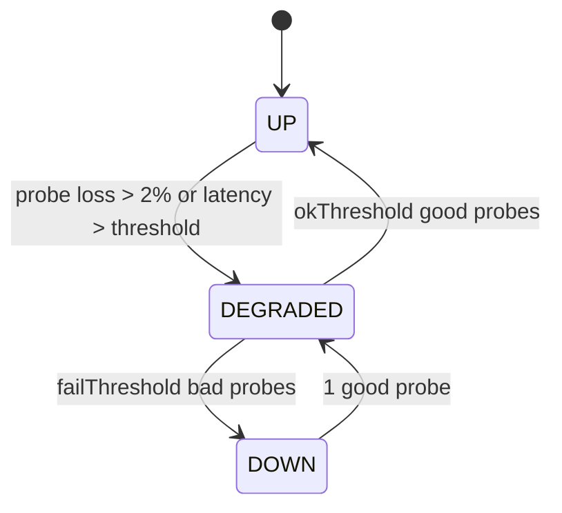

# M02 — Network

> TL;DR: Manages the appliance's L2/L3 plumbing in the console: interfaces (physical, VLAN, bridge, bond, GRE), static routing, and multi-WAN policies with probe-driven failover. Views `#/network/interfaces`, `#/network/routing`, `#/network/wan`.

Related: [PROJECT_MEMORY](../00-PROJECT-MEMORY/PROJECT_MEMORY.md) (§7.2, §7.3, §8) · [SCHEMA](../03-DATABASE/SCHEMA.md) (§4 JSON shapes) · [ER_DIAGRAM](../03-DATABASE/ER_DIAGRAM.md) (Zone/iface/WanPolicy relations) · [ENDPOINTS](../04-API/ENDPOINTS.md) · [PAGE_MAP](../05-FRONTEND/PAGE_MAP.md) · [UI_DESIGN_SYSTEM](../05-FRONTEND/UI_DESIGN_SYSTEM.md) · [SIMULATION_LAYER](../02-ARCHITECTURE/SIMULATION_LAYER.md) (§3 interfaces, §5 WAN state machine) · M01 (WAN strip) · M03 (zones consume interfaces)

---

## 1. Purpose & Scope (Phase 1)

M02 lets a network admin bring the appliance online: assign WAN/LAN/DMZ roles, configure addressing (static/DHCP/PPPoE), create logical interfaces (VLAN/bridge/bond/GRE), add static and blackhole routes, and survive a WAN outage via multi-WAN policies (priority, failover, load balance) with health probes.

Derived from upstream spec §1.2 (Interfaces) and §1.3 (Routing) Phase 1 tables, **trimmed to what the console manages in Phase 1**:

| Upstream Phase 1 feature | Console Phase 1 decision |
|---|---|
| Physical, VLAN, bridge, bond, GRE, MTU/MSS clamp, WAN static/DHCP/PPPoE, diagnostics (link speed, errors, drops) | IN — this spec |
| Loopback interface | Type exists in the schema (`loopback`); no create dialog in Phase 1 (seed only) |
| STP/RSTP on bridges | Reduced to the `stp?: boolean` flag in bridge `config`; no per-port STP tuning |
| L2/L3 mode toggle | OUT of console Phase 1 — role (`wan/lan/dmz/vpn/mgmt/unused`) covers the intent; deferred (build decision, ROADMAP §5) |
| LLDP neighbor discovery, IGMP snooping, MAC table, port mirroring/SPAN | OUT of console Phase 1 (build decision, ROADMAP §5) — spec keeps them Phase 1 appliance-side; no console config model exists yet |
| Interface diagnostics | Reduced to per-iface stats dialog (`/interfaces/{id}/stats`): counters + simulated errors/drops |
| Policy-based routing, route monitoring/BFD | OUT of console Phase 1 (build decision, ROADMAP §5) — spec keeps PBR/BFD Phase 1 appliance-side via FRR; `StaticRoute` model has no PBR fields |
| Default route management | Covered as a static route with `destinationCidr = "0.0.0.0/0"` |
| Floating static routes | IN via `distance` (lower wins) |
| Multi-WAN failover / load balance / probes | IN (console-managed; probe execution simulated) |
| IPv6 dual-stack | OUT — Phase 2 |

## 2. Data Model

Reference: [SCHEMA](../03-DATABASE/SCHEMA.md) §3 (models), §4 (JSON shapes).

| Model | Fields used here | Notes |
|---|---|---|
| `NetworkInterface` | `name`, `type` (`physical\|vlan\|bridge\|bond\|loopback\|gre`), `role` (`wan\|lan\|dmz\|vpn\|mgmt\|unused`), `parentName`, `vlanId`, `mtu` (default 1500), `mssClamp?`, `enabled`, `config` (JSON, shape per type), `description`, `zoneId?` | unique per tenant on `(tenantId, name)`; `zoneId` is a hard FK to `Zone` (SET NULL on zone delete) |
| `NetworkInterface.config` (physical) | `{ mac?, speedMbps?, duplex?, wanType?: "static"\|"dhcp"\|"pppoe", ip?, cidrPrefix?, gateway?, dns?: string[], pppoe?: { user, password, service? } }` | `wanType` values locked: `static` `dhcp` `pppoe` (PROJECT_MEMORY §6); PPPoE password resolved — see SCHEMA.md §4 |
| `NetworkInterface.config` (vlan) | `{ parent: string }` | `vlanId` is its own column |
| `NetworkInterface.config` (bridge) | `{ members: string[], stp?: boolean }` | members are iface names |
| `NetworkInterface.config` (bond) | `{ members: string[], mode: "active-backup"\|"802.3ad"\|"balance-xor" }` | — |
| `NetworkInterface.config` (gre) | `{ local: string, remote: string, ttl?: number }` | — |
| `StaticRoute` | `name?`, `destinationCidr`, `gateway?` (null when blackhole), `interfaceName?`, `distance` (default 1), `blackhole`, `enabled`, `description` | — |
| `WanPolicy` | `interfaceName` (unique per tenant, FK → `interfaces.name`), `mode` (`priority\|failover\|load_balance`), `weight` (load_balance %), `priority` (lower = preferred), `probeType` (`icmp\|tcp\|dns\|http`), `probeTarget`, `intervalSec`, `timeoutMs`, `failThreshold`, `okThreshold`, `state` (`up\|degraded\|down\|unknown`), `enabled` | one policy per interface |
| `Zone` | read for zone assignment: `name`, `type`, `interfaceNames` (JSON array of iface **names**) | logical ref — see integrity rules below |

Integrity rules ([ER_DIAGRAM](../03-DATABASE/ER_DIAGRAM.md) §2/§3):

- `WanPolicy.interfaceName` → hard FK by name; deleting an interface deletes its WAN policy first (service layer).
- `Zone.interfaceNames` is a **logical reference** (strings, not ids). On interface delete, the service layer removes the name from any zone's list; on zone save, every name must exist → else `400 VALIDATION_ERROR`.
- `iface.zoneId` and `zone.interfaceNames` must be kept consistent by the service layer on both zone edits and interface edits.

## 3. API Surface

Paths verbatim from PROJECT_MEMORY §7.2:

| METHOD | Path | Purpose | Triggering UI action |
|---|---|---|---|
| GET | `/api/v1/interfaces` | list (with live stats) | `#/network/interfaces` load |
| POST | `/api/v1/interfaces` | create (vlan/bridge/bond/gre) | "Add interface" dialog (type selector) |
| GET | `/api/v1/interfaces/{id}` | detail | edit dialog load / stats dialog |
| PUT | `/api/v1/interfaces/{id}` | update (ip config, mtu, role, zone…) | edit dialog save |
| DELETE | `/api/v1/interfaces/{id}` | delete (non-physical only) | row menu → delete (physical rows: action hidden) |
| GET | `/api/v1/interfaces/{id}/stats` | per-iface counters | "Stats" row action opens dialog |
| GET | `/api/v1/routes` | static routes list | `#/network/routing` load |
| POST | `/api/v1/routes` | create route | "Add route" dialog |
| PUT | `/api/v1/routes/{id}` | edit route | edit dialog save |
| DELETE | `/api/v1/routes/{id}` | delete route | row delete action |
| GET | `/api/v1/wan-policies` | multi-WAN policies + probe states | `#/network/wan` load |
| POST | `/api/v1/wan-policies` | create policy | "Add WAN policy" (iface not covered yet) |
| PUT | `/api/v1/wan-policies/{id}` | edit policy | policy editor save |
| DELETE | `/api/v1/wan-policies/{id}` | remove policy | row delete action |
| POST | `/api/v1/wan-policies/{id}/probe` | force probe now | "Probe now" button |

Query params/filters: `GET /api/v1/interfaces` uses additive field filters `?type=` and `?role=` (standard field-filter convention, PROJECT_MEMORY §7.1) for the table's filter chips; `GET /api/v1/wan-policies` returns embedded current `state` (no pagination needed at sandbox scale).

Expected error cases:

| Case | Result |
|---|---|
| `DELETE /interfaces/{id}` on `type = physical` | `400 VALIDATION_ERROR` — physical interfaces cannot be deleted, only disabled |
| Interface name collision | `409 CONFLICT` (unique `tenantId+name`) |
| Zone save referencing unknown iface name | `400 VALIDATION_ERROR` with the offending name in `details` |
| `WanPolicy` for nonexistent `interfaceName` | `400 VALIDATION_ERROR` |
| Second WAN policy for same iface | `409 CONFLICT` |
| `POST /wan-policies/{id}/probe` on disabled policy | `400 VALIDATION_ERROR` |
| Route with `blackhole = true` and non-null `gateway` | `400 VALIDATION_ERROR` (service nulls or rejects — rejects, keep payload honest) |
| Deleting an interface still referenced by a `StaticRoute.interfaceName` | service nulls the route's interface (documented behavior; no 409) |

## 4. Views & Interactions

### `#/network/interfaces`

- **Table**: name, type badge, role badge, zone, address summary (from `config`), VLAN/bond details, MTU, MSS, live rx/tx (updates from socket), link/enabled status, actions (edit, stats, enable/disable, delete where allowed).
- Live rx/tx per row: client keeps the latest `metrics:tick` per iface name; small inline sparkline (2 min) per row, rose/amber accents only per [UI_DESIGN_SYSTEM](../05-FRONTEND/UI_DESIGN_SYSTEM.md).
- **Create dialog** (type selector gates fields): VLAN (`parent` select of physical ifaces, `vlanId` 1–4094, name auto-suggest `vlan<id>`), bridge (`members` multiselect, `stp` switch), bond (`members` multiselect, `mode` select), GRE (`local`, `remote` IP fields, `ttl`). All: role select, zone select, MTU, MSS clamp (optional), description.
- **Edit dialog**: physical WAN rows expose `wanType` radio (`static` → ip/cidr/gateway/dns list; `dhcp` → hostname override only; `pppoe` → user/password/service), MTU, MSS clamp, role, zone, description. Non-physical rows edit members/parent/settings + same shared fields.
- **Enable/disable** toggle anywhere on physical or logical ifaces; disabling a parent visually marks children (vlan/bridge members) as degraded in the table.
- **Stats dialog**: totals + windowed rates, simulated error/drop counters, "last 60 ticks" sparkline.
- Empty state: none expected (seed guarantees 7 ifaces); loading = table skeleton; errors = toast + retry.

### `#/network/routing`

- **Table**: destination CIDR, gateway (or "blackhole" chip), interface, distance, enabled toggle, actions.
- **Add/edit route dialog**: name (optional), destination CIDR (zod cidr validation), gateway (disabled + cleared when blackhole switch on), interface select (optional, from iface list), distance number (1–255), enabled.
- Route ordering is not user-managed; the table sorts by `destinationCidr` then `distance`.

### `#/network/wan`

- **Policy cards/table** (one per WAN iface): iface name, mode chip, weight/priority values, probe summary (`icmp → 1.1.1.1` every 5 s), thresholds, current `state` badge (up=emerald, degraded=amber, down=rose, unknown=zinc).
- **Failover explanation panel** (static explainer card): how `priority` (lower number preferred), `failover` (standby until active fails probes), and `load_balance` (per-connection hash weighted by `weight` %) choose the egress path; states which iface is currently active given live `state` values.
- **Policy editor dialog**: iface select (ifaces with `role = wan` and no policy yet, or existing), mode radio, weight slider (only load_balance), priority number, probe type select, probe target input (with sensible defaults per type), interval/timeout/thresholds number inputs, enabled toggle.
- **"Probe now" button** per row → `POST .../probe` → button shows spinner until state re-evaluates.

## 5. Business Logic & Validation

- **Zod validation** (`src/lib/validators/`): iface name regex `^[a-z0-9-]{1,15}$`, `vlanId` int 1–4094, MTU 68–9000, MSS clamp 536–1460 (only meaningful on WAN), CIDR/gateway `ipv4`/cidr checks, bond/bridge `members` ≥ 2 (bond) / ≥ 1 (bridge), GRE `local` ≠ `remote`, load_balance `weight` 1–99. `wanType`/`mode`/`probeType`/`role`/`type` use the locked enums (PROJECT_MEMORY §6).
- **Delete semantics:** physical interfaces are never deletable — disable instead. Deleting a logical interface: nulls `zoneId` (FK SET NULL), removes its name from `zones.interfaceNames` and any `StaticRoute.interfaceName`, deletes its `WanPolicy` first — all in one transaction + audit row.
- **MSS clamp semantics:** value applied as TCP MSS clamp on the iface (simulated: recorded only; appliance: nftables `tcp flags syn tcp option set mss <value>` on the egress WAN chain). Warn in UI when MTU < 1500 and no MSS clamp set.
- **Probe evaluation (simulated)** — per `wan_policies` row, the `wan-probes` generator runs the state machine from [SIMULATION_LAYER](../02-ARCHITECTURE/SIMULATION_LAYER.md) §5:

- **Force probe:** `/probe` runs one immediate probe cycle and re-evaluates thresholds; response carries the fresh `state`. Simulated probe success probability follows the active traffic profile (`msp_branch` flaps more — DATA_LIFECYCLE §3).
- **Egress selection (simulated, routing section of apply):** active WAN = lowest `priority` among `state = up` policies; if none up → `degraded` candidates by priority; `load_balance` splits new connections by `weight` across up ifaces; `failover` mode keeps the secondary idle until the primary leaves `up`. This mirrors upstream spec §1.3 and is what the failover explanation panel describes.
- **Appliance rendering (informational, spec §1.3):** multi-WAN is implemented with nftables marking new connections per policy (fwmark → `ip rule fwmark <mark> lookup <table>` with one route table per WAN), the Go health-probe service (ICMP/TCP/DNS/HTTP probes) flipping marks on state transitions, and `rp_filter=2` (loose) — or disabled on WAN ifaces — so asymmetric multi-WAN paths are not silently dropped; per-interface source routes keep replies symmetric. `load_balance` is per-connection flow hashing (nftables `numgen`/`jhash`), never per-packet.
- **Link states (simulated):** physical ifaces always up when `enabled`; VLAN/bond follow parent link; bridge up when ≥ 1 member up; GRE up when both endpoints configured and enabled. No operator-configurable link state exists.
- **applyConfig:** every interface/route/WAN mutation ends with `adapter.applyConfig("interfaces" | "routing")` → `config_versions` row + `config:updated` broadcast (PROJECT_MEMORY §12 recipe).

## 6. Realtime

| Event | UI reaction |
|---|---|
| `metrics:tick` | update per-row rx/tx values + row sparklines (`ifaces[]` filtered by iface name); feed stats dialog if open |
| `wan:status` | `{iface, state}` → update the matching WAN card badge; toast on transitions involving `down`; refetch `/wan-policies` debounced |
| `config:updated` | `section = interfaces` → invalidate `interfaces` + `zones` queries; `section = routing` → invalidate `routes` |

Subscribe `{ channels: ["metrics"] }` on all three views.

## 7. Acceptance Criteria (checklist)

- Given the seeded 7 interfaces, when `#/network/interfaces` loads, then all rows render with role, zone, and live rx/tx within one tick (≤ 2 s).
- Given a physical row, when the row menu opens, then "Delete" is absent and "Disable" is present.
- Given a VLAN create with `vlanId = 10` on `lan0`, when saved, then the row `vlan10` appears with `config.parent = "lan0"` and an audit row exists.
- Given a bridge create with zero members, when submitting, then `400 VALIDATION_ERROR` is surfaced inline on the members field.
- Given a bond `mode = "802.3ad"` with one member, when submitting, then the form blocks with "bond needs at least 2 members".
- Given `wanType = pppoe`, when the dialog shows, then user/password fields appear and static IP fields are hidden.
- Given a blackhole route, when saved, then `gateway` is null in the payload and the table shows a "blackhole" chip.
- Given `wan0` policy `state = down`, when the dashboard WAN strip is compared, then `#/network/wan` and the strip show the same state (single source: `wan_policies.state`).
- Given "Probe now" clicked on `wan1`, when the request returns, then the card state updates to the returned `state` without a manual reload.
- Given `wan:status {iface: "wan1", state: "up"}`, when received, then the badge flips to emerald and a toast fires only if the previous state was `down`.
- Given an interface referenced by zone `LAN`, when deleted, then `zone.interfaceNames` no longer contains it and `#/firewall/zones` reflects the change after `config:updated`.
- Given MTU 1400 with no MSS clamp on `wan0`, when the edit dialog opens, then an amber inline hint suggests setting an MSS clamp.

## 8. Open Questions & Risks

- **`wan1` seeded disabled + DHCP:** failover demos need the failover path exercisable; confirm the generator can bring `wan1` up on enable without a manual apply.
- **Route/interface soft references:** `StaticRoute.interfaceName` silently nulls on iface delete — confirm this is intended vs. 409 (routes are cheap to re-point, current behavior is pragmatic).
- **Live stats payload:** `/interfaces` list "with live stats" is not shape-pinned (per-row `rxKbps/txKbps`?) — ENDPOINTS.md must define it; else rows rely solely on `metrics:tick`.
- Probe target defaults per type (icmp → IP, dns → resolver, http → URL) should be centralized in validators to avoid three divergent default tables.
