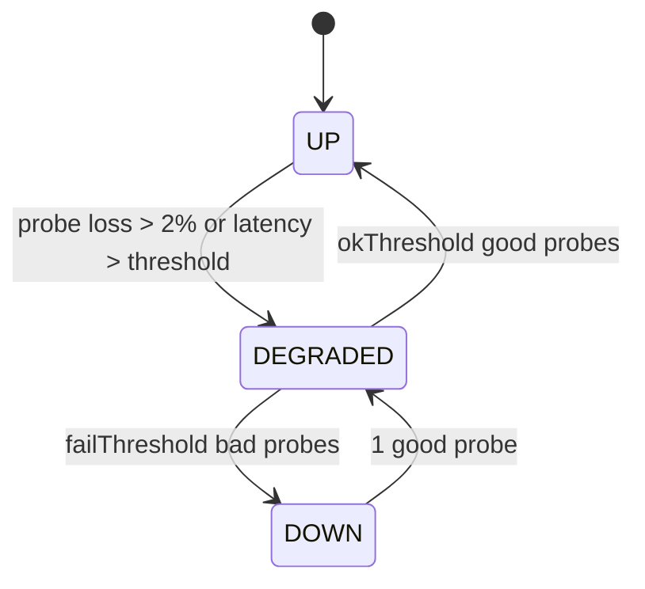

# M02 — Network

> TL;DR: Manages the appliance's L2/L3 plumbing in the console: interfaces (physical, VLAN, bridge, bond, GRE, IPIP), static routing, policy-based routing, switching extras (LLDP, MAC/FDB table, SPAN mirroring), and multi-WAN policies with probe-driven failover. Views `#/network/interfaces` (tabs: Interfaces | LLDP Neighbors | MAC Table | Mirroring), `#/network/routing` (tabs: Static Routes | Policy-Based Routes), `#/network/wan`.

Related: [PROJECT_MEMORY](../00-PROJECT-MEMORY/PROJECT_MEMORY.md) (§7.2, §7.3, §8) · [SCHEMA](../03-DATABASE/SCHEMA.md) (§4 JSON shapes) · [ER_DIAGRAM](../03-DATABASE/ER_DIAGRAM.md) (Zone/iface/WanPolicy relations) · [ENDPOINTS](../04-API/ENDPOINTS.md) · [PAGE_MAP](../05-FRONTEND/PAGE_MAP.md) · [UI_DESIGN_SYSTEM](../05-FRONTEND/UI_DESIGN_SYSTEM.md) · [SIMULATION_LAYER](../02-ARCHITECTURE/SIMULATION_LAYER.md) (§3 interfaces, §5 WAN state machine) · M01 (WAN strip) · M03 (zones consume interfaces)

---

## 1. Purpose & Scope (Phase 1)

M02 lets a network admin bring the appliance online: assign WAN/LAN/DMZ roles, configure addressing (static/DHCP/PPPoE), create logical interfaces (VLAN/bridge/bond/GRE), add static and blackhole routes, and survive a WAN outage via multi-WAN policies (priority, failover, load balance) with health probes.

Derived from upstream spec §1.2 (Interfaces) and §1.3 (Routing) Phase 1 tables — **fully covered per the owner zero-loss ruling (REVIEW-4A); the former console deferrals are restored**:

| Upstream Phase 1 feature | Console Phase 1 decision |
|---|---|
| Physical, VLAN, bridge, bond, GRE, MTU/MSS clamp, WAN static/DHCP/PPPoE, diagnostics (link speed, errors, drops) | IN — this spec |
| Loopback interface | IN — create/edit supported in the type selector (address-only logical iface; seed provides one) |
| IPIP tunnels | IN — `type = "ipip"`, `config: { local, remote }` (restored REVIEW-4A) |
| Interface L2/L3 mode toggle | IN — `mode` column (`l2\|l3`, default `l3`); when `l2`, IP/WAN fields are hidden in the editor (restored REVIEW-4A) |
| LLDP neighbor discovery | IN — per-iface `config.lldp` toggle + live neighbor table (`GET /api/v1/network/lldp-neighbors`, engine-derived) in the LLDP Neighbors tab (restored REVIEW-4A) |
| STP/RSTP on bridges | IN — bridge `stp` flag + `stpMode` (`stp\|rstp`) |
| IGMP snooping | IN — bridge `igmpSnooping` flag (bridge editor switch; appliance: bridge + mcproxy) (restored REVIEW-4A) |
| MAC table management | IN — live FDB view (`GET /api/v1/network/mac-table`, engine-derived) with iface/VLAN filters; static entries surface via DHCP reservations + bridge membership (restored REVIEW-4A) |
| Port mirroring / SPAN | IN — `PortMirror` config rows + Mirroring tab (restored REVIEW-4A; capture target feeds the IPS `passive` tap) |
| Interface diagnostics | IN — per-iface stats dialog (`/interfaces/{id}/stats`): counters + simulated errors/drops |
| Policy-based routing (source/dest) | IN — `PbrRule` model + Policy-Based Routes tab (restored REVIEW-4A) |
| Route monitoring / reachability (FRR + BFD) | IN — `StaticRoute.bfd` toggle + BFD state column (engine-simulated up/down) (restored REVIEW-4A) |
| Default route management | Covered as a static route with `destinationCidr = "0.0.0.0/0"` |
| Floating static routes | IN via `distance` (lower wins) |
| Multi-WAN failover / load balance / probes | IN (console-managed; probe execution simulated) |
| IPv6 dual-stack | OUT — Phase 2 (spec's own cut line; not a Phase-1 feature) |

## 2. Data Model

Reference: [SCHEMA](../03-DATABASE/SCHEMA.md) §3 (models), §4 (JSON shapes).

| Model | Fields used here | Notes |
|---|---|---|
| `NetworkInterface` | `name`, `type` (`physical\|vlan\|bridge\|bond\|loopback\|gre\|ipip`), `mode` (`l2\|l3`, default `l3`), `role` (`wan\|lan\|dmz\|vpn\|mgmt\|unused`), `parentName`, `vlanId`, `mtu` (default 1500), `mssClamp?`, `enabled`, `config` (JSON, shape per type), `description`, `zoneId?` | unique per tenant on `(tenantId, name)`; `zoneId` is a hard FK to `Zone` (SET NULL on zone delete) |
| `NetworkInterface.config` (physical) | `{ mac?, speedMbps?, duplex?, wanType?: "static"\|"dhcp"\|"pppoe", ip?, cidrPrefix?, gateway?, dns?: string[], pppoe?: { user, password, service? }, lldp?: boolean }` | `wanType` values locked: `static` `dhcp` `pppoe` (PROJECT_MEMORY §6); PPPoE password resolved — see SCHEMA.md §4; `lldp` default true |
| `NetworkInterface.config` (vlan) | `{ parent: string }` | `vlanId` is its own column |
| `NetworkInterface.config` (bridge) | `{ members: string[], stp?: boolean, stpMode?: "stp"\|"rstp", igmpSnooping?: boolean }` | members are iface names |
| `NetworkInterface.config` (bond) | `{ members: string[], mode: "active-backup"\|"802.3ad"\|"balance-xor" }` | — |
| `NetworkInterface.config` (gre) | `{ local: string, remote: string, ttl?: number }` | — |
| `NetworkInterface.config` (ipip) | `{ local: string, remote: string }` | proto-41 tunnel |
| `StaticRoute` | `name?`, `destinationCidr`, `gateway?` (null when blackhole), `interfaceName?`, `distance` (default 1), `bfd` (BFD monitoring toggle), `blackhole`, `enabled`, `description` | BFD state is engine-simulated (up/down per next-hop reachability) |
| `PbrRule` | `name`, `position`, `enabled`, `srcAddrIds`/`dstAddrIds`/`serviceIds` (mixed object+group ids), `outgoingIface?` xor `gateway?`, `description` | policy-based routing; appliance = fwmark → `ip rule` per-WAN tables |
| `PortMirror` | `name`, `srcIface`, `dstIface`, `direction` (`ingress\|egress\|both`), `enabled`, `description` | SPAN session; `srcIface`/`dstIface` are logical refs to `interfaces.name` |
| `WanPolicy` | `interfaceName` (unique per tenant, FK → `interfaces.name`), `mode` (`priority\|failover\|load_balance`), `weight` (load_balance %), `priority` (lower = preferred), `probeType` (`icmp\|tcp\|dns\|http`), `probeTarget`, `intervalSec`, `timeoutMs`, `failThreshold`, `okThreshold`, `state` (`up\|degraded\|down\|unknown`), `enabled` | one policy per interface |
| `Zone` | read for zone assignment: `name`, `type`, `interfaceNames` (JSON array of iface **names**) | logical ref — see integrity rules below |

Integrity rules ([ER_DIAGRAM](../03-DATABASE/ER_DIAGRAM.md) §2/§3):

- `WanPolicy.interfaceName` → hard FK by name; deleting an interface deletes its WAN policy first (service layer).
- `Zone.interfaceNames` is a **logical reference** (strings, not ids). On interface delete, the service layer removes the name from any zone's list; on zone save, every name must exist → else `400 VALIDATION_ERROR`.
- `iface.zoneId` and `zone.interfaceNames` must be kept consistent by the service layer on both zone edits and interface edits.

## 3. API Surface

Paths verbatim from PROJECT_MEMORY §7.2:

| METHOD | Path | Purpose | Triggering UI action |
|---|---|---|---|
| GET | `/api/v1/interfaces` | list (with live stats) | `#/network/interfaces` load |
| POST | `/api/v1/interfaces` | create (vlan/bridge/bond/gre/ipip/loopback) | "Add interface" dialog (type selector) |
| GET | `/api/v1/interfaces/{id}` | detail | edit dialog load / stats dialog |
| PUT | `/api/v1/interfaces/{id}` | update (ip config, mtu, role, zone…) | edit dialog save |
| DELETE | `/api/v1/interfaces/{id}` | delete (non-physical only) | row menu → delete (physical rows: action hidden) |
| GET | `/api/v1/interfaces/{id}/stats` | per-iface counters | "Stats" row action opens dialog |
| GET | `/api/v1/network/lldp-neighbors` | derived LLDP neighbor table (live) | LLDP Neighbors tab load (10 s auto-refresh) |
| GET | `/api/v1/network/mac-table` | derived bridge FDB view (`?iface=&vlan=&q=`) | MAC Table tab load + filters |
| GET | `/api/v1/network/port-mirrors` | list SPAN sessions | Mirroring tab load |
| POST | `/api/v1/network/port-mirrors` | create mirror session | "Add mirror" dialog |
| PUT | `/api/v1/network/port-mirrors/{id}` | update mirror session | mirror editor save / toggle |
| DELETE | `/api/v1/network/port-mirrors/{id}` | delete mirror session | row delete action |
| GET | `/api/v1/network/app-catalog` | nDPI app-label catalog | (consumed by M03/M08 pickers; listed for completeness) |
| GET | `/api/v1/routes` | static routes list | `#/network/routing` load |
| POST | `/api/v1/routes` | create route | "Add route" dialog |
| PUT | `/api/v1/routes/{id}` | edit route | edit dialog save |
| DELETE | `/api/v1/routes/{id}` | delete route | row delete action |
| GET | `/api/v1/pbr-rules` | policy-based routing rules (ordered) | Policy-Based Routes tab load |
| POST | `/api/v1/pbr-rules` | create PBR rule | "Add policy route" dialog |
| PUT | `/api/v1/pbr-rules/{id}` | edit PBR rule | editor save |
| DELETE | `/api/v1/pbr-rules/{id}` | delete PBR rule | row delete action |
| PATCH | `/api/v1/pbr-rules/{id}/toggle` | `{enabled}` — optimistic | row enable switch |
| GET | `/api/v1/wan-policies` | multi-WAN policies + probe states | `#/network/wan` load |
| POST | `/api/v1/wan-policies` | create policy | "Add WAN policy" (iface not covered yet) |
| PUT | `/api/v1/wan-policies/{id}` | edit policy | policy editor save |
| DELETE | `/api/v1/wan-policies/{id}` | remove policy | row delete action |
| POST | `/api/v1/wan-policies/{id}/probe` | force probe now | "Probe now" button |

Query params/filters: `GET /api/v1/interfaces` uses additive field filters `?type=` and `?role=` (standard field-filter convention, PROJECT_MEMORY §7.1) for the table's filter chips; `GET /api/v1/wan-policies` returns embedded current `state` (no pagination needed at sandbox scale).

Expected error cases:

| Case | Result |
|---|---|
| `DELETE /interfaces/{id}` on `type = physical` | `400 VALIDATION_ERROR` — physical interfaces cannot be deleted, only disabled |
| Interface name collision | `409 CONFLICT` (unique `tenantId+name`) |
| Zone save referencing unknown iface name | `400 VALIDATION_ERROR` with the offending name in `details` |
| `WanPolicy` for nonexistent `interfaceName` | `400 VALIDATION_ERROR` |
| Second WAN policy for same iface | `409 CONFLICT` |
| `POST /wan-policies/{id}/probe` on disabled policy | `400 VALIDATION_ERROR` |
| Route with `blackhole = true` and non-null `gateway` | `400 VALIDATION_ERROR` (service nulls or rejects — rejects, keep payload honest) |
| PBR rule with both `outgoingIface` and `gateway` (or neither) | `400 VALIDATION_ERROR` |
| PBR/PortMirror referencing an unknown interface name | `400 VALIDATION_ERROR` (logical-ref check) |
| Second active mirror with the same `srcIface` | `409 CONFLICT` (one mirror per source iface) |
| Deleting an interface still referenced by a `StaticRoute.interfaceName` | service nulls the route's interface (documented behavior; no 409) |

## 4. Views & Interactions

### `#/network/interfaces` — 4 tabs: Interfaces | LLDP Neighbors | MAC Table | Mirroring (SPAN)

#### Tab 1 — Interfaces

- **Table**: name, type badge, mode chip (`L2`/`L3`), role badge, zone, address summary (from `config`; hidden when `mode = l2`), VLAN/bond details, MTU, MSS, live rx/tx (updates from socket), link/enabled status, actions (edit, stats, enable/disable, delete where allowed).
- Live rx/tx per row: client keeps the latest `metrics:tick` per iface name; small inline sparkline (2 min) per row, rose/amber accents only per [UI_DESIGN_SYSTEM](../05-FRONTEND/UI_DESIGN_SYSTEM.md).
- **Create dialog** (type selector gates fields): VLAN (`parent` select of physical ifaces, `vlanId` 1–4094, name auto-suggest `vlan<id>`), bridge (`members` multiselect, `stp` switch, `stpMode` select, `igmpSnooping` switch), bond (`members` multiselect, `mode` select), GRE (`local`, `remote` IP fields, `ttl`), IPIP (`local`, `remote`), loopback (address only). All: role select, zone select, MTU, MSS clamp (optional), `mode` radio (`l2`/`l3` — hides IP fields on `l2`), description.
- **Edit dialog**: physical WAN rows expose `wanType` radio (`static` → ip/cidr/gateway/dns list; `dhcp` → hostname override only; `pppoe` → user/password/service), LLDP switch, MTU, MSS clamp, role, zone, mode radio, description. Non-physical rows edit members/parent/settings + same shared fields.
- **Enable/disable** toggle anywhere on physical or logical ifaces; disabling a parent visually marks children (vlan/bridge members) as degraded in the table.
- **Stats dialog**: totals + windowed rates, simulated error/drop counters, "last 60 ticks" sparkline.
- Empty state: none expected (seed guarantees 7 ifaces); loading = table skeleton; errors = toast + retry.

#### Tab 2 — LLDP Neighbors

- **Table** (derived, engine ring; auto-refresh 10 s): local iface, chassis id (mono), system name, port id/desc, capabilities chips, last seen ("x s ago"). Filters: iface select, `q`.
- Info banner: "Churned by the simulated switching generator — not persisted (SIMULATION_LAYER §6)." Per-iface transmit toggles live in the Interfaces tab (`config.lldp`).

#### Tab 3 — MAC Table

- **Table** (derived FDB): MAC (mono), VLAN, iface, type badge (`dynamic` zinc / `static` emerald), age. Filters: iface, VLAN, `q`; manual refresh + 10 s auto-refresh.
- Static entries are derived from DHCP reservations + bridge membership; a row-level hint links `#/dns-dhcp/dhcp` ("reserve this MAC").

#### Tab 4 — Mirroring (SPAN)

- **Table**: name, src iface → dst iface, direction chip, enabled toggle, actions. "Add mirror" dialog: name, src iface select, dst iface select (marked "capture"), direction radio, enabled.
- Note card: mirrored traffic feeds the IPS `passive` (IDS) tap on the appliance (`tc mirred`); in sandbox mirrors are recorded config only.
- One active mirror per src iface (`409 CONFLICT` otherwise).

### `#/network/routing` — 2 tabs: Static Routes | Policy-Based Routes

#### Tab 1 — Static Routes

- **Table**: destination CIDR, gateway (or "blackhole" chip), interface, distance, BFD chip (on/off + engine state dot), enabled toggle, actions.
- **Add/edit route dialog**: name (optional), destination CIDR (zod cidr validation), gateway (disabled + cleared when blackhole switch on), interface select (optional, from iface list), distance number (1–255), BFD switch (disabled while blackhole), enabled.
- Route ordering is not user-managed; the table sorts by `destinationCidr` then `distance`.

#### Tab 2 — Policy-Based Routes (PBR)

- **Table** (ordered by `position`): pos, name, match summary (src → dst, service), action summary (`→ wan1` or `→ 192.0.2.1`), enabled toggle, actions (edit, delete).
- **Editor dialog**: name, position number, `ObjectPicker` for src/dst addresses + services (mixed object+group ids, same semantics as M03), egress radio: `outgoingIface` select **or** `gateway` IP input (mutually exclusive — enforced `400`), enabled.
- Appliance note (info card): matching connections are fwmarked into per-WAN policy tables (`ip rule fwmark`); PBR evaluates before the multi-WAN mode selection.

### `#/network/wan`

- **Policy cards/table** (one per WAN iface): iface name, mode chip, weight/priority values, probe summary (`icmp → 1.1.1.1` every 5 s), thresholds, current `state` badge (up=emerald, degraded=amber, down=rose, unknown=zinc).
- **Failover explanation panel** (static explainer card): how `priority` (lower number preferred), `failover` (standby until active fails probes), and `load_balance` (per-connection hash weighted by `weight` %) choose the egress path; states which iface is currently active given live `state` values.
- **Policy editor dialog**: iface select (ifaces with `role = wan` and no policy yet, or existing), mode radio, weight slider (only load_balance), priority number, probe type select, probe target input (with sensible defaults per type), interval/timeout/thresholds number inputs, enabled toggle.
- **"Probe now" button** per row → `POST .../probe` → button shows spinner until state re-evaluates.

## 5. Business Logic & Validation

- **Zod validation** (`src/lib/validators/`): iface name regex `^[a-z0-9-]{1,15}$`, `vlanId` int 1–4094, MTU 68–9000, MSS clamp 536–1460 (only meaningful on WAN), CIDR/gateway `ipv4`/cidr checks, bond/bridge `members` ≥ 2 (bond) / ≥ 1 (bridge), GRE/IPIP `local` ≠ `remote`, load_balance `weight` 1–99. `wanType`/`mode` (iface `l2|l3`)/`probeType`/`role`/`type`/`stpMode` use the locked enums (PROJECT_MEMORY §6). PBR rules: exactly one of `outgoingIface`/`gateway`; mirror `srcIface` ≠ `dstIface`, one active mirror per src iface (409).
- **L2/L3 mode semantics:** `mode = l2` means the iface switches (no L3 config; the service rejects IP/WAN fields with `400 VALIDATION_ERROR`); `l3` (default) routes. Bridges/physical trunk ports commonly run `l2`. Changing mode re-applies section `interfaces`.
- **IGMP snooping / STP:** bridge flags are rendered into the appliance bridge config (`multicast_snooping`, `stp`/`rstp` via mstpd); simulated — recorded only.
- **LLDP:** `config.lldp = true` (default) runs lldpd on the iface; the neighbor table is generator-fed (no persisted rows).
- **Delete semantics:** physical interfaces are never deletable — disable instead. Deleting a logical interface: nulls `zoneId` (FK SET NULL), removes its name from `zones.interfaceNames` and any `StaticRoute.interfaceName`, deletes its `WanPolicy` first — all in one transaction + audit row.
- **MSS clamp semantics:** value applied as TCP MSS clamp on the iface (simulated: recorded only; appliance: nftables `tcp flags syn tcp option set mss <value>` on the egress WAN chain). Warn in UI when MTU < 1500 and no MSS clamp set.
- **Probe evaluation (simulated)** — per `wan_policies` row, the `wan-probes` generator runs the state machine from [SIMULATION_LAYER](../02-ARCHITECTURE/SIMULATION_LAYER.md) §5:

- **Force probe:** `/probe` runs one immediate probe cycle and re-evaluates thresholds; response carries the fresh `state`. Simulated probe success probability follows the active traffic profile (`msp_branch` flaps more — DATA_LIFECYCLE §3).
- **Egress selection (simulated, routing section of apply):** active WAN = lowest `priority` among `state = up` policies; if none up → `degraded` candidates by priority; `load_balance` splits new connections by `weight` across up ifaces; `failover` mode keeps the secondary idle until the primary leaves `up`. This mirrors upstream spec §1.3 and is what the failover explanation panel describes.
- **Appliance rendering (informational, spec §1.3):** multi-WAN is implemented with nftables marking new connections per policy (fwmark → `ip rule fwmark <mark> lookup <table>` with one route table per WAN), the Go health-probe service (ICMP/TCP/DNS/HTTP probes) flipping marks on state transitions, and `rp_filter=2` (loose) — or disabled on WAN ifaces — so asymmetric multi-WAN paths are not silently dropped; per-interface source routes keep replies symmetric. `load_balance` is per-connection flow hashing (nftables `numgen`/`jhash`), never per-packet.
- **Link states (simulated):** physical ifaces always up when `enabled`; VLAN/bond follow parent link; bridge up when ≥ 1 member up; GRE up when both endpoints configured and enabled. No operator-configurable link state exists.
- **applyConfig:** every interface/route/PBR/WAN mutation ends with `adapter.applyConfig("interfaces" | "routing")` → `config_versions` row + `config:updated` broadcast (PROJECT_MEMORY §12 recipe).

## 6. Realtime

| Event | UI reaction |
|---|---|
| `metrics:tick` | update per-row rx/tx values + row sparklines (`ifaces[]` filtered by iface name); feed stats dialog if open |
| `wan:status` | `{iface, state}` → update the matching WAN card badge; toast on transitions involving `down`; refetch `/wan-policies` debounced |
| `config:updated` | `section = interfaces` → invalidate `interfaces` + `port-mirrors` + `zones` queries; `section = routing` → invalidate `routes` + `pbr-rules` |

Subscribe `{ channels: ["metrics"] }` on all three views.

## 7. Acceptance Criteria (checklist)

- Given the seeded 7 interfaces, when `#/network/interfaces` loads, then all rows render with role, zone, and live rx/tx within one tick (≤ 2 s).
- Given a physical row, when the row menu opens, then "Delete" is absent and "Disable" is present.
- Given a VLAN create with `vlanId = 10` on `lan0`, when saved, then the row `vlan10` appears with `config.parent = "lan0"` and an audit row exists.
- Given a bridge create with zero members, when submitting, then `400 VALIDATION_ERROR` is surfaced inline on the members field.
- Given a bond `mode = "802.3ad"` with one member, when submitting, then the form blocks with "bond needs at least 2 members".
- Given `wanType = pppoe`, when the dialog shows, then user/password fields appear and static IP fields are hidden.
- Given a blackhole route, when saved, then `gateway` is null in the payload and the table shows a "blackhole" chip.
- Given `wan0` policy `state = down`, when the dashboard WAN strip is compared, then `#/network/wan` and the strip show the same state (single source: `wan_policies.state`).
- Given "Probe now" clicked on `wan1`, when the request returns, then the card state updates to the returned `state` without a manual reload.
- Given `wan:status {iface: "wan1", state: "up"}`, when received, then the badge flips to emerald and a toast fires only if the previous state was `down`.
- Given an interface referenced by zone `LAN`, when deleted, then `zone.interfaceNames` no longer contains it and `#/firewall/zones` reflects the change after `config:updated`.
- Given MTU 1400 with no MSS clamp on `wan0`, when the edit dialog opens, then an amber inline hint suggests setting an MSS clamp.
- Given a bridge create with `igmpSnooping = true` and `stpMode = "rstp"`, when saved, then the config JSON stores both and the row renders an IGMP/RSTP chip.
- Given a physical iface with `config.lldp = true`, when the LLDP Neighbors tab opens, then neighbors on that iface appear within one 10 s refresh window (simulated churn).
- Given the MAC Table tab, when filtered by iface `br-mgmt`, then only FDB rows for that iface render and a static row appears per DHCP reservation on the bridge.
- Given a mirror `lan0 → wan2-capture` (direction both), when saved, then the Mirroring tab lists it and a second mirror with `srcIface = lan0` returns `409 CONFLICT`.
- Given an interface with `mode = l2`, when the editor submits an IP field, then `400 VALIDATION_ERROR` blocks the save and IP fields are visually disabled.
- Given a PBR rule `voip-via-wan1` (SIP service → wan1), when saved, then the Policy-Based Routes tab shows it at its position and the generator's egress selection prefers it over WAN-mode selection for matching flows (SIMULATION_LAYER §6 routing semantics).
- Given a static route with `bfd = true`, when the next hop is reachable, then the BFD chip shows emerald "up" (engine-simulated); stopping reachability flips it rose "down".
- Given a loopback create (`lo1`, 10.255.0.1/32), when saved, then the row appears (type `loopback`) and is deletable (non-physical).

## 8. Open Questions & Risks

- **`wan1` seeded disabled + DHCP:** failover demos need the failover path exercisable; confirm the generator can bring `wan1` up on enable without a manual apply.
- **Route/interface soft references:** `StaticRoute.interfaceName` silently nulls on iface delete — confirm this is intended vs. 409 (routes are cheap to re-point, current behavior is pragmatic).
- **Live stats payload:** `/interfaces` list "with live stats" is not shape-pinned (per-row `rxKbps/txKbps`?) — ENDPOINTS.md must define it; else rows rely solely on `metrics:tick`.
- Probe target defaults per type (icmp → IP, dns → resolver, http → URL) should be centralized in validators to avoid three divergent default tables.
- ~~LLDP/IGMP/MAC-table/SPAN/L2L3/PBR/BFD deferrals~~ RESOLVED (REVIEW-4A): all restored in this spec; derived tables (LLDP/MAC) are engine views — do not persist them.
- Mirror target ifaces should have `role = mgmt` or be non-WAN in practice; no hard validation enforced (operator freedom) — revisit if support tickets show capture-on-WAN misconfigurations.
