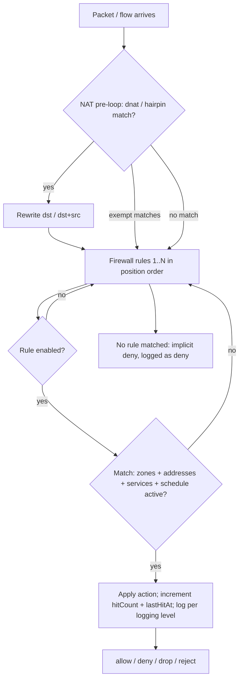

# M03 — Firewall & NAT

> TL;DR: The core security policy module: zone-based firewall rules with first-match-wins evaluation, NAT rules, the five object types rules reference, and zones themselves. Views `#/firewall/rules`, `#/firewall/nat`, `#/firewall/objects`, `#/firewall/zones`.

Related: [PROJECT_MEMORY](../00-PROJECT-MEMORY/PROJECT_MEMORY.md) (§6 enums, §7.2, §7.3, §12 recipe) · [SCHEMA](../03-DATABASE/SCHEMA.md) · [ER_DIAGRAM](../03-DATABASE/ER_DIAGRAM.md) §2/§3 (RESTRICT + mixed-id semantics — read before delete logic) · [ENDPOINTS](../04-API/ENDPOINTS.md) · [UI_DESIGN_SYSTEM](../05-FRONTEND/UI_DESIGN_SYSTEM.md) (RuleEditor, ObjectPicker, StatusBadge, DataTable) · [PAGE_MAP](../05-FRONTEND/PAGE_MAP.md) · [SIMULATION_LAYER](../02-ARCHITECTURE/SIMULATION_LAYER.md) §3/§6 (apply + log generator) · M02 (interfaces feed zones) · M04 (IPS policies attach) · M08 (QoS policies attach) · M09 (firewall logs)

---

## 1. Purpose & Scope (Phase 1)

M03 is where policy lives. An admin defines zones (grouping interfaces), address/service/schedule objects, then writes ordered firewall rules ("from zone A to zone B, for these services, allow/deny/drop/reject") and NAT rules (SNAT/masquerade, DNAT/port-forward, hairpin, exempt). The log generator then enforces what was written — blocked flows appear in `#/logs/firewall` — closing the "config → observable behavior" loop.

Derived from upstream spec §1.4 (Firewall) and §1.5 (NAT) Phase 1 tables, **trimmed to console Phase 1**:

| Upstream Phase 1 feature | Console Phase 1 decision |
|---|---|
| Zone-based firewall, L3/L4 rules, objects/groups, schedules, enable/disable, comments, hit counters, 4 actions, conn limit, rate limit, SYN protection, port forwarding, logging none/summary/detail, implicit deny logging, rule validation (shadow/conflict), import/export CSV+JSON, ICMP type filtering | IN — this spec |
| GeoIP filtering | IN as address object `type = geo` (matching simulated); no GeoIP DB management UI |
| FQDN-based rules | IN as address object `type = fqdn`; resolution + set updates simulated (no resolver-state UI) |
| App-aware rules (`applicationIds`), user-based rules (`userIds`), MAC filtering rules | OUT for the RuleEditor in Phase 1 — DB columns exist and are validated, but no pickers in the editor; deferred to [ROADMAP](../01-PRODUCT/ROADMAP.md) Phase 2 (app control / advanced identity) |
| Rule groups/categories | Reduced to free-form `tags` on rules (no rule-folder UI) |
| DNS security rules | Owned by M06 (DNS policies), not firewall rules |
| 1:1 NAT (static NAT) | No dedicated type — compose as `dnat` (no port) + `snat`; documented in the NAT editor hint |
| NAT pool management (ranges/overload), NAT logging toggle, DNAT port ranges | OUT — `translatedSrc` is a single IP or `"masq"`, `translatedPort` a single int; Phase 2 |
| NAT session timeouts per rule | OUT — Phase 2 |

## 2. Data Model

Reference: [SCHEMA](../03-DATABASE/SCHEMA.md) §3; JSON-array semantics: [ER_DIAGRAM](../03-DATABASE/ER_DIAGRAM.md) §3.

| Model | Fields used here | Notes |
|---|---|---|
| `Zone` | `name`, `type` (`L3\|L2\|VPN`), `interfaceNames` (JSON array of iface names), `description` | hard-FK children: `NetworkInterface.zoneId` (SET NULL on zone delete) |
| `AddressObject` | `name`, `type` (`ip\|range\|subnet\|fqdn\|geo\|wildcard`), `value` (format per type, e.g. `"10.0.0.5"`, `"10.0.0.5-10.0.0.20"`, `"10.0.0.0/24"`, `"example.com"`, `"DE"`, `"10.0.0.0 255.0.0.0"`), `description` | unique `(tenantId, name)` |
| `AddressGroup` | `name`, `memberIds` (JSON array of `address_objects.id`), `description` | logical ref; groups are flat (no nesting) in Phase 1 |
| `ServiceObject` | `name`, `protocol` (`tcp\|udp\|icmp\|any`), `srcPort?`, `dstPort?` (port lists like `"5000-5100,6000"`), `icmpType?`, `description` | — |
| `ServiceGroup` | `name`, `memberIds` (JSON array of `service_objects.id`), `description` | flat |
| `ScheduleObject` | `name`, `type` (`always\|recurring\|onetime`), `recurrence?` JSON `{days: number[], start: "HH:MM", end: "HH:MM"}` (1=Mon), `startsAt?`, `endsAt?`, `timezone` (IANA, default `UTC`) | hard FK from `FirewallRule.scheduleId` → **RESTRICT** on delete |
| `FirewallRule` | `name`, `description?`, `enabled`, `position`, `srcZoneIds`/`dstZoneIds` (JSON id arrays), `srcAddrIds`/`dstAddrIds` (**mixed** object+group ids), `serviceIds` (**mixed**), `applicationIds`, `userIds`, `scheduleId?`, `action` (`allow\|deny\|drop\|reject`), `logging` (`none\|summary\|detail`), `connLimit?`, `rateLimit?`, `synProtection`, `synThreshold?`, `ipsPolicyId?`, `qosPolicyId?`, `tags` (JSON string array), `comment?`, `hitCount`, `lastHitAt?` | ordered by `position`; index `(tenantId, enabled, position)` |
| `NatRule` | `name?`, `position`, `type` (`snat\|dnat\|hairpin\|exempt`), `enabled`, `srcAddrIds`/`dstAddrIds`/`serviceIds` (mixed, same semantics), `outgoingIface?`, `translatedSrc?` (ip or `"masq"`), `translatedDst?`, `translatedPort?`, `comment?`, `hitCount` | ordered by `position` |

Integrity rules:

- **Mixed id semantics:** `*AddrIds` and `serviceIds` deliberately mix object ids and group ids; UI pickers expand groups for display, the service layer validates every id exists in *either* table (ER_DIAGRAM §3). Never assume "all ids are objects".
- Unknown id in any JSON array on create/update → `400 VALIDATION_ERROR`.
- **Delete protection:** deleting an Address/Service object or group referenced by any rule (firewall or NAT) → `409 CONFLICT` with the referencing rule names in `details`. Deleting a `ScheduleObject` / `IpsPolicy` / `QosPolicy` referenced by `FirewallRule` → `409 CONFLICT` (RESTRICT, ER_DIAGRAM §2) — UI must ask the user to detach rules first.
- Empty array (`[]`) means **any** (no constraint); absent zone constraint = inter-zone any.

## 3. API Surface

Paths verbatim from PROJECT_MEMORY §7.2. All list endpoints paginate (`?page=&limit=`) and filter with `?q=`.

| METHOD | Path | Purpose | Triggering UI action |
|---|---|---|---|
| GET | `/api/v1/zones` | zones + member ifaces | `#/firewall/zones` load; also feeds zone pickers in RuleEditor |
| POST | `/api/v1/zones` | create zone | "Add zone" dialog |
| PUT | `/api/v1/zones/{id}` | edit zone (name, type, members) | zone editor save |
| DELETE | `/api/v1/zones/{id}` | delete zone | row delete (protected zones rejected) |
| GET | `/api/v1/address-objects` | list | objects view → Address tab |
| POST | `/api/v1/address-objects` | create | "Add object" dialog |
| PUT | `/api/v1/address-objects/{id}` | edit | dialog save |
| DELETE | `/api/v1/address-objects/{id}` | delete | row delete → may `409` |
| GET | `/api/v1/address-groups` | list (+ member names resolved) | Address Groups tab |
| POST/PUT/DELETE | `/api/v1/address-groups` (+`/{id}`) | group CRUD | group editor / row delete |
| GET | `/api/v1/service-objects` | list | Services tab |
| POST/PUT/DELETE | `/api/v1/service-objects` (+`/{id}`) | service CRUD | service editor / row delete |
| GET | `/api/v1/service-groups` | list | Service Groups tab |
| POST/PUT/DELETE | `/api/v1/service-groups` (+`/{id}`) | group CRUD | group editor / row delete |
| GET | `/api/v1/schedule-objects` | list | Schedules tab |
| POST/PUT/DELETE | `/api/v1/schedule-objects` (+`/{id}`) | schedule CRUD | schedule editor / row delete |
| GET | `/api/v1/firewall-rules` | ordered list (`?zone=&search=`) | `#/firewall/rules` load; zone filter chips |
| POST | `/api/v1/firewall-rules` | create rule | RuleEditor save (appends at end) |
| GET | `/api/v1/firewall-rules/{id}` | rule detail (hydrated names) | RuleEditor edit load |
| PUT | `/api/v1/firewall-rules/{id}` | update rule | RuleEditor save |
| DELETE | `/api/v1/firewall-rules/{id}` | delete rule | row delete |
| PATCH | `/api/v1/firewall-rules/{id}/toggle` | `{enabled}` | row switch (optimistic) |
| POST | `/api/v1/firewall-rules/reorder` | `{orderedIds: number[]}` | dnd-kit drag drop |
| GET | `/api/v1/firewall-rules/{id}/hits` | hit counters | counters popover refresh |
| POST | `/api/v1/firewall-rules/validate` | shadow/conflict check (no persist) | RuleEditor "Validate" + auto before save |
| POST | `/api/v1/firewall-rules/import` | `{format: json\|csv, payload}` | Import button |
| GET | `/api/v1/firewall-rules/export` | `?format=json\|csv` download | Export button |
| GET | `/api/v1/nat-rules` | ordered NAT list | `#/firewall/nat` load |
| POST/PUT/DELETE | `/api/v1/nat-rules` (+`/{id}`) | NAT CRUD | NAT editor / row actions |
| PATCH | `/api/v1/nat-rules/{id}/toggle` | `{enabled}` — optimistic | row enable switch |
| POST | `/api/v1/nat-rules/reorder` | `{orderedIds: number[]}` | dnd-kit drag drop |
| POST | `/api/v1/firewall-rules/{id}/hits/reset` | reset per-rule counters (audited) | "Reset counters" row action |

Expected error cases:

| Case | Result |
|---|---|
| Duplicate name (any object/zone/rule) | `409 CONFLICT` (unique `tenantId+name`) |
| Unknown id inside a JSON id array | `400 VALIDATION_ERROR` (offending id in `details`) |
| Delete object/group referenced by rules | `409 CONFLICT`, `details.referencedBy = [{ruleName, ruleType}]` |
| Delete schedule/IPS/QoS policy attached to rules | `409 CONFLICT` with rule names (RESTRICT) |
| Delete protected zone (`WAN`, `LAN`) | `409 CONFLICT` — service-level protection |
| Delete zone referenced by rules | `409 CONFLICT` with referencing rule names (zones are logical refs — same service-layer check as objects, ER_DIAGRAM §3) |
| `reorder` with missing/duplicate ids | `400 VALIDATION_ERROR` (must be a permutation of the tenant's rule ids) |
| Import payload invalid | `400 VALIDATION_ERROR` with per-row errors; no partial persist (all-or-nothing) |
| Toggle/PUT on nonexistent rule | `404 NOT_FOUND` |

## 4. Views & Interactions

### `#/firewall/rules`

- **Toolbar:** zone filter chips (All, WAN, LAN, DMZ, VPN…), search box (`?search=`), Add rule, Import, Export; per-row kebab carries "Reset counters" → `POST /{id}/hits/reset` (audited, §5).
- **Table** (ordered, row number = evaluation order): position, enable switch, name (+comment tooltip), action badge (allow=emerald, deny/drop=rose-600, reject=orange-500 — UI_DESIGN_SYSTEM §2.3), src zone → dst zone chips, src/dst addresses (resolved object/group names, groups suffixed "+N"), services, schedule icon, protections icons (conn limit / rate limit / SYN), hits + last hit, actions (edit, duplicate, delete). Drag handle reorders via dnd-kit → `POST /firewall-rules/reorder` with the full new id order.
- **RuleEditor dialog** (shared component, per [UI_DESIGN_SYSTEM](../05-FRONTEND/UI_DESIGN_SYSTEM.md)): sections —
  - General: name, description, tags input, comment.
  - Match: src/dst zone multi-pick (empty = any), src/dst address `ObjectPicker` (groups shown expandable; selecting a group stores the **group id**), services picker (same mixed semantics), schedule picker (`ScheduleObject` list + "always").
  - Action: radio `allow|deny|drop|reject`; logging radio `none|summary|detail`.
  - Protections: `connLimit`, `rateLimit` (conn/s per source), SYN protection switch + `synThreshold` (visible when on).
  - Attachments: IPS policy select (from M04), QoS policy select (from M08) — read-only lists fetched from their modules.
  - Footer: "Validate" runs `POST /firewall-rules/validate` → inline warnings panel (shadow/conflict/redundant, referencing rule positions); Save disabled while blocking errors exist (see §5).
- **Hit counters popover:** per-row `GET /{id}/hits` showing `hitCount`, `lastHitAt`, plus per-action breakdown if provided.
- **Import dialog:** format radio json/csv, file drop, preview of parsed rows, confirm → `POST /import`. **Export** menu: JSON / CSV → `GET /export?format=…` triggers download.
- Empty state (no rules): EmptyState with "All traffic falls through to implicit deny" explainer + Add button.

### `#/firewall/nat`

- **Table** ordered by position: pos, enable switch, name, type badge (snat/dnat/hairpin/exempt), match summary (src → dst, service, outgoing iface), translation summary (e.g. `→ masq`, `8080 → 172.16.20.5:80`), hits, actions.
- **NAT editor dialog:** type selector gates fields — `snat`: outgoing iface + `translatedSrc` (ip input or "masquerade" switch storing `"masq"`); `dnat`: `translatedDst` + optional `translatedPort`; `hairpin`: both (helper text: for LAN clients reaching a DNAT'd public IP from inside); `exempt`: translation fields disabled (identity NAT). Match pickers reuse `ObjectPicker`.
- **Port-forward wizard** (button on dnat rows / toolbar): 3 steps — 1) WAN iface + external port + protocol, 2) internal host (address object or ip) + internal port, 3) preview generated `dnat` rule (+ suggested matching firewall allow rule, one-click create). Wizard emits the same PUT/POST payloads as the editor.

### `#/firewall/objects` — 5 tabs (view map §8: Address | Address Groups | Services | Service Groups | Schedules)

- Each tab: DataTable (name, type/value summary, referenced-by count, actions) + Add/Edit dialog per type.
- **Address dialog:** name, type select with per-type value field + placeholder (ip / range / subnet / fqdn / geo (country code) / wildcard), description.
- **Group dialogs:** name + member transfer-list (search, available vs. chosen); members stored as raw object ids in `memberIds`.
- **Service dialog:** name, protocol radio, src/dst port string inputs (validated `"80"`, `"5000-5100,6000"`), icmp type (when protocol=icmp), description.
- **Schedule dialog:** name, type radio — `always`; `recurring` (weekday toggles 1–7, start/end time, IANA timezone select default from system settings); `onetime` (start/end datetime). Shows computed "active now" hint client-side.
- Delete anywhere: ConfirmDialog; on `409 CONFLICT` render the referencing-rules list from `details` with links to `#/firewall/rules`.

### `#/firewall/zones`

- **Zone cards/table:** name, type badge (L3/L2/VPN), member interface chips, description, actions.
- **Zone editor dialog:** name, type radio, interface multiselect (only unassigned ifaces + current members; assigning moves `zoneId` and updates both sides of the relation), description.
- Protected rows `WAN` and `LAN`: delete hidden, edit allowed except name/type (tooltip explains).

## 5. Business Logic & Validation

### Position ordering

- `position` is dense `1..N`; top of the table = evaluated first. New rules append at `max+1`. Duplicate → edit dialog offers "insert at position" (server renumbers). `reorder` accepts the full `orderedIds` permutation and renumbers in one transaction.

### Evaluation (first match wins)

- Empty `srcZoneIds`/`dstZoneIds`/`*AddrIds`/`serviceIds` = wildcard for that dimension.
- Zone match is by id set membership; addresses: groups expanded at apply time (mixed ids), `fqdn`/`geo`/`wildcard` matched by the simulated resolver/geo sets.
- Schedule gating: rule matches only while its schedule is active in the schedule's timezone (`always` always active; `recurring` per `days`+window; `onetime` between `startsAt`/`endsAt`).
- Implicit deny: no rule matched → deny, emitted by the generator with `rule_name = "implicit deny"` so `#/logs/firewall` shows it (upstream spec: implicit deny logging).

### Shadow / conflict detection (validate endpoint, no persist)

For candidate rule R vs each enabled existing rule E with lower position, compare match scopes per dimension (zone set, address set after group expansion, service set, app/user if set, schedule window). Response shape is the one pinned in ENDPOINTS.md §5: `{ ok, conflicts: [{ ruleId, ruleName, reason, withRuleId, withRuleName }] }` — `ok` is `true` when `conflicts` is empty:

| `reason` | Condition | UI severity |
|---|---|---|
| `shadowed_by` | E ⊇ R on every dimension AND `E.action != R.action` | error — R can never trigger for overlapping traffic |
| `conflicts_with` | R ⊆ E and E ⊆ R (identical scope) with different actions | error — contradictory duplicates |
| `redundant` | E ⊇ R on every dimension AND same action | warning — R unreachable / duplicate |

The RuleEditor renders them inline; `shadowed_by`/`conflicts_with` block Save unless "Save anyway" is clicked (which records the warning text into the rule `comment`). The same pure function powers the import preview.

### Protections semantics

- `connLimit`: max concurrent connections per source matched by the rule (nftables `ct count`); excess → drop rows in logs.
- `rateLimit`: new connections/s per source above the limit → dropped.
- `synProtection` + `synThreshold`: SYN-flood guard on the rule's match scope; above threshold, SYN cookies / drops (simulated: burst flows above threshold produce `drop` rows).

### Hit counters

- Incremented by the firewall-log generator per matched flow (SIMULATION_LAYER §6: `rule_name` = matched rule, hits increment `hit_count` + `last_hit_at`). `GET /{id}/hits` returns the current values; `POST /{id}/hits/reset` zeroes them (audited, per-rule — there is intentionally no "reset all" endpoint in Phase 1).

### applyConfig + simulation loop

- Every mutation ends with `adapter.applyConfig("firewall")` or `("nat")`; object/zone mutations snapshot under section `firewall` (allowed `ConfigVersion.section` values are locked in SCHEMA §3). Each apply: `audit_log` + `config_versions` snapshot + `config:updated {section}` broadcast (PROJECT_MEMORY §12, SIMULATION_LAYER §3).
- Simulated enforcement: after apply, the `firewall-logs` generator immediately respects the new ruleset — blocked flows produce `firewall_logs` rows with `action = drop|deny` and the matching `rule_name`; NAT hit counters increment per translated flow. Reordering rules changes which rule name shows up in generated logs.

## 6. Realtime

| Event | UI reaction |
|---|---|
| `config:updated` | `section = firewall` → invalidate `firewall-rules`, `zones`, `address-objects`, `address-groups`, `service-objects`, `service-groups`, `schedule-objects` query keys; `section = nat` → invalidate `nat-rules` |
| `logs:tail` | `kind = "firewall"` entries matching an open rules view pulse the matching rule row's hit counter (optional, cheap match on `ruleName`); full log UI is M09 |

Subscribe `{ channels: ["logs"] }` only while `#/firewall/rules` is visible (hit pulse); otherwise no log subscription needed in this module.

## 7. Acceptance Criteria (checklist)

- Given 12 seeded rules, when `#/firewall/rules` loads, then rows render strictly by `position` starting at 1 and the generator's next log row matches the first matching enabled rule.
- Given a drag from position 8 to 2, when dropped, then `POST /reorder` fires with all 12 ids, positions renumber densely, and no gap appears after refresh.
- Given a rule toggle clicked, when the request is in flight, then the switch shows the new state immediately and reverts + toast on failure (optimistic).
- Given a new rule shadowed by an earlier broader `allow`, when Validate runs, then an error-level "shadowed by rule #N" warning appears and Save requires "Save anyway".
- Given identical-scope rules with `allow` and `deny`, when Validate runs, then a `conflicts_with` warning names both rules.
- Given an address object referenced by 2 rules, when Delete is clicked, then `409 CONFLICT` renders both rule names as links instead of deleting.
- Given a zone referenced by 1 rule, when Delete is clicked, then `409 CONFLICT` names the rule (zones are logical refs — ER_DIAGRAM §3).
- Given `BUSINESS_HOURS` schedule (Mon–Fri 09:00–17:00, Asia/Calcutta), when the generator emits flows inside vs outside the window, then only in-window flows match the schedule-gated rule.
- Given a dnat rule `8080 → 172.16.20.5:80`, when the port-forward wizard finishes, then the preview shows exactly that translation and hit counters start incrementing after apply.
- Given `translatedSrc = "masq"` on the SNAT rule, when the NAT table renders, then the translation column shows "masquerade", not the literal string.
- Given group `TRUSTED` in `srcAddrIds`, when the row renders, then the chip shows `TRUSTED +N` (expanded member count) and validation accepts the mixed id list.
- Given CSV import with 3 valid + 1 invalid rows, when confirmed, then nothing is persisted and the per-row error is shown.
- Given `config:updated {section: "firewall"}`, when received on `#/firewall/rules`, then the list refetches without a manual reload.
- Given zone `WAN`, when the row menu opens, then Delete is hidden and the edit dialog locks name/type.
- Given a zone edit adding `vlan10`, when saved, then both `zone.interfaceNames` and `vlan10.zoneId` reflect membership in `#/network/interfaces` and `#/firewall/zones`.

## 8. Open Questions & Risks

- ~~**Counter reset has no endpoint**~~ RESOLVED: `POST /api/v1/firewall-rules/{id}/hits/reset` is in the locked surface (audited, per-rule).
- ~~**Zone delete with referencing rules**~~ RESOLVED: zones are logical refs; the service layer returns `409` listing referencing rules (ER_DIAGRAM §3), matching the RESTRICT rule of thumb.
- **Mixed-id expansion cost:** group expansion at validate/apply time is O(rules × members); fine at sandbox scale, watch it if import files carry hundreds of rules.
- **`applicationIds`/`userIds` kept but uneditable:** columns are validated but no Phase 1 picker exists; ensure import/export round-trips them without corrupting.
- **CSV schema not pinned:** column order/headers for import/export must be fixed in ENDPOINTS.md before the Import dialog is built.
- GeoIP/FQDN matching is fully simulated (no real sets); acceptance tests must not assert on real-world resolution behavior.
