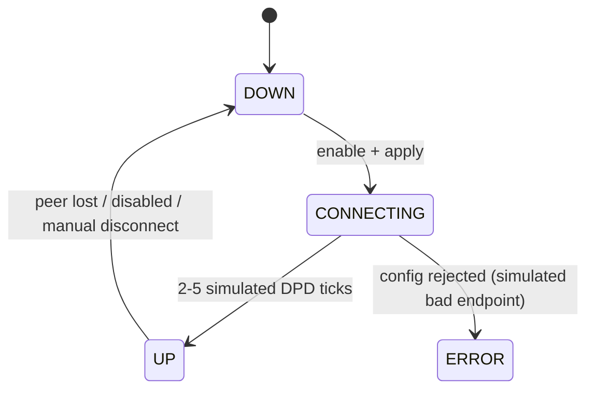

# M05 — VPN

> TL;DR: Site-to-site and remote-access VPN management across WireGuard, IPSec (IKEv2) and OpenVPN: typed config editors over locked JSON shapes, simulated tunnel state machines, client-bundle downloads, and the live session table with disconnect. Views `#/vpn/configs`, `#/vpn/sessions`.

Related: [PROJECT_MEMORY](../00-PROJECT-MEMORY/PROJECT_MEMORY.md) (§6 enums, §7.2, §7.3) · [SCHEMA](../03-DATABASE/SCHEMA.md) §3/§4 (VpnConfig/VpnSession + config JSON shapes) · [ER_DIAGRAM](../03-DATABASE/ER_DIAGRAM.md) §2 (VpnConfig → VpnSession CASCADE) · [ENDPOINTS](../04-API/ENDPOINTS.md) · [UI_DESIGN_SYSTEM](../05-FRONTEND/UI_DESIGN_SYSTEM.md) · [PAGE_MAP](../05-FRONTEND/PAGE_MAP.md) · [SIMULATION_LAYER](../02-ARCHITECTURE/SIMULATION_LAYER.md) §5 (tunnel state machine) · M02 (`wg0` iface, role `vpn`) · M07 (identity for remote users)

---

## 1. Purpose & Scope (Phase 1)

M05 connects sites and remote users. An admin creates per-type tunnel configs (WireGuard site-to-site with peers and allowed IPs, WireGuard remote access with an address pool, IPSec s2s/remote with subnets + PSK/EAP, OpenVPN remote access), watches the simulated tunnel come up, monitors status (handshakes, transfer, DPD), downloads ready-to-use client bundles, and manages live sessions (kick misbehaving clients).

Derived from upstream spec §1.7 (VPN) Phase 1 table — **fully covered per the owner zero-loss ruling (REVIEW-4A)**:

| Upstream Phase 1 feature | Console Phase 1 decision |
|---|---|
| WireGuard s2s + remote access, IPSec IKEv2 s2s + remote (EAP-MSCHAPv2 / EAP-TLS), OpenVPN remote access, split tunneling (allowedIps / subnets), DNS assignment, DPD, PFS, keepalive, address pools, client bundles (.conf/.ovpn), tunnel monitoring | IN — this spec |
| VPN user groups (per-group policies) | IN — `VpnUserGroup` CRUD (pool override, pushed DNS, timeouts, session limits, member usernames) + User Groups tab on `#/vpn/configs` (restored REVIEW-4A) |
| VPN address pools (per-group) | IN — config-level `pool` + per-group `VpnUserGroup.pool` override applied at connect time (restored REVIEW-4A) |
| VPN session limits (per-user, per-group) | IN — `VpnUserGroup.maxSessionsPerUser` (+ `maxSessionMin`); a per-user limit is expressed as a single-member group (restored REVIEW-4A) |
| VPN session timeout (idle, max) | IN — `VpnUserGroup.idleTimeoutMin` + `maxSessionMin`; the session churn honors both (restored REVIEW-4A) |
| IPsec anti-replay window | IN — `replayWindow` field on `ipsec_*` config shapes (32–1024, editor select) (restored REVIEW-4A) |
| IKEv1, L2TP over IPSec, SSTP, VPN load balancing, post-connect hooks | OUT — dropped/deferred upstream, see [ROADMAP](../01-PRODUCT/ROADMAP.md) |
| Real crypto key generation/rotation UI | OUT — keys/PSKs are editable strings; generation is a "generate" helper only (SIMULATION_LAYER §9: no real crypto) |
| WireGuard native user authentication | N/A — WireGuard is public-key-only (Cryptokey Routing via AllowedIPs; UDP transport, no username/password, no built-in IP assignment — the pool + per-peer `/32` allowedIps are the IPAM). Remote-access identity = provisioned peer name surfaced in `VpnSession.userName`; username/password remote access uses IPSec EAP or OpenVPN |

## 2. Data Model

Reference: [SCHEMA](../03-DATABASE/SCHEMA.md) §3/§4.

| Model | Fields used here | Notes |
|---|---|---|
| `VpnConfig` | `name`, `type` (`wireguard_s2s\|wireguard_remote\|ipsec_s2s\|ipsec_remote\|openvpn`), `enabled`, `config` (JSON, exact shape per type below), `status` (`up\|down\|connecting\|error`), `statusMessage?` | unique `(tenantId, name)`; index `(tenantId, type)` |
| `VpnSession` | `vpnId` (FK → `vpn_configs`, **CASCADE** on config delete), `userName?`, `sourceIp`, `assignedIp?`, `groupName?` (VpnUserGroup applied at connect), `bytesIn`, `bytesOut`, `connectedAt`, `lastActivity`, `status` (`active\|idle\|disconnected`) | sessions of a deleted config are cascaded away |
| `VpnUserGroup` | `name`, `description?`, `pool?` (per-group CIDR override), `dns?`, `idleTimeoutMin?`, `maxSessionMin?`, `maxSessionsPerUser?`, `memberUsernames` (JSON array — logical ref to `VpnSession.userName`) | unique `(tenantId, name)`; group policy applied by the engine at connect time |
| `NetworkInterface` (read) | `wg0`-style interfaces with `role = vpn` shown as the tunnel iface in status detail | created by seed; no iface CRUD from this module |

`VpnConfig.config` JSON shapes (zod-validated, SCHEMA §4 — exact):

| Type | Shape |
|---|---|
| `wireguard_s2s` | `{ privateKey: string, listenPort: number, peers: [{ name, publicKey, allowedIps: string[], endpoint?, keepaliveSec? }], address: string }` |
| `wireguard_remote` | `{ privateKey: string, listenPort: number, address: string, pool: string, dns?: string, keepaliveSec?: number, peers: [{ name, publicKey, allowedIps: string[] }] }` — each provisioned remote client is a peer with a `/32` `allowedIps` from the pool (WireGuard has no built-in address assignment; pool + peer `/32`s are the IPAM). SCHEMA.md §4 mirrors this shape — client-bundle generation appends peers (§5) |
| `ipsec_s2s` / `ipsec_remote` | `{ localIp, remoteIp?, localSubnets: string[], remoteSubnets: string[], psk, ike: string, esp: string, dpdSec?: number, pfs?: boolean, authMethod?: "psk"\|"eap_mschapv2"\|"eap_tls", replayWindow?: 32\|64\|128\|256\|512\|1024, dns?: string }` |
| `openvpn` | `{ proto: "udp"\|"tcp", port: number, cipher: string, auth: string, pool: string, tls?: boolean, dns?: string, keepaliveSec?: number }` |

Integrity: deleting a config cascades its sessions (ER_DIAGRAM §2) with a ConfirmDialog warning; `status` is engine-owned (never edited via PUT `config` directly — transitions come from enable/disable and the state machine).

## 3. API Surface

| METHOD | Path | Purpose | Triggering UI action |
|---|---|---|---|
| GET | `/api/v1/vpn/configs` | list all configs (+ status, statusMessage) | `#/vpn/configs` load; tabs filter client-side by type |
| POST | `/api/v1/vpn/configs` | create config | "Add" in the active tab |
| PUT | `/api/v1/vpn/configs/{id}` | update config / enabled | editor save / enable switch |
| DELETE | `/api/v1/vpn/configs/{id}` | delete config (+ sessions) | row delete |
| GET | `/api/v1/vpn/configs/{id}/status` | tunnel state, DPD, handshakes | "Status" row action → detail dialog |
| POST | `/api/v1/vpn/configs/{id}/client-bundle` | wg `.conf` / `.ovpn` download payload | "Download client bundle" button |
| GET | `/api/v1/vpn/sessions` | active sessions | `#/vpn/sessions` load |
| POST | `/api/v1/vpn/sessions/{id}/disconnect` | kick session | row Disconnect action |
| GET | `/api/v1/vpn/user-groups` | list VPN user groups | User Groups tab load |
| POST | `/api/v1/vpn/user-groups` | create group | "Add group" dialog |
| PUT | `/api/v1/vpn/user-groups/{id}` | update group (incl. `memberUsernames` replace-all) | group editor save |
| DELETE | `/api/v1/vpn/user-groups/{id}` | delete group | row delete action |

Query params/filters: `GET /api/v1/vpn/sessions` takes `?vpnId=` (per-config filter — additive field filter per PROJECT_MEMORY §7.1) plus `?page=/limit=` pagination; the configs list is small (no pagination needed).

Expected error cases:

| Case | Result |
|---|---|
| Duplicate config name | `409 CONFLICT` |
| Config JSON failing its type's zod schema (e.g. peer without `publicKey`, bad CIDR in `allowedIps`) | `400 VALIDATION_ERROR` with field path |
| `client-bundle` on an `ipsec_*` config | `400 VALIDATION_ERROR` — bundles exist only for WireGuard/OpenVPN (endpoint contract says wg `.conf` / `.ovpn`) |
| `client-bundle` on a disabled config | allowed (bundle reflects the stored config), with an "offline config" notice |
| Disconnect on nonexistent/already-disconnected session | `404 NOT_FOUND` / idempotent success with `status = disconnected` |
| Port collision between configs (same listenPort) | `409 CONFLICT` |
| Duplicate VPN user-group name | `409 CONFLICT` |
| Group `pool` overlapping a remote-access config pool (or another group's) | `400 VALIDATION_ERROR` |
| `replayWindow` outside the allowed set (32–1024 powers of two) | `400 VALIDATION_ERROR` |

## 4. Views & Interactions

### `#/vpn/configs` — tabs: WireGuard | IPSec | OpenVPN | User Groups

- **Tab mapping:** WireGuard tab lists `wireguard_s2s` + `wireguard_remote`; IPSec tab lists `ipsec_s2s` + `ipsec_remote`; OpenVPN tab lists `openvpn`. Each tab's "Add" opens the editor preset to that type family. The **User Groups** tab manages `VpnUserGroup` rows (applies to remote-access sessions of any type).
- **Config list (per tab):** name, subtype chip (s2s / remote access), enabled switch, status badge (`up`=emerald, `connecting`=amber, `down`=zinc, `error`=rose + `statusMessage` tooltip), endpoint/pool summary, actions (edit, status, bundle, delete).
- **Editors per type** (fields mirror §2 shapes exactly; secrets masked with reveal-eye button):
  - WireGuard s2s: name, privateKey (generate helper), listenPort, tunnel `address` (CIDR), peers table (name, publicKey, `allowedIps` CIDR list, endpoint host:port, keepaliveSec) with add/remove rows.
  - WireGuard remote: privateKey, listenPort, `address`, `pool` (CIDR), pushed `dns`, `keepaliveSec`.
  - IPSec (s2s/remote): name, `localIp`, `remoteIp` (s2s), `localSubnets` / `remoteSubnets` CIDR list editors, `psk` (masked + reveal + generate), `ike` / `esp` proposal strings (placeholder shows `aes256-sha256-modp2048` style), `dpdSec`, `pfs` switch, `authMethod` select (`psk` for s2s; `eap_mschapv2` / `eap_tls` for remote), `replayWindow` select (32/64/128/256/512/1024 — anti-replay window, spec §1.7), pushed `dns` (remote).
  - OpenVPN: name, `proto` radio, `port`, `cipher`, `auth`, `pool`, `tls` switch, pushed `dns`, `keepaliveSec`.
- **Status detail dialog** (from `/status`): current status + statusMessage, last handshake age, transfer bytes in/out, DPD state (dead-peer detection alive/expired), peer/subnet summary; auto-refresh every 5 s while open.
- **Client-bundle action:** POST → response carries filename + text payload → browser download (`hq-mesh-peer1.conf` / `roadwarriors-client.ovpn`). Button hidden on IPSec rows (no bundle contract for IPSec in Phase 1).
- **User Groups tab:** table (name, description, pool chip, dns, idle/max timeouts, maxSessionsPerUser, member count) + editor dialog: name, description, pool (CIDR, optional — override), dns (optional), idleTimeoutMin / maxSessionMin / maxSessionsPerUser (numbers, optional), `memberUsernames` tag input (remote usernames; must match `VpnSession.userName` values at connect). Empty state CTA.
- Empty tab state: EmptyState ("No WireGuard tunnels configured") + Add button; seed guarantees four configs spread across tabs.

### `#/vpn/sessions`

- **Filter bar:** per-config select (`?vpnId=`), status chips (active/idle), search by user/IP.
- **Live table:** user (from `userName`, s2s rows show peer name), source ip, assigned ip (pool-derived), bytes in/out (humanized, ticking), connected at, last activity, status badge (active=emerald, idle=amber, disconnected=zinc), Disconnect action (ConfirmDialog).
- Server-paginated; disconnected sessions leave the default (active) filter but remain visible when filtering by status.

## 5. Business Logic & Validation

- **Type → editor mapping is strict:** the PUT payload's `config` must match the zod schema for the row's `type`; the API rejects a `wireguard_remote` shape on an `ipsec_s2s` row. `authMethod` defaults to `psk`; `pfs` defaults true on save when omitted.
- **Validation specifics:** listenPort 1–65535 (collision-checked across configs → 409), `address`/`pool`/`allowedIps`/`*Subnets` valid IPv4 CIDRs, pool must not overlap another remote-access config's pool (service-layer check → 400), `dpdSec` 5–600, `keepaliveSec` 0–120.
- **Tunnel state machine (simulated)** — [SIMULATION_LAYER](../02-ARCHITECTURE/SIMULATION_LAYER.md) §5:

- Enabling a config → `applyConfig("vpn")` → engine flips `status` to `connecting`, then `up` after 2–5 ticks (4–10 s), `statusMessage` updated ("handshake complete with <peer>"); random low-probability `error` states give the error badge something to show (profile-driven; `MOCK_SEED` deterministic).
- **Status detail data:** handshake time = last simulated DPD success; transfer bytes accumulate per tick for s2s tunnels and per session for remote access; DPD state derived from the machine above.
- **Client bundles (server-generated):** WireGuard remote → server generates a fresh client keypair, appends a peer row to the config's `peers` (name = bundle name), returns a `.conf` with the client private key + `Endpoint` = appliance WAN + `AllowedIPs` per split-tunnel pool; WireGuard s2s → renders a peer `.conf` for the selected peer; OpenVPN → renders an `.ovpn` with proto/port/cipher/CA-ish placeholders. Simulated keys are random strings (no real crypto, SIMULATION_LAYER §9).
- **Sessions churn (simulated):** the `sessions` generator connects/disconnects remote-access sessions per tick (DATA_LIFECYCLE §5: ~10 live rows); `assignedIp` drawn from the **matching VpnUserGroup pool when `userName` is a member, else the config `pool`**; `groupName` is stamped on the session; `bytesIn/bytesOut` grow while `active`; sessions age into `idle` then `disconnected` — **group `idleTimeoutMin`/`maxSessionMin` shorten the churn timers for member sessions, and `maxSessionsPerUser` blocks a new connect when the user already holds the limit** (the engine marks the attempt `disconnected` immediately with `statusMessage` "session limit reached").
- **Disconnect action:** sets session `status = disconnected`, `lastActivity = now`; the generator honors it (no re-spawn of that session in the same window). Remote-user effective kick, simulated.
- Every mutation → `applyConfig("vpn")` → audit + `config_versions` snapshot (section `vpn`) + `config:updated` broadcast (PROJECT_MEMORY §12).

## 6. Realtime

| Event | UI reaction |
|---|---|
| `sessions:update` | `{kind: "vpn", diff: [...]}` → patch the sessions table rows in place (new/updated/disconnected) without refetch; update per-config session counts on the configs view |
| `vpn:status` | `{vpnId, status, statusMessage?}` → update tunnel status badges live (additive event; clients may also rely on refetch) |
| `config:updated` | `section = vpn` → invalidate `vpn-configs` queries; status badges refetch |
| `alerts:new` | `notification.type = "vpn"` (e.g. tunnel down) → toast + badge; the status badge itself refreshes via the invalidated query |

**Tunnel state delivery:** `vpn:status` is the live channel (PROJECT_MEMORY §7.3); the status dialog additionally polls `/status` every 5 s while open for handshake/DPD detail.

## 7. Acceptance Criteria (checklist)

- Given the 4 seeded configs, when `#/vpn/configs` loads, then each tab shows exactly its family's configs with correct status badges (seed mix: up/up/connecting/down).
- Given a `wireguard_s2s` create with a peer missing `publicKey`, when saving, then the API returns `400 VALIDATION_ERROR` naming the peer row field.
- Given enabling `BRANCH-IPSEC`, when 2–5 ticks pass, then status transitions `connecting` → `up` and `statusMessage` names the peer handshake.
- Given a disabled config, when the row renders, then the enable switch is off and the status badge is `down`, not `error`.
- Given "Download client bundle" on `ROADWARRIORS`, when clicked, then a `.conf` file downloads containing the pool's DNS and a newly appended peer entry.
- Given an `ipsec_s2s` row, when the row menu opens, then the bundle action is hidden (no `.conf`/`.ovpn` contract for IPSec).
- Given the PSK field, when rendered, then the value is masked and the reveal-eye toggles visibility (never printed in page source as plain text by default).
- Given two remote configs with overlapping pools, when saving the second, then a `400 VALIDATION_ERROR` with a pool-overlap message appears.
- Given `#/vpn/sessions` open, when `sessions:update {kind: "vpn"}` arrives, then rows patch in place within 1 s and byte counters tick without a refetch flash.
- Given user `c.reyes` in group `CONTRACTORS` (pool `10.99.1.0/24`, idle 30 min, max 1/user), when they connect, then `assignedIp` comes from `10.99.1.0/24`, the session shows the group chip, and a second simultaneous connect for the same user is refused ("session limit reached").
- Given group `CONTRACTORS` with `idleTimeoutMin = 30`, when a member session is idle 30 min (simulated churn), then it flips `idle` → `disconnected` sooner than non-member sessions.
- Given an IPSec remote edit with `replayWindow = 512`, when saved, then the config JSON stores it and the status dialog shows "anti-replay window 512".
- Given Disconnect on an active session, when confirmed, then the row turns `disconnected` and a later diff does not resurrect it.
- Given filter `vpnId = ROADWARRIORS`, when applied, then only that config's sessions render and the query key includes `vpnId` (cache isolation).
- Given deleting `HQ-MESH`, when confirmed, then its sessions are gone (CASCADE) and the WireGuard tab no longer lists it after `config:updated`.

## 8. Open Questions & Risks

- **`status` write-path:** PUT owns `enabled`/`config` but `status` is engine-owned; pin in ENDPOINTS.md that PUT ignores/keeps engine status fields to avoid agents "setting" status.
- **Bundle key persistence:** remote-access bundles append a peer to the config — repeated downloads mutate config history silently; consider marking generated peers (`generated: true`) or a dedicated peer-management UI in Phase 2.
- **IPSec remote users:** `ipsec_remote` sessions use EAP against identity (M07) — the sim fills `userName`; real appliance needs FreeRADIUS wiring noted in ARCHITECTURE, out of console scope.
- OpenVPN `.ovpn` contents are placeholder-grade (no real CA/TLS files) — editor copy must not promise production-grade bundles.
- ~~**VPN user groups / session limits / timeouts / anti-replay deferred**~~ RESOLVED (REVIEW-4A): restored via `VpnUserGroup` + config-shape fields above.
