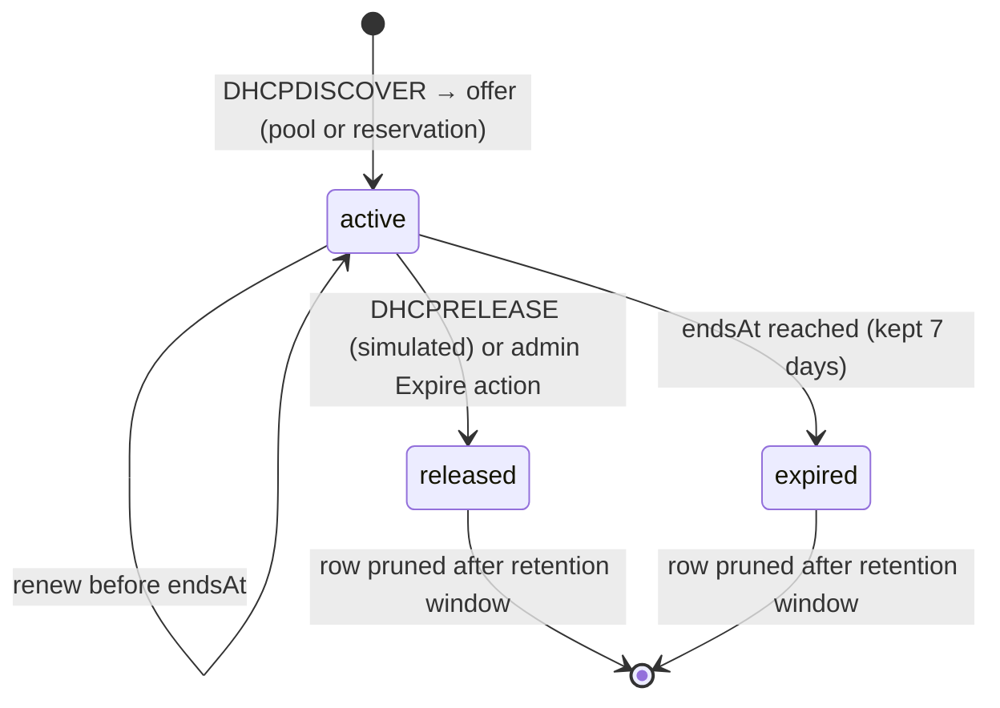

# M06 — DNS & DHCP

> TL;DR: DNS security and DHCP service management: Unbound-style resolver settings, RPZ-style
> filtering policies, local records, a derived query log, plus Kea-style subnets, MAC
> reservations, and leases. All data-plane behavior is simulated by MockEngine (SIMULATION_LAYER §3/§6).

Related: ../00-PROJECT-MEMORY/PROJECT_MEMORY.md (§6 enums, §7.2 API, §7.3 realtime, §8 views) ·
../03-DATABASE/SCHEMA.md · ../03-DATABASE/ER_DIAGRAM.md · ../02-ARCHITECTURE/SIMULATION_LAYER.md ·
../04-API/ENDPOINTS.md · ../04-API/API_STANDARDS.md · ../05-FRONTEND/UI_DESIGN_SYSTEM.md ·
../05-FRONTEND/PAGE_MAP.md · ../05-FRONTEND/STATE_AND_DATA_FLOW.md · ../01-PRODUCT/ROADMAP.md ·
siblings: M03-FIREWALL.md (shared object model), M09-LOGGING.md (log table patterns)

---

## 1. Purpose & Scope (Phase 1)

This module lets an admin run the appliance's DNS resolver and DHCP server from the console:
configure the resolver (forwarders, cache, RRL), author DNS filtering policies (category +
custom lists, sinkhole/NXDOMAIN action), manage local DNS records, inspect the DNS query log,
and manage DHCP subnets, static MAC reservations, and leases.

**In scope (Phase 1):**

| Area | Contents |
|---|---|
| Resolver settings | Forwarder list, cache size, RRL toggle, DoT toggle (display-only in sandbox — see §5.4) |
| DNS policies | CRUD; block categories `ads, malware, phishing, adult, social, gambling` (multi-toggle); custom block/allow domain lists (bulk paste); action `sinkhole` \| `nxdomain`; sinkhole IP |
| DNS records | CRUD for types `A, AAAA, CNAME, MX, TXT, SRV, PTR`; TTL; priority for MX/SRV; enabled toggle |
| Query log | Filtered, paginated list with blocked badge — **derived view, not a Prisma table** (§2, §5.4) |
| DHCP subnets | CRUD with interface, CIDR, pool range, gateway, DNS servers, lease time, custom options JSON |
| Reservations | CRUD (mac/ip/hostname); MAC globally unique; pool exclusion |
| Leases | Table with state badges `active/expired/released`, remaining TTL, admin expire action; simulated churn |

**Out of scope (deferred — see ../01-PRODUCT/ROADMAP.md):**

| Feature | Upstream status | Why deferred here |
|---|---|---|
| DNSSEC validation | Phase 2 (spec cut list) | Not in Phase-1 contract |
| DoH server, DoT **termination** | DoT Ready / DoH custom | DoT toggle is display-only in sandbox; no contract fields for certs |
| Per-domain conditional forwarding (forward-zones) | Upstream Ready (spec §1.8 lists this Phase 1) | Spec divergence (REVIEW-2A): console Phase-1 contract has a flat forwarder list only — no endpoint/field; reconcile in §8 |
| DNS rewriting, DNS failover/LB, DGA + DNS-tunneling detection | Phase 2/3 | Not in contract |
| DHCP relay (ip-helper), DHCPv6 (basic), DHCP failover, client classification | Relay + basic DHCPv6 are spec §1.9 Phase 1; failover + classification Phase 2 | Spec divergence (REVIEW-2A): the appliance renders relay/dhcp6 config per spec, but the console contract has no fields (IPv4-only Phase 1); reconcile in §8 |
| Malware feed update automation | Custom engineering | Categories are static toggles Phase 1 |

---

## 2. Data Model

From ../03-DATABASE/SCHEMA.md §3 (names verbatim; JSON columns are zod-validated per SCHEMA §4).

| Model | Fields used here | Notes |
|---|---|---|
| `DnsPolicy` | `name`, `enabled`, `blockCategories` (JSON array), `customBlock` (JSON array of domains), `customAllow` (JSON array), `sinkholeIp` (default `0.0.0.0`), `action` (`sinkhole` \| `nxdomain`) | `@@unique([tenantId, name])` |
| `DnsRecord` | `zone`, `name`, `type` (`A\|AAAA\|CNAME\|MX\|TXT\|SRV\|PTR`), `value`, `ttl` (default 3600), `priority Int?` (MX/SRV only), `enabled` | Indexed `(tenantId, zone, name)` |
| `DhcpSubnet` | `interfaceName`, `subnetCidr`, `rangeStart`, `rangeEnd`, `gateway?`, `dnsServers` (JSON array of IPs), `leaseTime` (seconds, default 86400), `options` (JSON map, SCHEMA §4), `enabled` | Deleting a subnet **cascades** its reservations and leases (ER_DIAGRAM §2) — UI must warn |
| `DhcpReservation` | `subnetId` (FK), `mac` (**globally unique** — `@@unique([mac])`), `ip`, `hostname?` | Cascade on subnet delete |
| `DhcpLease` | `subnetId` (FK), `mac`, `ip` (**unique** — `@@unique([ip])`), `hostname?`, `state` (`active\|expired\|released`), `startsAt`, `endsAt` | Cascade on subnet delete; index `(tenantId, state)` |

**Non-table data (state the mechanism — do not invent models):**

| Data | Mechanism |
|---|---|
| Resolver settings (forwarders, cache size, RRL, DoT) | No dedicated Prisma model exists. Persist as a `SystemSetting` row (`category: "general"`, `key: "dns_resolver"`, `value` = JSON per §5.4). **Contract gap flagged in §8.** |
| DNS query log | **Derived view.** SCHEMA.md has no `DnsQueryLog` model; SIMULATION_LAYER §6 defines generator `dns-queries` → output `dns/query-logs (derived view)` served from the MockEngine ring buffer through `GET /api/v1/dns/query-logs`. Rows are not persisted; reset (`--reset`) and restarts clear them. |

Logical references: none from this module into firewall objects (DHCP `interfaceName` is a
logical ref by name into `interfaces.name` — validate existence on save).

---

## 3. API Surface

Paths verbatim from PROJECT_MEMORY §7.2 (LOCKED — expand, never rename). Envelope, errors,
and pagination per §7.1 / ../04-API/API_STANDARDS.md.

| METHOD | Path | Purpose | Triggering UI action |
|---|---|---|---|
| GET | `/api/v1/dns/settings` | Read resolver settings | Open "Resolver Settings" tab |
| PUT | `/api/v1/dns/settings` | Save resolver settings | "Save" on Resolver Settings tab |
| GET | `/api/v1/dns/policies` | List DNS policies | Open "Policies" tab |
| POST | `/api/v1/dns/policies` | Create policy | "Add Policy" dialog submit |
| PUT | `/api/v1/dns/policies/{id}` | Update policy | Policy editor dialog submit / enable toggle |
| DELETE | `/api/v1/dns/policies/{id}` | Delete policy | Row action "Delete" (ConfirmDialog) |
| GET | `/api/v1/dns/records` | List records (`?q=`, `?zone=`, `?type=`) | Open "Records" tab, search/filter |
| POST | `/api/v1/dns/records` | Create record | "Add Record" dialog submit |
| PUT | `/api/v1/dns/records/{id}` | Update record | Record dialog submit / enabled toggle |
| DELETE | `/api/v1/dns/records/{id}` | Delete record | Row action "Delete" (ConfirmDialog) |
| GET | `/api/v1/dns/query-logs` | Derived query log; filters `?q=&blocked=` | Open "Query Log" tab, search, blocked filter |
| GET | `/api/v1/dhcp/subnets` | List subnets (with lease counts) | Open DHCP view, "Subnets" tab |
| POST | `/api/v1/dhcp/subnets` | Create subnet | "Add Subnet" dialog submit |
| PUT | `/api/v1/dhcp/subnets/{id}` | Update subnet | Subnet dialog submit / enabled toggle |
| DELETE | `/api/v1/dhcp/subnets/{id}` | Delete subnet (cascades children) | Row action "Delete" (ConfirmDialog shows child counts) |
| GET | `/api/v1/dhcp/reservations` | List reservations (`?subnetId=`) | Open "Reservations" tab |
| POST | `/api/v1/dhcp/reservations` | Create reservation | "Add Reservation" dialog submit |
| PUT | `/api/v1/dhcp/reservations/{id}` | Update reservation | Reservation dialog submit |
| DELETE | `/api/v1/dhcp/reservations/{id}` | Delete reservation | Row action "Delete" (ConfirmDialog) |
| GET | `/api/v1/dhcp/leases` | List leases; `?state=active\|expired`; `?subnetId=`; `?q=` | Open "Leases" tab, state filter chips |
| POST | `/api/v1/dhcp/leases/{id}/release` | Force-release a lease (sets `released`, frees the IP) | Row action **Expire** on an active lease |

Lease release is a **locked** endpoint (PROJECT_MEMORY §7.2 + ENDPOINTS.md §5, role floor
`network_admin`, audited): `POST /api/v1/dhcp/leases/{id}/release`. PATCH/DELETE on leases is
not offered — POST keeps the 7-day expired/released history window intact.

**Expected error cases:** `VALIDATION_ERROR` 400 (bad CIDR/MAC/domain/IP, priority on
non-MX/SRV type, range outside subnet, guaranteed fields per §5); `CONFLICT` 409 (duplicate
policy/record name per tenant, duplicate reservation MAC, overlapping subnet on same
interface, lease IP already active); `NOT_FOUND` 404 (unknown id); deleting a subnet that is
the only DHCP scope for a live interface is allowed (cascade) but requires the typed
confirmation if it has >0 active leases.

---

## 4. Views & Interactions

Two hash views (LOCKED, PROJECT_MEMORY §8). Layouts follow ../05-FRONTEND/PAGE_MAP.md;
components per ../05-FRONTEND/UI_DESIGN_SYSTEM.md (`p-4`/`p-6`, `gap-4`/`gap-6`, EmptyState,
skeletons, `max-h-96 overflow-y-auto` lists). Both views subscribe to `config:updated`
(section `dns` / `dhcp`) to invalidate TanStack Query caches (keys include all filters).

### `#/dns-dhcp/dns` — 4 tabs

| Tab | Layout & key components | User actions |
|---|---|---|
| Resolver Settings | Single settings card (form): forwarders (editable IP list with add/remove + validation), cache size (MB, number), RRL toggle, DoT toggle. DoT row carries an inline info note: "Display-only in sandbox; Unbound DoT termination is applied on appliance." | Save → `PUT /api/v1/dns/settings` → toast + audit + version snapshot (section `dns`) |
| Policies | Table/cards of policies: name, enabled badge (emerald/zinc), categories as chips, action badge (`sinkhole`/`nxdomain`), counts of custom block/allow entries. Editor dialog (Sheet or Dialog): name; enabled switch; 6 category toggle chips; custom block list textarea (bulk paste, one domain per line, parsed + deduped); custom allow list textarea; action Select (`sinkhole` \| `nxdomain`); sinkhole IP Input (visible when action = `sinkhole`, default `0.0.0.0`). | Add / edit / delete / toggle enabled. Deleting the last enabled policy shows a warning that DNS filtering becomes inactive |
| Records | DataTable: zone, name, type (badge), value, ttl, priority (— except MX/SRV), enabled toggle. `?q=` search, zone + type filter selects. Editor dialog: zone (text with datalist of existing zones), name, type Select (7 enum values), value (type-validated per §5.2), ttl number, priority number (enabled only for `MX`/`SRV`), enabled switch. | Add / edit / delete / toggle. Empty state: EmptyState with "Add Record" CTA |
| Query Log | Filtered list (server-paginated envelope, newest first): timestamp, client IP, queried domain (mono), qtype, result badge — allowed (zinc) / `sinkhole` (amber) / `nxdomain` (rose); **blocked** badge (rose-600) when `blocked=true`; category chip when known. Filters: `q` (domain/client substring), `blocked` tri-state (all/blocked/allowed), auto-refresh every 10 s while tab is visible. | Filter, paginate, row expand (client, full derived row). Banner on top: "Derived from the simulated DNS generator — not persisted (SIMULATION_LAYER §6)" |

States: every tab has skeleton loading on first fetch; EmptyState per table; error state =
inline error card with Retry (../05-FRONTEND/STATE_AND_DATA_FLOW.md).

### `#/dns-dhcp/dhcp` — 3 tabs

| Tab | Layout & key components | User actions |
|---|---|---|
| Subnets | Cards or DataTable: interfaceName, subnetCidr (mono), pool `rangeStart–rangeEnd`, gateway, dnsServers chips, leaseTime (humanized), active lease count badge, enabled toggle. Editor dialog: interface Select (from `/api/v1/interfaces`), subnetCidr, rangeStart/rangeEnd, gateway, dnsServers (multi-IP input), leaseTime (seconds with humanized hint), custom options JSON edited as key/value pairs rendered by `JsonFieldViewer`-style editor (SCHEMA §4 shape `{ [optionCode]: string }`, e.g. `{ "42": "192.168.10.1" }`), enabled switch. | Add / edit / delete (ConfirmDialog lists cascade counts: N reservations, M leases) / toggle |
| Reservations | DataTable: mac (mono), ip, hostname, subnet (cidr), actions. Editor dialog: subnet Select, mac (validated, uniqueness enforced server-side), ip, hostname. | Add / edit / delete / toggle none. Empty state CTA |
| Leases | DataTable: mac, ip, hostname, subnet, state badge — `active` emerald, `expired` amber, `released` zinc — startsAt, endsAt + remaining time. Filters: state chips (`all` / `active` / `expired`), subnet select, `q`. Row action on active leases: **Expire** (locked `POST /dhcp/leases/{id}/release`, §3). | Filter, refresh (manual + on tab focus), Expire |

Lease lifecycle (drawn here; no lease machine exists in SIMULATION_LAYER §5):

---

## 5. Business Logic & Validation

### 5.1 Policy evaluation (how `DnsPolicy` drives the simulated generator)

SIMULATION_LAYER §3 (`dns` row): applying a policy change makes the query-log generator
"start blocking per policy categories". Precise semantics for the generator (and the
appliance's Unbound RPZ renderer):

1. Collect all `enabled` policies (ordered by `id` asc).
2. For each queried domain, in order: if it matches any `customAllow` entry (exact or
   subdomain match) → **allowed, stop**; if it matches any enabled policy's `customBlock` →
   **blocked** with *that* policy's `action`, stop; else if its category is in that policy's
   `blockCategories` → **blocked** with that policy's `action`, stop; else allowed.
3. `action = sinkhole` → answer is `sinkholeIp` (default `0.0.0.0`); `action = nxdomain` →
   NXDOMAIN. The derived log row records `blocked=true`, the `action`, and the matched
   category (custom lists report category `custom`).

Generator mix (SIMULATION_LAYER §6): ~85% normal, ~10% ads, ~5% malware/phishing — so
enabling `ads` visibly flips the Query Log blocked ratio within one tick (2 s).

### 5.2 Records validation (zod)

| Type | Value format | Priority |
|---|---|---|
| `A` | IPv4 (`z.string().ip()` v4) | rejected if set |
| `AAAA` | IPv6 | rejected if set |
| `CNAME` | hostname | rejected if set |
| `MX` | hostname | **required** (10–65535) |
| `TXT` | free text ≤ 255 chars per string | rejected if set |
| `SRV` | `weight port target` | **required** |
| `PTR` | reverse zone name (`…in-addr.arpa`) | rejected if set |

TTL 60–604800. `zone` + `name` + `type` need not be unique (multiple records allowed), but
identical `zone+name+type+value` duplicates return `409 CONFLICT`.

### 5.3 DHCP validation

- `subnetCidr`: valid IPv4 CIDR; ranges and gateway must fall inside it; `rangeStart ≤ rangeEnd`.
- Overlap rule: two enabled subnets on the same `interfaceName` must not overlap → `409 CONFLICT`.
- `leaseTime` 60–604800 s. `options` keys are DHCP option codes (digits); values strings.
- Reservation: MAC format `aa:bb:cc:dd:ee:ff` (zod regex, lowercase-normalized), globally
  unique (`@@unique(mac)` → 409), `ip` inside its subnet CIDR (else `VALIDATION_ERROR`).
  Reserved IPs are excluded from the dynamic pool; if a dynamic lease holds a newly reserved
  IP, the simulated lease churn reassigns the dynamic client on next renew.
- Deleting a subnet cascades reservations + leases (ER_DIAGRAM §2) — service returns the
  would-be cascade counts in the ConfirmDialog payload requirement (UI fetches counts before
  confirm).

### 5.4 Simulated behavior (what SimulatedAdapter does)

Per ../02-ARCHITECTURE/SIMULATION_LAYER.md §3/§4/§6 — no Unbound/Kea runs in the sandbox:

- `PUT` on any dns/dhcp path → zod → DB write (tx) → `audit_log` row → `config_versions`
  snapshot (`section: "dns"` or `"dhcp"`) → SimulatedAdapter marks the section applied →
  `config:updated {section}` broadcast (SIMULATION_LAYER §7).
- Resolver settings: accepted and persisted; **DoT toggle is display-only** (the simulated
  resolver never terminates TLS; on the appliance Unbound renders `tls-upstream` +
  `tls-cert`/`tls-key` for encrypted forwarding, and `tls-port: 853` when serving the
  spec's Phase 1 DoT-server feature). Forwarders feed the generator's "upstream
  answered" latency flavor only.
- Lease churn: per 2 s tick the engine creates/renews/expires leases from enabled subnets'
  ranges minus reservations, honoring `@@unique(ip)`; expired rows kept 7 days
  (DATA_LIFECYCLE §4); a small fraction of releases keeps the `released` state visible.
- Query log rows exist only in the engine ring buffer (500 rows) backing
  `GET /api/v1/dns/query-logs`.

---

## 6. Realtime

| Event (§7.3, verbatim) | Reaction in this module |
|---|---|
| `config:updated` `{ section: "dns" }` | Invalidate `['dns', …]` query keys (settings, policies, records); toast "DNS configuration applied" |
| `config:updated` `{ section: "dhcp" }` | Invalidate `['dhcp', …]` query keys (subnets, reservations, leases) |
| `metrics:tick` | Not consumed here |
| `logs:tail` / `alerts:new` / `sessions:update` / `wan:status` | Not consumed here |

No socket event exists for lease churn or query-log rows (contract §7.3); the Query Log tab
polls/refetches on interval + visibility, and the Leases tab refetches on tab focus and after
`config:updated`. Do not invent a `leases:update` event — flagged in §8.

---

## 7. Acceptance Criteria (checklist)

- [ ] `#/dns-dhcp/dns` renders 4 tabs, `#/dns-dhcp/dhcp` renders 3 tabs; deep links land on the right tab.
- [ ] Resolver settings save issues `PUT /api/v1/dns/settings`, writes an audit row, a `config_versions` snapshot (section `dns`), and broadcasts `config:updated`.
- [ ] DoT toggle renders with the display-only note and does not claim to apply.
- [ ] Policy editor supports all 6 category chips, bulk paste of custom block/allow lists (one domain per line, deduped, invalid lines rejected inline), and `sinkhole`/`nxdomain` action with conditional sinkhole-IP field.
- [ ] With `ads` enabled, blocked DNS rows appear in Query Log within one 2 s tick; `blocked` filter and blocked badges work; disabling the category stops new blocked rows.
- [ ] A `customAllow` domain that also matches a blocked category resolves as allowed (evaluation order §5.1).
- [ ] Record dialog enforces priority-required for MX/SRV, hides priority otherwise, and rejects malformed values per type.
- [ ] Subnet save rejects ranges outside the CIDR and overlapping enabled subnets on the same interface with `409 CONFLICT`.
- [ ] Deleting a subnet shows cascade counts (reservations + leases) in the ConfirmDialog and cascades on confirm.
- [ ] Creating a reservation with a duplicate MAC returns `409` and the UI shows the conflicting holder.
- [ ] Leases tab shows all three state badges and the remaining-time column; `?state=active|expired` filter matches the API.
- [ ] Expire action on an active lease calls `POST /api/v1/dhcp/leases/{id}/release` and the row flips to `released` (frees the IP).
- [ ] Query Log view states in-product that rows are derived (not persisted) and survive neither restart nor `--reset`.
- [ ] Every mutation in this module produces an `audit_log` row with before/after (no secrets involved here) and a config version snapshot.
- [ ] `bun run lint` passes; no view creates additional Next.js routes (single-route rule §11.1).

---

## 8. Open Questions & Risks

- **Persistence of resolver settings is not contract-defined** (no model in SCHEMA.md). Proposed: `SystemSetting` row `("general", "dns_resolver", JSON)`; if the builder prefers a dedicated `category: "dns"`, SCHEMA.md §2/§3 comment + DATA_LIFECYCLE §2.5 must be updated in the same task (PROJECT_MEMORY §12 recipe).
- **Lease Expire** uses the locked `POST /dhcp/leases/{id}/release` (ENDPOINTS.md §5) — no open question.
- **Multi-policy semantics** (merge + first-match action) are defined here for the first time; confirm product wants a single *active* policy model instead (simpler, matches seed `DEFAULT`).
- Query-log ring buffer (500 rows) may be too small for the hospitality profile's DNS-heavy mix; consider raising to 2000 when building (engine-only change, no contract impact).
- No realtime event for lease churn → Leases tab depends on refetch-on-focus; acceptable Phase 1, revisit if demo shows stale rows.
- IPv6 (`AAAA` records) is supported in records, but DHCP remains IPv4-only Phase 1 — make sure copy does not imply DHCPv6.
- **Spec divergences flagged in REVIEW-2A (§1 out-of-scope table):** conditional forwarding (Unbound `forward-zone`), DHCP relay (`dhcrelay`/Kea), and basic DHCPv6 (`kea-dhcp6.conf`) are spec §1.8/§1.9 Phase 1 appliance features; the console contract (PROJECT_MEMORY §7.2, SCHEMA.md) has no fields for them. Either add contract fields or get product sign-off to defer to Phase 2.
