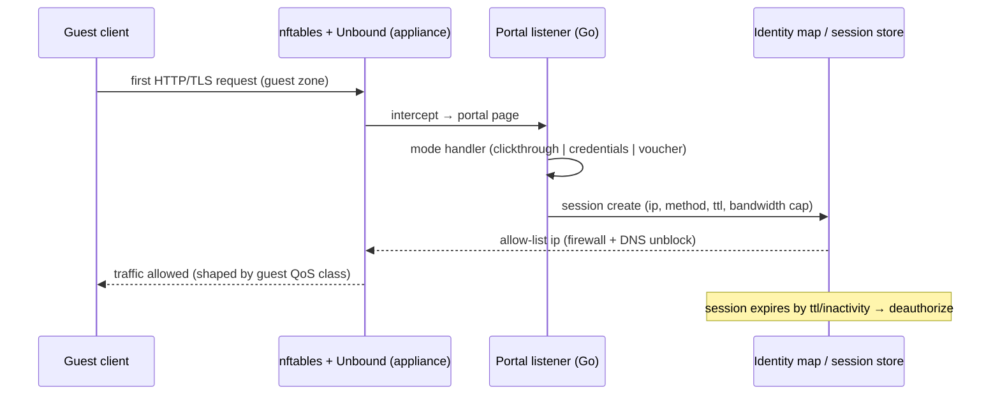

# Auth and RBAC — Console Security Design

> TL;DR: Two principal types: interactive users (JWT HS256 in httpOnly cookie
> `cryptsk_token`, 8h) and machine API keys (`Bearer ck_<prefix>_<secret>`, sha256-hashed
> at rest, scope read/write/admin). 8 roles; the RBAC matrix below is enforced in exactly
> one place — `lib/api/handler.ts` — and merely *mirrored* in the UI (hidden menus are
> never trusted). Every mutation writes an audit row; every secret-shaped field is masked
> in API responses. ADR-007 is the decision record; this file is the design.

Contracts referenced: PROJECT_MEMORY §6 (role + enum values), §7 (auth envelope rules),
ADR-007 (custom JWT), ADR-009 (tenant scoping), ADR-011 (audit on mutation).
Schema: [../03-DATABASE/SCHEMA.md](../03-DATABASE/SCHEMA.md) — `User`, `ApiKey`,
`AuditLog`, `CaptivePortalProfile`, `IdentitySession`. Control-plane enforcement context:
[../02-ARCHITECTURE/CONTROL_PLANE.md](../02-ARCHITECTURE/CONTROL_PLANE.md) §7.

---

## 1. Principals

| Principal | Authenticates with | Identity carries | Typical use |
|---|---|---|---|
| Interactive user (8 roles, §4) | username + password (bcrypt), JWT cookie | `sub`, `username`, `role`, `tenantId` | Admins/auditors using the console |
| API key | `Authorization: Bearer ck_<prefix>_<secret>` | key row: `prefix`, `hashedKey`, `scopes`, `tenantId` | Scripts, MSP tooling, monitoring |
| Machine flow (future, Phase 2+) | Service JWT or mTLS client cert (agent↔API, central manager) | mTLS identity or service token | cryptsk-agent, Phase 4 manager |

Roles are a single string on `User.role` (values locked in PROJECT_MEMORY §6 — exactly
the 8 roles in §4, enforced by zod; **spec divergence note:** the spec's `users` table
mentions a `viewer` default; the build contract replaces it — column default is
`helpdesk`, read-only humans are `auditor`).

## 2. Authentication (Users)

| Aspect | Contract |
|---|---|
| Library | `jose` (ADR-007); algorithm HS256 with a server-side secret (env-provided) |
| Token | JWT, claims `{ sub, username, role, tenantId, iat, exp }`; `exp = iat + 8h` |
| Transport | httpOnly cookie `cryptsk_token`; `SameSite=Lax`; `Secure` in production; Path=/ |
| Password hashing | bcrypt, cost 12 (`lib/auth/password.ts`) |
| Login rate limit | 5 attempts / minute per (username, source IP) → `RATE_LIMITED` 429 |
| Lockout | From `auth-settings` (`system_settings`, category `auth`): default 5 consecutive failures → 15-minute lockout; per-user counter resets on success |
| Login outcome | Success: Set-Cookie + `{user, permissions}` payload + `audit_log(login, success)`; failure: `audit_log(login, failure)` + generic error (no user-enumeration differences) |
| Logout | Clears the cookie; Phase 2 note: server-side JWT denylist (jti + Redis) for immediate revocation — Phase 1 accepts tokens until natural 8h expiry |
| Session check | `GET /api/v1/auth/me` returns user + effective permissions for UI gating |

Decoded token payload example (claims are the whole contract — the Go API on the
appliance must issue/verify the identical claim set):

```json
{
  "sub": "2",
  "username": "secops",
  "role": "security_admin",
  "tenantId": 1,
  "iat": 1794240000,
  "exp": 1794268800
}
```

Example login request (note: JSON body required — this is part of the CSRF posture,
§8):

```bash
curl -i -X POST /api/v1/auth/login \
  -H 'Content-Type: application/json' \
  -d '{"username":"secops","password":"..."}'
# 200 → Set-Cookie: cryptsk_token=<jwt>; HttpOnly; SameSite=Lax; Path=/; Max-Age=28800
# 401 → {"error":{"code":"UNAUTHORIZED","message":"Invalid credentials"}}
# 429 → RATE_LIMITED after 5 failed attempts/min per username+IP
```

## 3. API Key Authentication

| Aspect | Contract |
|---|---|
| Format | `Authorization: Bearer ck_<prefix>_<secret>` — prefix 8 chars after the fixed `ck_` stem, stored plaintext for lookup (`ApiKey.prefix`, unique); full key shown exactly once at creation |
| Verification | Lookup by prefix → sha256(full presented key) constant-time compare with `hashedKey` → reject if `revoked` or past `expiresAt` |
| Metadata touch | Successful auth updates `lastUsedAt` (rate-limited write, at most once per minute per key) |
| Scopes | JSON array on `ApiKey.scopes`: `read`, `write`, `admin` |
| Scope → method class | `read` = GET; `write` = mutating methods (POST/PUT/PATCH/DELETE) on non-admin resources; `admin` = settings, api-keys, restore, and any endpoint flagged admin in the handler registry |
| Revocation | `DELETE /api/v1/api-keys/{id}` sets `revoked` — effective immediately on the next request (lookup happens per request) |
| Tenancy | Key carries its own `tenantId`; keys can never cross tenants |

Example machine request:

```bash
curl -H 'Authorization: Bearer ck_a1b2c3d4_<secret>' /api/v1/logs/firewall?page=1
# read-scope key: GET ok; POST /api/v1/firewall-rules → 403 FORBIDDEN (scope write missing)
```

Key generation rules: prefix = 8 random chars after the `ck_` stem (unique, indexed);
secret = 32 random chars; only `sha256(full key)` is persisted; the concatenation format
`ck_<prefix>_<secret>` is what operators copy once at creation.

## 4. RBAC Matrix (Core Table)

Legend: **full** = read + edit + delete/admin within the area; **edit** = create/update/delete of
operational objects; **read** = list/get only; **none** = endpoint invisible (403 if addressed);
**scoped** = permitted strictly by the API key's scopes.

| Capability area | super_admin | tenant_admin | security_admin | network_admin | soc_analyst | helpdesk | auditor | api_service |
|---|---|---|---|---|---|---|---|---|
| Dashboard | full | full | full | full | full | read | read | scoped |
| Network config (interfaces, routes, WAN) | full | full | read | full | read | none | read | scoped |
| Firewall / NAT / objects | full | full | full | read | read | none | read | scoped |
| IPS policies | full | full | full | read | read | none | read | scoped |
| IPS events handle (suppress) | full | full | full | read | edit | none | read | scoped |
| VPN config | full | full | read | edit | read | none | read | scoped |
| VPN sessions ops (disconnect) | full | full | edit | read | edit | none | read | scoped |
| DNS / DHCP config | full | full | read | full | read | none | read | scoped |
| Identity / users | full | full | edit | none | none | none | read | scoped |
| QoS | full | full | read | full | read | none | read | scoped |
| Logs read (firewall, ips) | full | full | full | full | full | read | read | scoped |
| Audit read | full | full | read | read | read | none | full | scoped |
| HA | full | full | read | full | read | none | read | scoped |
| System settings | full | full | none | read | none | none | read | scoped |
| Backups (create/restore) | full | full | none | read | none | none | read | scoped |
| API keys admin | full | read | none | none | none | none | read | none |
| Notifications | full | full | edit | edit | edit | edit | edit | scoped |

Rationale and invariants:

- **Read-only humans:** `auditor` and `helpdesk` are read-only everywhere except
  notifications (mark-as-read is their only mutation). `auditor` additionally gets full
  audit-log read (their primary job).
- **Security vs network split:** `security_admin` owns firewall/NAT/objects, IPS (both
  policies and event handling), identity sessions ops; `network_admin` owns interfaces/
  routing/WAN, DNS/DHCP, QoS, HA, VPN configuration. Each gets read access to the other's
  domain so troubleshooting does not require role switching. Module docs (M02–M08) must
  mirror this exact split in their endpoint tables.
- **tenant_admin:** full within the tenant **except** API-key administration (create/
  revoke is `super_admin` only); tenant_admin gets read on api-keys for visibility.
- **super_admin:** everything.
- **soc_analyst:** operational security response — IPS event suppression, VPN session
  disconnect, full log visibility; no config authority.
- **api_service:** no implicit rights — every request is limited by its key scopes; the
  matrix column is a reminder that a key with `admin` scope still cannot manage other
  api-keys unless the key registry marks that endpoint admin-scope-only (it does).

> **Divergence notes vs module help-text (M07):** M07-IDENTITY renders a role
> descriptions help table (and defers to this file as the matrix authority). Two rows
> differ from the authoritative matrix above: (1) M07's `helpdesk` row mentions password
> reset — this matrix keeps helpdesk read-only except notifications, so helpdesk
> password reset is **not granted** in Phase 1 (revisit via a new ADR if wanted);
> (2) M07's `security_admin` row mentions "DNS policies" — this matrix keeps DNS/DHCP
> config with `network_admin` (security_admin gets read). M07's help text should be
> reconciled to this matrix when M07 is built; where the two disagree, this file wins.

**Enforcement rule:** this matrix is enforced ONLY in `lib/api/handler.ts` (single
enforcement point, injected for every route handler; denial result = `FORBIDDEN` 403 +
`audit_log` row with `result: "denied"`). The UI **mirrors** it for menus/buttons
(`permissions` from `/auth/me`) but hidden UI is **never trusted** — the API is the only
authority. Module docs must not redefine per-endpoint permissions; they reference this
matrix.

### 4.1 Capability Areas Mapped to Endpoints (sample rows)

The full catalog lives in PROJECT_MEMORY §7.2 / `docs/04-API/ENDPOINTS.md`; this table
shows how areas of the matrix map onto endpoint families (the handler registry encodes
the same mapping):

| Capability area | Example endpoints |
|---|---|
| Network config | `/api/v1/interfaces*`, `/api/v1/routes*`, `/api/v1/wan-policies*` |
| Firewall / NAT / objects | `/api/v1/firewall-rules*`, `/api/v1/nat-rules*`, `/api/v1/zones*`, `address-objects`, `service-objects`, `schedule-objects` (+ `-groups`) |
| IPS policies / events | `/api/v1/ips/policies*`, `/api/v1/ips/rule-categories`, `/api/v1/ips/events*` (suppress = handle) |
| VPN config / sessions ops | `/api/v1/vpn/configs*` (config), `/api/v1/vpn/sessions/{id}/disconnect` (ops) |
| DNS / DHCP config | `/api/v1/dns/*` (settings/policies/records), `/api/v1/dhcp/*` (subnets/reservations; leases = read) |
| Identity / users | `/api/v1/users*`, `/api/v1/user-groups*`, `/api/v1/auth-settings`, `/api/v1/radius-profiles*`, `/api/v1/captive-portal` |
| Logs read | `/api/v1/logs/firewall`, `/api/v1/logs/ips`, `/api/v1/logs/stats`, `/api/v1/dns/query-logs` |
| Audit read | `/api/v1/logs/audit` |
| System settings / backups / HA | `/api/v1/system/settings`, `/api/v1/system/backups*` (restore = admin), `/api/v1/ha/*` |
| API keys admin | `/api/v1/api-keys*` (POST/DELETE = super_admin only) |
| Notifications | `/api/v1/notifications*` (mark-read = the read-only roles' single mutation) |

## 5. Tenant Isolation

- JWT carries `tenantId`; the handler injects it into every query/filter — services
  cannot receive a tenant id from request input (it is not trusted from body/query).
- Every tenant-scoped model carries `tenantId @default(1)` (ADR-009); the sandbox seeds
  exactly one tenant (id 1, "Default"), so isolation is invisible in demos but always on.
- **No cross-tenant endpoints in Phase 1** (ADR-009): there is no tenant switch, no
  tenant list endpoint, no super-admin cross-tenant views. Phase 4 MSP central manager
  introduces them with a new ADR.
- API keys inherit `tenantId` from their owning tenant; a key from tenant 2 cannot read
  tenant 1 objects even with `admin` scope.

## 6. MFA (TOTP)

- Schema support exists now: `User.totpSecret` (SCHEMA.md).
- **Phase 1:** optional enroll stub in the identity UI (generate secret + show QR data,
  not persisted-active flows); **enforcement is explicitly deferred** — no login-time TOTP
  challenge in Phase 1, and `auth-settings` does not yet expose an "enforce TOTP" switch.
- When enforced (Phase 2): login becomes two-step (`login` → `mfa` challenge → cookie),
  denylist/refresh mechanics arrive with the Phase 2 session revocation work.
- Rationale: appliance-console logins are short-lived local sessions; password + lockout +
  rate limiting covers the Phase 1 threat profile; MFA enforcement needs the session
  revocation story to be meaningful.

## 7. Captive Portal Auth Flow

Portal identities are *network* identities, separate from console logins (M07):

| Mode | Flow |
|---|---|
| Clickthrough | Client associates → intercepted by portal → accepts terms → session created |
| Credentials | Client associates → portal login form → local guest user or RADIUS check → session created |
| Voucher | Client enters voucher code → validated against `captive_portal_vouchers` (code, ttl, bandwidth) → session created with voucher TTL + rate caps |

Appliance mechanics: nftables intercepts new LAN/guest connections to a local portal
listener; Unbound resolves only the portal domain until the session exists; on success
the identity map (ip → user) is written and firewall policy for the guest zone applies.
Voucher model: code (opaque), `ttlHours` (from `captive_portal_profiles.voucher_ttl_hours`),
bandwidth cap (`bandwidth_kbps`), single-use enforcement. Sandbox: portal profile is
configurable; guest attempts surface as generated `identity_sessions` (method
`captive_portal`) and DNS/log traffic per profile (hospitality profile, DATA_LIFECYCLE §3).

> **Spec divergence note (vouchers):** the spec lists a `captive_portal_vouchers` table
> under "Phase 2+ tables (add when needed)", while portal vouchers are a Phase 1 feature.
> The build contract (M07 + SCHEMA.md) resolves this as: **no Prisma voucher model in
> Phase 1** — voucher codes live in the MockEngine in-memory store (code, ttl, bandwidth
> cap semantics as described above), exposed through proposed-expansion endpoints; loss
> of voucher state across process restarts is an accepted Phase 1 trade-off (flagged in
> M07 §8). A durable voucher table is a Phase 2 schema addition.

Portal session lifecycle (appliance mechanics):



## 8. Session Security Details

| Aspect | Contract |
|---|---|
| Cookie flags | `cryptsk_token`: httpOnly, SameSite=Lax, Secure (prod), Path=/, Max-Age 8h |
| CSRF posture | Phase 1 ships **no CSRF token**. Rationale: all state-changing APIs are JSON-body-only with `Content-Type: application/json` (HTML forms cannot send them cross-origin), SameSite=Lax blocks cross-site POST navigation, and CORS is not opened to foreign origins. Revisit if a cookie-authenticated non-JSON endpoint ever appears |
| Password policy defaults (auth-settings) | min length 8; complexity: letters + digits required; expiry off by default (appliance admins rotate on process); history 0 |
| Lockout defaults | 5 failures → 15 min (§2); lockout counter per user, reset on success or window expiry |
| Secret masking | `psk` / `sharedSecret` / `totpSecret` / api-key hashes are **never returned clear** by any endpoint. VPN PSK may be revealed via a dedicated reveal endpoint (explicit POST, audited); everything else stays masked permanently. API keys show prefix only after creation |
| Error hygiene | Login failures are indistinguishable (unknown user vs wrong password); account lockout messages do not reveal whether the account exists |

## 9. Threat Model (Lite)

| Threat | Mitigation in this design | Residual risk (accepted, Phase 1) |
|---|---|---|
| Abused console (credential stuffing) | 5/min rate limit per username+IP; lockout 5 → 15 min; bcrypt cost 12; generic errors | Distributed slow brute force below rate thresholds — acceptable; password policy is enforced |
| Stolen cookie | 8h max expiry; httpOnly (no JS exfil via XSS); SameSite=Lax; Secure in prod | No device binding or server-side revocation in Phase 1 — Phase 2 adds jti denylist + refresh tokens |
| Privilege escalation | Matrix enforced in handler only; tenant scoping handler-injected; denied attempts audited; api-keys cannot manage api-keys | A `super_admin` account compromise is full compromise — mitigate with OS-level controls and (Phase 2) MFA enforcement |
| Audit tampering | `audit_log` is append-only (no update/delete paths in code); retention prunes by age only; before/after JSON snapshots make changes reconstructable | A DB-level attacker can still edit rows — Phase 2 notes hash-chained audit (spec §1.12 Phase 2 item) |
| API key leakage | sha256-at-rest; prefix-only display; immediate revocation; scope ceiling; `lastUsedAt` for anomaly spotting | Keys are bearer tokens — rotate on suspicion; expiry optional per key |

## 10. Request Lifecycle Sequence

```mermaid
sequenceDiagram
    participant B as Browser
    participant L as POST /api/v1/auth/login
    participant H as lib/api/handler.ts
    participant R as /api/v1/firewall-rules (PUT)
    participant A as audit_log
    B->>L: {username, password}
    L->>L: bcrypt compare + rate limit + lockout check
    L->>A: audit(login, success)
    L-->>B: Set-Cookie cryptsk_token (JWT 8h) + permissions
    B->>R: PUT /api/v1/firewall-rules/12 (cookie)
    R->>H: authenticate → sub/role/tenantId
    H->>H: RBAC matrix check (network_admin PUT firewall = 403; security_admin = ok)
    H->>R: proceed: zod validate → service → tx (row + audit + snapshot)
    H->>A: audit(rule.update, before/after, result success|denied)
    R-->>B: envelope {data} or {error:{code:"FORBIDDEN"}}
```
